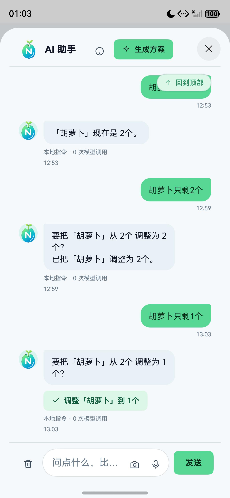
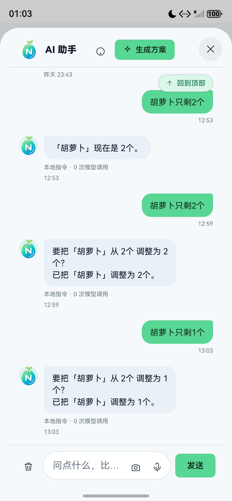
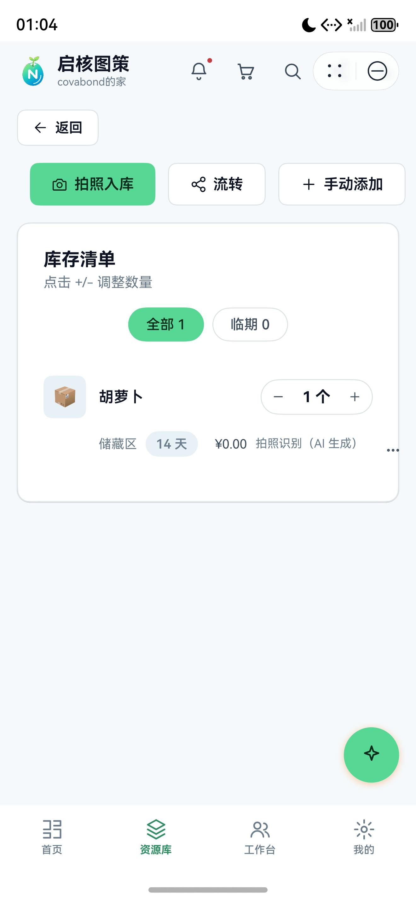
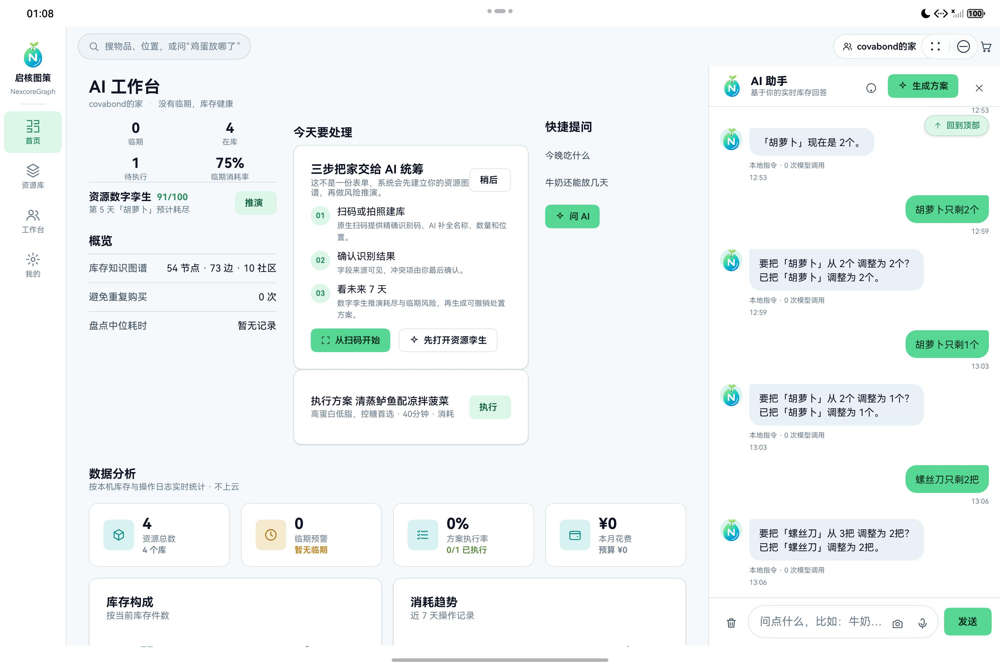

# 鸿蒙端真实业务操作回归

> 日期：2026-11-11
> 环境：HarmonyOS 6.0.2 API 22
> 设备：Mate 80 Pro Max、MatePad Pro 11
> 后端：`127.0.0.1:3000`；流转中转：`127.0.0.1:3100`

## 1. 测试目标

验证“自然语言修改库存”是否遵守以下完整链路：

```text
用户输入 → 确定性解析 → 预览 → 策略校验
        → 用户确认 → 幂等执行 → 本地落盘 / 多端同步
```

## 2. 发现的问题

首次输入“胡萝卜只剩2个”时，本地指令直接写库并回复“现在是2个”，没有预览按钮。

根因：

- `Commands.runCommand()` 的 `qty`、`shopadd`、`additem` 等库存写操作直接调用业务 API；
- 只有删库、删物品、移动、改名等“破坏性操作”进入确认卡；
- 与作品声明的“所有写操作先预览”不一致。

## 3. 修复

- 所有业务写命令统一返回 `opKind + opArg + opLabel`；
- 用户点击确认后才调用 `applyCmdOp()`；
- `applyCmdOp()` 接入 Agent 白名单、角色、数量和幂等守卫；
- AI 对话确认按钮增加忙碌态和唯一执行键；
- 新增 `Commands.test.ets`，先验证“未确认不写库”，再验证“确认后写入”。

## 4. 运行验证

### 4.1 数量预览

输入：

```text
胡萝卜只剩1个
```

结果：

- 气泡显示“要把‘胡萝卜’从 2个调整为1个？”；
- 下方出现“调整‘胡萝卜’到1个”确认按钮；
- 确认前库存未变化。



### 4.2 确认执行

点击确认后：

- 显示“已把‘胡萝卜’调整为1个”；
- 资源库“冰箱”详情显示胡萝卜 `1个`；
- 没有重复执行按钮。





### 4.3 跨设备同步

继续将螺丝刀从 3 把调整为 2 把并确认。

中转服务验证：

```text
GET /api/health
{"ok":true,"service":"nexcore-flow-bridge","port":3100,"has":true}

GET /api/flow/latest
found=true
rev=45
from=手机
contains 螺丝刀
```

平板重启应用后拉取最新快照：

- AI 对话出现胡萝卜 4→2→1 与螺丝刀 3→2 的完整记录；
- 首页资源健康度由 `96` 变为 `91`；
- 风险摘要变为“第 5 天「胡萝卜」预计耗尽”；
- 证明库存、聊天和孪生结果随同步更新。



## 5. 服务健康检查

后端：

```json
{"ok":true,"service":"nexcoregraph-backend","mode":"lan-self-hosted","ai":"ready"}
```

流转中转：

```json
{"ok":true,"service":"nexcore-flow-bridge","port":3100,"has":true}
```

## 6. 结论

- AI 数量调整已改为“先预览、后执行”；
- 确认按钮可以真实写入库存；
- 手机到平板的快照同步在流转中转启动后成功；
- 数字孪生会随库存变化重新计算风险和健康度；
- 该流程仍有自动化测试保护。
