# 鸿蒙端启动与多轮运行复核

> 日期：2026-11-10
> 环境：HarmonyOS 6.0.2 API 22 模拟器
> 设备：Mate 80 Pro Max（1320×2848）、MatePad Pro 11（2880×1920）
> HAP：`entry-default-unsigned.hap`

## 1. 安装与启动

执行：

```powershell
hdc -t 127.0.0.1:5555 install -r entry-default-unsigned.hap
hdc -t 127.0.0.1:5555 shell aa start -a EntryAbility -b com.example.myapplication
```

结果：

- 手机安装成功；
- 平板安装成功；
- 两端 `EntryAbility` 均可启动；
- 手机进程 `10967`、平板进程 `9189` 在测试结束时仍存活。

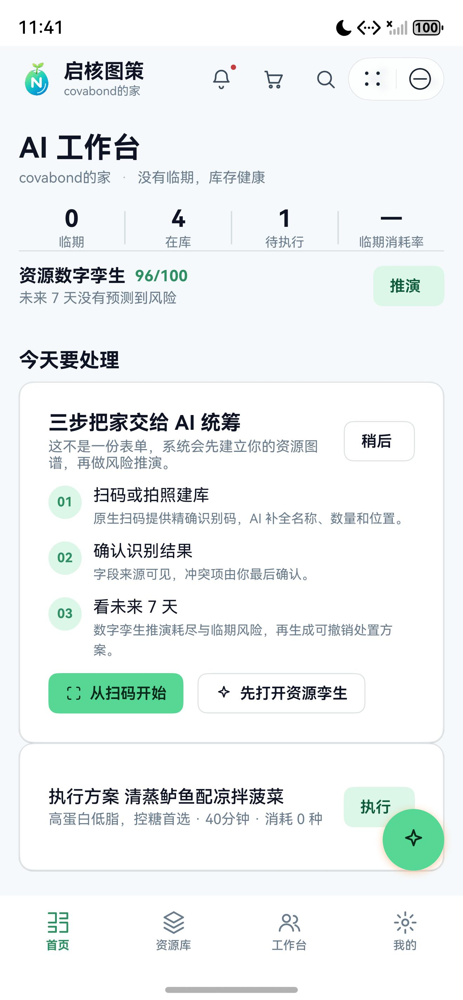

## 2. 数字孪生交互

操作：

1. 从 AI 工作台点击“推演”；
2. 打开家庭资源数字孪生；
3. 点击“来客 +2”；
4. 检查健康度分项、风险与 7 天轨迹。

结果：

- 沙盘成功打开；
- 健康度为 `96/100`；
- 分项为 `40/25/16/15`；
- 情景按钮正确切换选中态；
- 当前库存充足，因此来客情景未产生额外风险，符合确定性模拟公式。

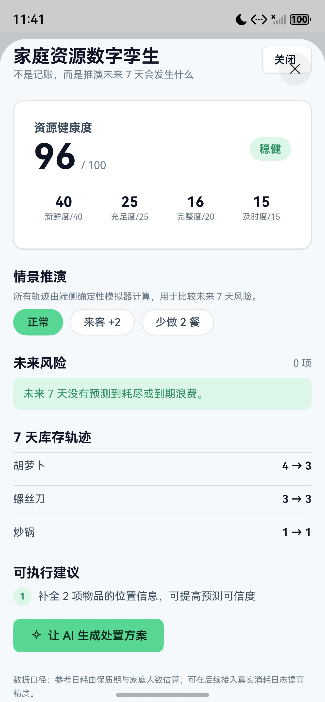

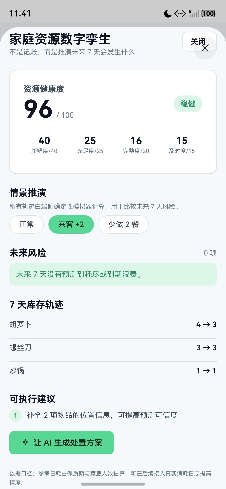

## 3. AI 对话

实际输入：

```text
库存里都有什么
```

结果：

- 正确回答 4 个库、4 件物品；
- 使用本地指令，0 次模型调用；
- 气泡没有出现 `<thought>`、`</think>` 或内部推理；
- 证据行显示“本地指令 · 0 次模型调用”。

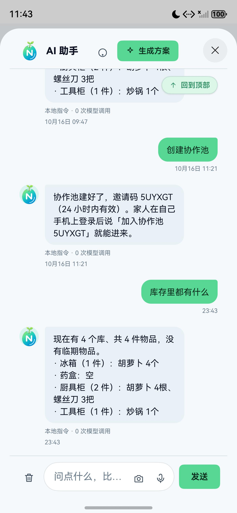

## 4. 扫码入库

操作：

1. 首启引导进入“拍照入库”；
2. 点击“扫码”；
3. 检查系统扫码页面。

结果：

- `Scan Kit` 成功拉起系统“扫描二维码/条形码”页面；
- 系统显示安全相机提示；
- 未发现应用崩溃。

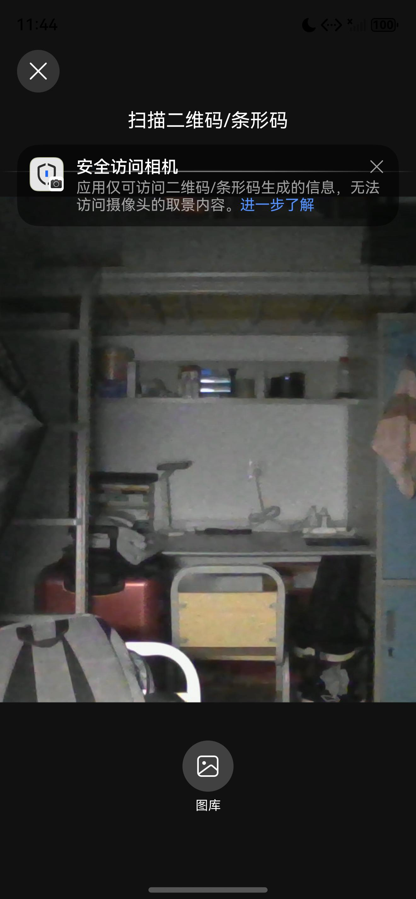

## 5. 手机全 Tab 回归

逐项点击底部导航：

- 首页：AI 工作台正常；
- 资源库：4 个库、2 列网格正常；
- 工作台：协作入口与失效提示正常；
- 我的：服务器、账号、家庭空间正常。

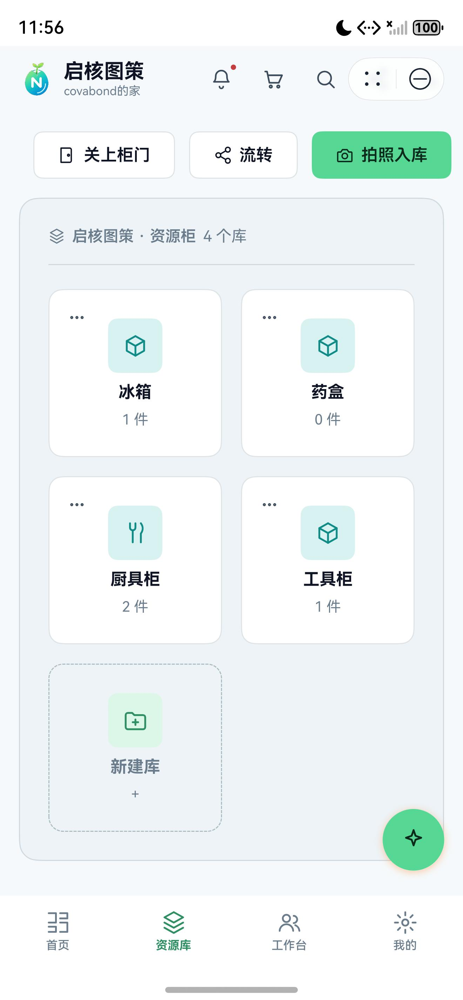

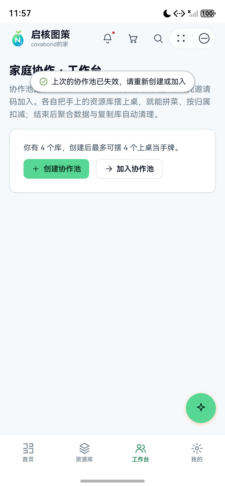

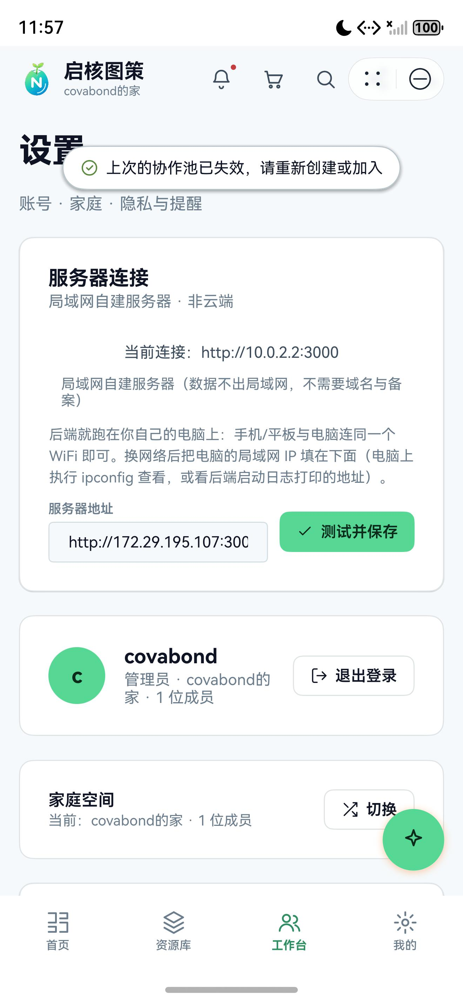

## 6. 平板宽屏

平板结果：

- 左侧导航栏正常；
- 主内容三列布局正常；
- AI 面板在宽屏右侧停靠；
- 数字孪生以半模态覆盖内容，无横向裁切；
- 手机与平板同步后，平板因收到本机之外的新聊天而打开 AI 面板，符合跨设备消息触达逻辑。

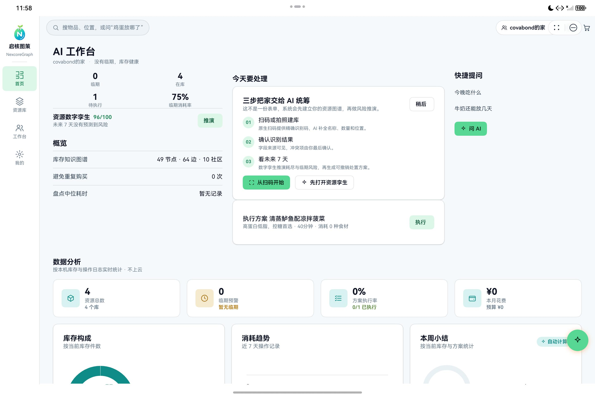

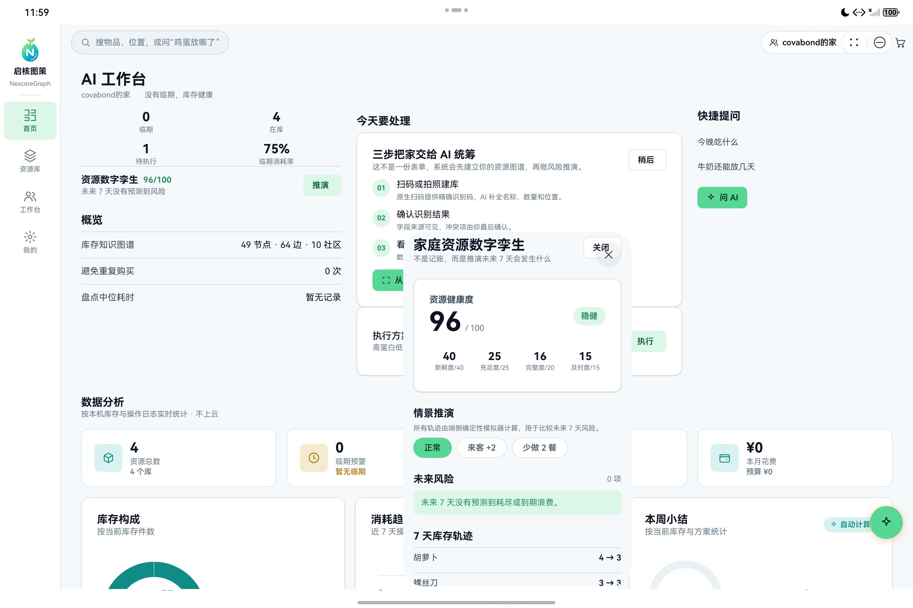

## 7. 运行中修复

### 冷启动历史聊天误弹面板

根因：

`applyDataSnapshot()` 将“载入本地聊天历史”和“收到其他设备的新聊天”混为一件事，只要聊天数量增加就设置 `store.aiOpen = true`。

修复：

- `applyDataSnapshot(raw, openAiOnNewChat = false)`；
- 本地恢复使用默认 `false`；
- 活同步、手动流转和云端拉取显式传入 `true`；
- 新增 `LocalRestore.test.ets` 覆盖两种来源。

验证：

- 修复后冷启动直接进入 AI 工作台；
- 远程同步仍保留新聊天气泡提示。

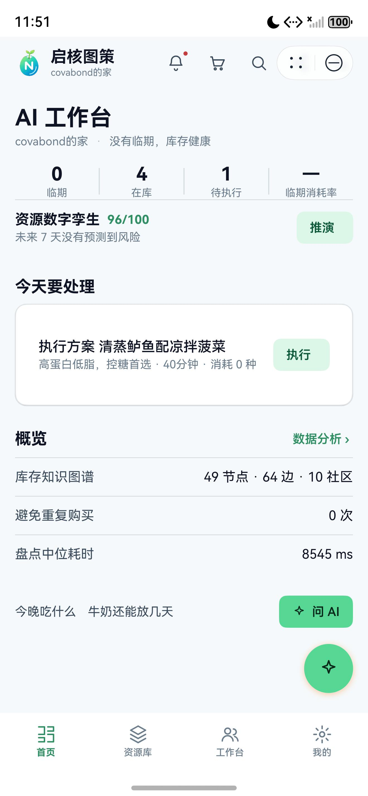

## 8. 日志

手机应用日志：

```text
NexcoreGraph: cmd selfcheck: 手册自检 22/22 可命中
NexcoreGraph: graph built: nodes=49 edges=64 communities=10 unlinked=2 ms=14
```

平板应用日志：

```text
NexcoreGraph: cmd selfcheck: 手册自检 22/22 可命中
```

两端日志过滤 `FATAL / CRASH / TypeError / ReferenceError` 后没有命中应用自身错误。

## 9. 本轮未覆盖

- 真实商品条码完成一次识别闭环；
- 服务卡片添加到桌面并点击跳转；
- 双设备系统级应用接续；
- 2in1 模拟器；
- signed Release HAP；
- 真实大模型在线回答（本轮验证的是本地快路径）。
