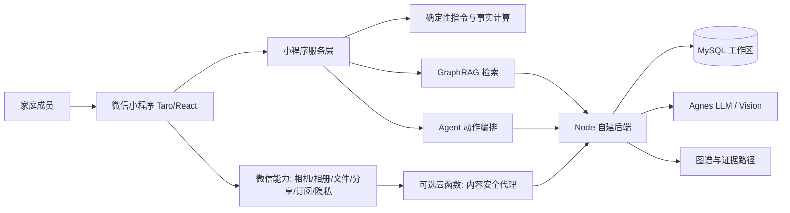

# 启核图策微信小程序端提分与提交执行计划

> **For agentic workers:** REQUIRED SUB-SKILL: Use superpowers:subagent-driven-development (recommended) or superpowers:executing-plans to implement this plan task-by-task. Steps use checkbox (`- [ ]`) syntax for tracking.

**Goal:** 在 2026-11-18 报名截止前，把现有“启核图策”微信小程序从 75 分预指导反馈继续推进为“视觉可信、录入省事、AI 有证据、微信能力真实可用、提交材料完整”的冲奖版本。

**Architecture:** 保留现有 Taro 4 + React 18 + TypeScript + Zustand 小程序、Node/MySQL 自建后端和 GraphRAG 链路，不重写框架。改造集中在三层：以设计令牌和统一图标提升呈现质量；以“拍照/小票/语音/手动四入口 + 默认值补全”降低录入成本；以“证据面板 + 多动作 Agent 预览 + 微信分享/订阅”强化 AI 与移动生态。微信云开发只用于无状态辅助能力，不迁移现有业务数据。

**Tech Stack:** Taro 4.1.9、React 18.3、TypeScript 5.1、Sass、Zustand 4、Node.js 后端、MySQL、Agnes 多模态模型、GraphRAG、微信小程序原生能力、Vitest、微信开发者工具。

**Spec:** 用户提供的《作品提交要求》第（一）（二）部分、预指导分数截图、[赛道要求对照与漏洞审计报告](../../启核图策-赛道要求对照与漏洞审计报告.md)、[微信小程序端专项整改与验收文档](../../启核图策-微信小程序端专项整改与验收文档.md)、[三端功能对照与差异清单](../../启核图策-三端功能对照与差异清单.md)。

**高级扩展包:** [微信小程序端高级加分扩展计划](2026-11-10-微信小程序端高级加分扩展计划.md)。该计划必须在核心 Task 0 至 Task 4 通过后按波次进入，不能影响主流程交付。

## Global Constraints

- 报名截止为 **2026-11-18**；团队内部冻结时间为 **2026-11-16 18:00**，11 月 17 日只做取证和缓冲，不新增功能。
- 最终提交包命名为 `第九届传智杯-AI小程序赛道-启核图策.zip`；ZIP 目标体积不超过 180MB，硬上限 300MB。
- 以代码当前使用的 AppID `wx25e3afb6ce695963` 为唯一事实；提交前同步修正 README 和专项文档中残留的 `wx9d1c625b399ecda3`、`touristappid`，不得在未核验的情况下改代码 AppID。
- 不重写页面框架，不迁移 MySQL，不引入微信支付，不做与“家庭资源管理”无关的功能。
- 主包不超过 2MB，分包总量不超过 20MB；每次合并前同时记录构建耗时、主包体积和分包体积。
- 所有写库存、写采购、执行方案的操作必须经过“预览 → 用户确认 → 执行 → 可撤销”，模型不得直接写数据。
- 所有 AI 结论必须区分“代码计算结果”和“模型生成内容”；模型回答必须展示模型名、耗时和 GraphRAG 证据或明确标注“未引用图谱”。
- 客户端不得包含真实 API Key；含 `.env`、`x-agnes-key` 明文或构建期内联 Key 的产物不得进入公开仓库和最终源码目录。
- 真实微信平台能力必须有体验版、授权页或调用日志作为证据；没有外部配置的能力如实标注“未启用”，不得用本地模拟冒充。
- 功能界面只使用统一图标和设计令牌；物品内容本身可使用分类色块或图形，但导航、按钮、状态不得混用 emoji 作为主图标。
- 以 375px 设计稿为基准，点击区域不小于 44px，正文不小于 28rpx，正文与背景对比度不低于 4.5:1。
- 所有新增业务模块先写失败测试，再写最小实现；完成标准是测试、类型检查、构建和微信开发者工具冒烟四项都有记录。

---

## 一、评分判断与方案选择

### 1.1 预指导反馈的准确含义

截图显示本次为预指导查询，总分 **75**。评审认可“用 AI 管理家庭日常资源”的场景创意，明确指出的问题集中在两处：

| 反馈 | 翻译为工程任务 | 评分影响 |
|---|---|---|
| 细节方面可以调整图标之类 | 统一图标体系、去除界面中临时 emoji、统一按钮/卡片/状态样式、补齐空态/加载态/错误态 | 第一眼视觉完成度；可信度；移动端精细度 |
| 资源录入其实挺繁琐，可以优化 | 识别结果默认填全、只要求补低置信字段、批量确认、拍小票、语音记一件事、最近位置复用 | 核心流程效率；产品体验创新；场景落地 |

因此本轮不应继续堆叠新页面，而应把已有闭环“拍得到、看得懂、确认快、追得到、分享得出去”做扎实。

### 1.2 三种可选路线

| 路线 | 内容 | 优势 | 风险 | 结论 |
|---|---|---|---|---|
| A. 只做视觉修补 | 换图标、调颜色、改首页布局 | 两天可完成，风险最低 | 解决不了录入繁琐，AI 与微信生态加分不足 | 不单独采用 |
| B. 评审短板 + 微信生态 + 提交闭环 | 视觉系统、录入 2.0、分享/订阅/隐私、测试与材料 | 直接回应 75 分反馈，8 天内可验证，证据链完整 | 需要真实设备与微信后台配置 | **主路线** |
| C. GraphRAG/Agent 平台化 | 多 Agent、流式、批量动作、图谱可视化、云开发 | 技术上限最高 | 8 天内易出现半成品和无法演示的风险 | 只吸收“多动作 Agent + 证据面板” |

**推荐组合：B 为主线，C 中只做“可撤销的多动作 Agent”和“真实流式回答”。** 这两项直接建立在现有命令层、GraphRAG、方案核销和回滚能力上，不另起一套系统。

### 1.3 本轮“加分但不冒险”的产品定位

把作品从“能管理资源的工具”升级成“会主动发现浪费、能给出证据、能把建议变成家庭行动的 AI 管家”：

1. **30 秒建档**：拍照或拍购物小票后，AI 预先填好名称、数量、位置、保质期；用户只处理真正缺失的字段。
2. **今天先做什么**：首页给出最多 3 个高价值动作，如处理临期、补低库存、执行方案，并说明依据。
3. **一句话办多件事**：用户说“把临期牛奶排进本周方案，缺的加采购”，Agent 生成 2 至 3 步动作预览，统一确认后执行，整批撤销。
4. **证据可追问**：AI 回答旁可展开“引用了哪些库存和图谱路径”，把 GraphRAG 从技术名词变成用户能看懂的证据。
5. **家庭内流转**：方案、采购清单、邀请卡通过微信分享；订阅消息只在用户主动授权后触达。
6. **可运营的报告**：每周生成“临期处理、减少浪费、重复购买”报告，形成可分享的传播入口和后续会员服务的价值证明。

---

## 二、提交要求到开发任务的对应关系

| 提交要求 | 产品与技术落点 | 最终材料 |
|---|---|---|
| a. 项目说明 | 首页“今天先做什么”、30 秒建档、AI 方案、家庭协作四个主场景 | 3 至 5 分钟演示视频；四段核心流程截图 |
| b. 小程序与 AI 能力 | 相机/相册、文件选择、分享、订阅消息、隐私授权、客服入口；GraphRAG、视觉识别、LLM、确定性指令、多动作 Agent；云开发仅列实际启用项 | 能力矩阵表；关键 API 调用截图；后端日志 |
| c. 创新点 | AI 应用、场景、产品、技术、商业模式、用户体验六个维度各一条可演示证据 | 一页创新点矩阵 + 演示片段 |
| d. 技术实现 | 小程序架构图、页面树、GraphRAG 数据流、Agent 确认与回滚时序图、关键代码说明 | 技术章节、架构图、代码片段 |
| e. 成果展示 | 真机/开发者工具截图、关键路径录屏、性能、体积、测试记录 | 截图目录、测试报告、视频 |
| f. 历史说明 | 明确这是基于 75 分预指导反馈的迭代，列出本轮优化项；往届获奖情况如无则写“无” | 历史与迭代章节 |
| g. 落地规划 | 体验版发布、家庭场景增长、订阅触达、周报分享、会员与 B 端服务、后续版本路线 | 上线计划、运营机制、商业闭环 |
| ZIP 规范 | 完整源码、演示 Demo、说明文档、视频、账号/二维码、测试记录、校验文件 | 统一命名 ZIP + SHA-256 清单 |

---

## 三、目标架构



架构原则：

1. **代码掌握事实**：库存数量、临期天数、预算、健康度、风险和动作影响全部由代码计算。
2. **模型负责理解和表达**：模型只做识别、意图理解、排序建议和自然语言组织。
3. **Agent 负责编排不负责越权**：动作白名单、参数校验、用户确认、执行和撤销都由代码控制。
4. **端侧缓存保障演示**：断网时可浏览最近快照；写操作必须联网并显示明确错误，不伪造成功。
5. **平台能力按需接入**：云开发只承担无状态代理，避免再造一套数据同步系统。

---

## 四、工作分解

### Task 0：冻结基线、建立测试闸门

**Files:**
- Modify: `wxminiapp/NexcoreGraph_wxminiapp/package.json`
- Create: `wxminiapp/NexcoreGraph_wxminiapp/vitest.config.ts`
- Create: `wxminiapp/NexcoreGraph_wxminiapp/tests/project-contract.test.ts`
- Create: `wxminiapp/NexcoreGraph_wxminiapp/scripts/check-weapp-budget.mjs`
- Modify: `wxminiapp/NexcoreGraph_wxminiapp/README.md`

**Interfaces:**
- Produces: `npm test` 运行 Vitest；`npm run typecheck` 运行 `tsc --noEmit`；`npm run check:budget` 读取当前 `dist/` 并输出主包/分包体积；`npm run verify:weapp` 串联类型检查、测试和生产构建。

- [ ] **Step 1: 写项目契约失败测试**

```ts
import { describe, expect, it } from 'vitest'
import fs from 'node:fs'

const root = new URL('../', import.meta.url)
const appConfig = fs.readFileSync(new URL('src/app.config.ts', root), 'utf8')
const packageJson = JSON.parse(fs.readFileSync(new URL('package.json', root), 'utf8'))

describe('weapp project contract', () => {
  it('declares the four primary tabs', () => {
    for (const page of [
      'pages/workbench/index',
      'pages/home/index',
      'pages/library/index',
      'pages/mine/index',
    ]) expect(appConfig).toContain(`'${page}'`)
  })

  it('exposes one production verification command', () => {
    expect(packageJson.scripts['verify:weapp']).toBeTruthy()
  })
})
```

- [ ] **Step 2: 运行测试并确认失败**

Run: `npm test -- tests/project-contract.test.ts`

Expected: FAIL，因为 `verify:weapp` 尚不存在。

- [ ] **Step 3: 安装最小测试依赖并补脚本**

```powershell
npm install -D vitest
```

在 `package.json` 中加入：

```json
{
  "scripts": {
    "test": "vitest run",
    "typecheck": "tsc --noEmit",
    "check:budget": "node scripts/check-weapp-budget.mjs",
    "verify:weapp": "npm run typecheck && npm test && npm run build:weapp && npm run check:budget"
  }
}
```

`check-weapp-budget.mjs` 必须遍历 `dist/`，打印文件数、总字节数、主包字节数和每个分包字节数；主包超过 2MB 或总计超过 20MB 时以非零码退出。

- [ ] **Step 4: 记录基线**

在 README 增加一张基线表：构建日期、构建耗时、文件数、主包体积、分包体积、开发者工具版本、基础库版本。首行填当前真实测量值，不复制旧记录。

- [ ] **Step 5: 运行测试**

Run: `npm test -- tests/project-contract.test.ts`

Expected: PASS，2 个测试通过。

- [ ] **Step 6: 提交**

```powershell
git add wxminiapp/NexcoreGraph_wxminiapp/package.json wxminiapp/NexcoreGraph_wxminiapp/package-lock.json wxminiapp/NexcoreGraph_wxminiapp/vitest.config.ts wxminiapp/NexcoreGraph_wxminiapp/tests wxminiapp/NexcoreGraph_wxminiapp/scripts/check-weapp-budget.mjs wxminiapp/NexcoreGraph_wxminiapp/README.md
git commit -m "test(weapp): add baseline verification gate"
```

---

### Task 1：统一视觉系统与图标语言

**Files:**
- Modify: `wxminiapp/NexcoreGraph_wxminiapp/src/styles/theme.scss`
- Modify: `wxminiapp/NexcoreGraph_wxminiapp/src/styles/variables.scss`
- Modify: `wxminiapp/NexcoreGraph_wxminiapp/src/components/AppIcon/index.tsx`
- Create: `wxminiapp/NexcoreGraph_wxminiapp/src/components/CategoryIcon/index.tsx`
- Create: `wxminiapp/NexcoreGraph_wxminiapp/src/components/CategoryIcon/index.module.scss`
- Modify: `wxminiapp/NexcoreGraph_wxminiapp/src/pages/home/index.module.scss`
- Modify: `wxminiapp/NexcoreGraph_wxminiapp/src/pages/library/index.module.scss`
- Modify: `wxminiapp/NexcoreGraph_wxminiapp/src/pages/library-detail/index.module.scss`
- Modify: `wxminiapp/NexcoreGraph_wxminiapp/src/pages/workbench/index.module.scss`
- Modify: `wxminiapp/NexcoreGraph_wxminiapp/src/pages/intake/index.module.scss`
- Test: `wxminiapp/NexcoreGraph_wxminiapp/tests/icon-contract.test.ts`

**Interfaces:**
- Consumes: `AppIcon` 的 `name`、`size`、`className` 属性。
- Produces: `IconName` 覆盖全部导航/动作图标；`CategoryIcon({ category, size, tone })` 只负责分类图形，不承担按钮文案。

视觉规则固定为：

- 主色 `#57D794`，主文字的深绿 `#2E8F63`，页面底色 `#F4F1E8`，卡片底色 `#FFFEFA`，正文 `#18251F`，次要文字 `#40534A`。
- 导航、操作按钮、状态提示统一使用线性图标；emoji 只允许作为用户录入物品的临时识别内容，不能作为按钮主图标。
- 卡片圆角统一使用 `$radius-lg` 或 `$radius-xl`，只有标签/筛选片允许全圆角。
- 页面最多一个主按钮；次要动作使用描边或文字按钮。
- 每张卡片标题下方只保留一条最有价值的信息，不使用连续四行等权说明。

- [ ] **Step 1: 写图标覆盖测试**

```ts
import { describe, expect, it } from 'vitest'
import { readFileSync } from 'node:fs'

const source = readFileSync(new URL('../src/components/AppIcon/index.tsx', import.meta.url), 'utf8')

describe('icon contract', () => {
  it('covers navigation, AI and action icons', () => {
    for (const name of [
      "'home'", "'library'", "'mine'", "'ai'", "'camera'", "'plans'",
      "'alerts'", "'shopping'", "'graph'", "'share'", "'volume'", "'qrcode'",
    ]) expect(source).toContain(name)
  })
})
```

- [ ] **Step 2: 运行测试并确认当前可用，再补缺失图标**

Run: `npm test -- tests/icon-contract.test.ts`

Expected: 若已有图标全部存在则 PASS；缺少的图标先让测试 FAIL，再补到图标表和类型联合中。

- [ ] **Step 3: 用设计令牌替换页面硬编码颜色**

将首页 KPI、库存健康度、工作台摘要、录入页按钮和卡片中的颜色替换为 `$color-*`、`$tone-*` 和 `$shadow-*`。对数据分类色保留允许清单，避免把物品类别色误删。

Run: `rg -n "#[0-9A-Fa-f]{6}" src/pages src/components --glob "*.scss"`

Expected: 页面级 SCSS 中只保留 `styles/theme.scss` 已定义的令牌值和明确允许的数据色；结果写入验收记录，不做机械全局替换。

- [ ] **Step 4: 建立分类图标**

`CategoryIcon` 接受分类并返回“图标 + 淡色底”的小方块，用于物品行和识别结果。映射至少覆盖：

```ts
const GROUPS = ['生鲜', '乳品', '主食', '药品', '工具', '衣物', '家电', '其他']
```

无匹配分类时回退为包裹图标，不使用问号 emoji。

- [ ] **Step 5: 重排五个高频页面**

- 首页：首屏只放“今天先做什么”、库存状态和近 7 天趋势；预警、构成、待办下移。
- 资源库：库卡片以图标、库名、件数、临期数为主；长按菜单保留。
- 库详情：物品行采用分类图标、名称、位置、数量、状态的稳定列结构。
- AI 工作台：摘要条减少装饰渐变，保留 GraphRAG 数字和一句摘要；动作队列最多显示 3 条。
- 录入页：把“入库目标、待确认项、确认入库”做成清晰的三段，不让每项展开五个输入框。

- [ ] **Step 6: 生成视觉验收截图**

使用同一开发者工具、同一设备尺寸截图：首页、资源库、库详情、AI 工作台、录入结果页。每页检查：

- 375px 宽度下无横向溢出。
- 页面只有一个视觉主操作。
- 按钮点击区不小于 88rpx。
- 所有标题和正文在浅色与深色模式下可读。
- 图标风格一致，没有 emoji 充当导航或按钮。

- [ ] **Step 7: 运行验证并提交**

Run: `npm test -- tests/icon-contract.test.ts && npm run typecheck && npm run build:weapp`

Expected: 测试、类型检查、构建全部通过；截图放入 `docs/images/weapp-v2/visual/`。

---

### Task 2：资源录入 2.0，把首屏流程压到三次操作

**Files:**
- Create: `wxminiapp/NexcoreGraph_wxminiapp/src/services/intakeModel.ts`
- Create: `wxminiapp/NexcoreGraph_wxminiapp/tests/intake-model.test.ts`
- Modify: `wxminiapp/NexcoreGraph_wxminiapp/src/pages/intake/index.tsx`
- Modify: `wxminiapp/NexcoreGraph_wxminiapp/src/pages/intake/index.module.scss`
- Modify: `wxminiapp/NexcoreGraph_wxminiapp/src/services/agnes.ts`
- Modify: `wxminiapp/NexcoreGraph_wxminiapp/src/services/api.ts`
- Modify: `wxminiapp/NexcoreGraph_wxminiapp/src/types/index.ts`
- Modify: `wxminiapp/NexcoreGraph_wxminiapp/src/pages/library-detail/index.tsx`

**Interfaces:**

```ts
export type IntakeField = 'name' | 'qty' | 'pos' | 'expiry'

export interface IntakeDefaults {
  libId: string
  lastPos: string
  now: number
}

export interface IntakeDraft extends IntakeResult {
  source: 'vision' | 'receipt' | 'voice' | 'manual' | 'barcode'
  missingFields: IntakeField[]
  needsReview: boolean
}

export function toIntakeDrafts(items: VisionItem[], defaults: IntakeDefaults): IntakeDraft[]
export function mergeDuplicateDrafts(items: IntakeDraft[]): IntakeDraft[]
export function intakeSummary(items: IntakeDraft[]): {
  total: number
  needsReview: number
  canConfirm: boolean
}
```

- [ ] **Step 1: 写录入归一化失败测试**

```ts
import { describe, expect, it } from 'vitest'
import { mergeDuplicateDrafts, toIntakeDrafts } from '../src/services/intakeModel'

describe('intake model', () => {
  it('aliases common names and fills the last-used position', () => {
    const [item] = toIntakeDrafts([
      { name: '西红柿', category: '生鲜', qty: 2, unit: '个', pos: '', expDays: 5, price: 4 }
    ], { libId: 'fridge', lastPos: '冷藏区中层', now: 0 })

    expect(item.name).toBe('番茄')
    expect(item.pos).toBe('冷藏区中层')
    expect(item.missingFields).toEqual([])
  })

  it('treats a tool without expiry as complete but a milk without expiry as incomplete', () => {
    const drafts = toIntakeDrafts([
      { name: '螺丝刀', category: '工具', qty: 1, unit: '把', pos: '工具柜二层', expDays: 0, price: 20 },
      { name: '牛奶', category: '乳品', qty: 2, unit: '盒', pos: '冷藏区', expDays: 0, price: 12 }
    ], { libId: 'tools', lastPos: '工具柜二层', now: 0 })

    expect(drafts[0].missingFields).not.toContain('expiry')
    expect(drafts[1].missingFields).toContain('expiry')
  })

  it('merges duplicate drafts by name and unit', () => {
    const drafts = toIntakeDrafts([
      { name: '鸡蛋', category: '生鲜', qty: 6, unit: '个', pos: '冷藏区', expDays: 10, price: 4 },
      { name: '鸡蛋', category: '生鲜', qty: 4, unit: '个', pos: '冷藏区', expDays: 10, price: 4 }
    ], { libId: 'fridge', lastPos: '冷藏区', now: 0 })

    expect(mergeDuplicateDrafts(drafts)).toHaveLength(1)
    expect(mergeDuplicateDrafts(drafts)[0].qty).toBe('10')
  })
})
```

- [ ] **Step 2: 运行测试并确认失败**

Run: `npm test -- tests/intake-model.test.ts`

Expected: FAIL，`intakeModel.ts` 尚不存在。

- [ ] **Step 3: 实现纯函数**

实现规则：

- `西红柿`、`番茄`统一为 `番茄`；`鲜奶`、`纯牛奶`统一为 `牛奶`；名称保持用户可编辑。
- AI 未给位置时使用最近一次同库位置；仍为空才标记 `pos`。
- 衣物、工具、书籍、药品等按分类判断保质期是否适用；工具 `expDays=0` 不标记缺失。
- 生鲜、乳品、熟食、药品在 `expDays=0` 时标记 `expiry`，不得自动填成 7 天。
- 同名同单位合并数量，价格取加权平均后保留两位小数。
- 有缺失字段或视觉模型明确返回低置信度时 `needsReview=true`；没有缺失字段时允许一键批量确认。

- [ ] **Step 4: 运行测试**

Run: `npm test -- tests/intake-model.test.ts`

Expected: PASS，3 个测试通过。

- [ ] **Step 5: 改造录入交互**

- 首屏提供四个入口：`拍物品`、`拍小票`、`说一句`、`手动添加`。
- `拍物品` 保留 `chooseMedia`；`拍小票` 用不同提示词识别多行商品、数量和小计；`手动添加` 只要求名称和数量。
- 识别结果默认展示“可直接入库 N 项 / 需补 X 项”。
- 可直接入库项折叠字段；需补项只展开缺失字段，并用位置芯片、单位芯片、天数步进器代替自由文本。
- 页面顶部显示目标库，默认使用入口携带的库或最近使用的库。
- 批量按钮文案为 `确认入库 7 项`；只有存在关键缺失字段时才禁用。
- 权限拒绝后显示“去设置开启相机/相册”按钮，调用 `Taro.openSetting()`；用户可继续走手动或从聊天文件选择。
- 识别失败显示三种恢复路径：“重试”“换一张”“手动添加”；不得只弹一个“识别失败”。

- [ ] **Step 6: 增加语音快速记**

语音入口使用 `Taro.getRecorderManager()` 录音，上传后端 `/api/ai/asr`。如果后端未配置 ASR，入口仍可见，但点击后显示“语音识别未启用，可直接说给 AI 工作台或手动添加”，不得假装识别成功。

语音文本只用于生成一条录入草稿。例如“往冰箱加两盒牛奶，冷藏区，五天到期”解析为名称、数量、库和位置；解析结果必须进入统一预览后确认。

- [ ] **Step 7: 增加小票与扫码扩展**

- 小票提示词要求模型返回名称、数量、单位、总价、购买日期；保质期未知时留空。
- 使用 `Taro.scanCode({ scanType: ['barCode', 'qrCode'] })` 识别条码；命中知识库时填充名称和类别，未命中时进入手动确认。
- 所有来源都在结果卡显示来源标签，便于评委区分“AI 识别”“扫码”“语音”“手动”。

- [ ] **Step 8: 记录交互耗时**

在录入开始、识别完成、确认入库、失败重试四个节点写入本地事件。指标定义：

- `intake_open_to_confirm_ms`：从打开页面到确认入库。
- `manual_edit_count`：用户实际改动字段数。
- `first_pass_confirm_rate`：无需修改即可确认的批次数占比。

演示目标：5 件物品的快乐路径不超过 3 次点击、不要求手工填写位置和保质期；无法识别时仍有可恢复路径。

- [ ] **Step 9: 验证并提交**

Run: `npm test -- tests/intake-model.test.ts && npm run typecheck && npm run build:weapp`

Expected: 测试、类型检查、构建通过；在开发者工具完成“拍照 → 识别 → 确认入库”和“权限拒绝 → 去设置”两条录屏。

---

### Task 3：AI 证据面板与可撤销的多动作 Agent

**Files:**
- Create: `wxminiapp/NexcoreGraph_wxminiapp/src/services/agent.ts`
- Create: `wxminiapp/NexcoreGraph_wxminiapp/tests/agent-contract.test.ts`
- Create: `wxminiapp/NexcoreGraph_wxminiapp/src/components/EvidencePanel/index.tsx`
- Create: `wxminiapp/NexcoreGraph_wxminiapp/src/components/EvidencePanel/index.module.scss`
- Create: `wxminiapp/NexcoreGraph_wxminiapp/src/components/AgentPlanSheet/index.tsx`
- Create: `wxminiapp/NexcoreGraph_wxminiapp/src/components/AgentPlanSheet/index.module.scss`
- Modify: `wxminiapp/NexcoreGraph_wxminiapp/src/pages/workbench/index.tsx`
- Modify: `wxminiapp/NexcoreGraph_wxminiapp/src/pages/workbench/index.module.scss`
- Modify: `wxminiapp/NexcoreGraph_wxminiapp/src/services/commands.ts`
- Modify: `wxminiapp/NexcoreGraph_wxminiapp/src/services/graphRag.ts`
- Modify: `wxminiapp/NexcoreGraph_wxminiapp/src/services/api.ts`
- Modify: `wxminiapp/NexcoreGraph_wxminiapp/src/types/index.ts`

**Interfaces:**

```ts
export type AgentStepKind = 'adjust_qty' | 'add_shopping' | 'execute_plan'

export interface AgentStep {
  id: string
  kind: AgentStepKind
  targetId: string
  label: string
  qty?: number
  evidenceRefs: string[]
}

export interface AgentProposal {
  id: string
  title: string
  summary: string
  steps: AgentStep[]
  impact: {
    expiringHandled: number
    shoppingAdded: number
    inventoryChanged: number
  }
}

export function parseAgentProposal(raw: unknown): AgentProposal
export function validateAgentProposal(proposal: AgentProposal, state: DB): AgentProposal
```

- [ ] **Step 1: 写 Agent 白名单失败测试**

```ts
import { describe, expect, it } from 'vitest'
import { parseAgentProposal, validateAgentProposal } from '../src/services/agent'

describe('agent proposal contract', () => {
  it('rejects an action outside the whitelist', () => {
    expect(() => parseAgentProposal({
      title: '越权动作',
      summary: '删除数据库',
      steps: [{ kind: 'drop_database', targetId: 'all', label: '删除' }]
    })).toThrow('不支持的 Agent 动作')
  })

  it('rejects a write action without evidence', () => {
    const proposal = parseAgentProposal({
      title: '补货',
      summary: '牛奶不足',
      steps: [{ kind: 'add_shopping', targetId: 'milk', label: '加入牛奶', evidenceRefs: [] }]
    })
    expect(() => validateAgentProposal(proposal, { libraries: [], shopping: [] } as any))
      .toThrow('Agent 动作缺少依据')
  })
})
```

- [ ] **Step 2: 运行测试并确认失败**

Run: `npm test -- tests/agent-contract.test.ts`

Expected: FAIL，Agent 模块尚未建立。

- [ ] **Step 3: 实现严格解析与校验**

- 模型输出最多 3 个步骤。
- 步骤类型只允许 `adjust_qty`、`add_shopping`、`execute_plan`。
- 每个动作必须带至少一条证据引用；引用的图谱路径必须存在于当前 `graphEvidence.paths`。
- 数量必须是有限正数；目标物品和方案必须存在；执行方案前必须重新计算用料是否足够。
- 解析失败时只显示普通文本回答，不把模型 JSON 直接透传。

- [ ] **Step 4: 增加检查点与整批撤销**

在 `api` 中增加两个内部接口：

```ts
createAgentCheckpoint(): string
restoreAgentCheckpoint(id: string): DB
```

Agent 执行前保存库存、采购、方案和日志快照；任一步失败则自动恢复整批快照；执行成功后生成一条 `agent_run` 日志和一次“撤销整批”入口。撤销必须在 10 分钟内可用，并在页面显示倒计时。

- [ ] **Step 5: 实现多动作预览面板**

面板显示：

- 标题和一句原因，例如“先处理 2 件临期，再补 1 项低库存”。
- 每个动作的原值、目标值和依据。
- 代码计算的预计影响，例如“库存变化 3 项、采购清单新增 1 项”。
- 逐步开关；至少保留 1 个动作才能执行。
- 主按钮“确认执行 N 步”；次按钮“取消”。

执行后显示“已完成 N 步，可撤销整批”，并在 AI 对话中保留执行回执。

- [ ] **Step 6: 增加证据面板**

每条模型回答下方显示“证据 · GraphRAG”。点击后展开：

- 查询模式：`local`、`global` 或 `multi-hop`。
- 引用节点数、边数和路径数。
- 最多 3 条人可读路径，例如“牛奶 → 冷藏区 → 本周方案 → 采购清单”。
- 若没有图谱证据，显示“本条未引用图谱”，不得隐藏。

- [ ] **Step 7: 增加复合指令示例**

命令手册新增一条可演示的复合表达：

```text
把临期牛奶排进本周方案，不够的牛奶加进采购清单
```

解析器先生成 Agent 预览；模型只负责识别意图和候选对象，动作顺序、数量、影响和确认由代码完成。

- [ ] **Step 8: 运行测试**

Run: `npm test -- tests/agent-contract.test.ts && npm run typecheck`

Expected: PASS；越权动作、无证据动作、非法数量和缺失目标均有失败用例。

- [ ] **Step 9: 人工验证**

在开发者工具中执行：

1. 输入复合指令。
2. 查看 2 至 3 步预览和证据。
3. 取消，确认库存不变。
4. 再次执行，确认库存与采购清单同步变化。
5. 点击撤销整批，确认全部回滚。

---

### Task 4：真实流式回答与可解释 AI 状态

**Files:**
- Modify: `wxminiapp/NexcoreGraph_wxminiapp/src/services/agnes.ts`
- Modify: `wxminiapp/NexcoreGraph_wxminiapp/src/services/ai.ts`
- Modify: `wxminiapp/NexcoreGraph_wxminiapp/src/pages/workbench/index.tsx`
- Modify: `harmonyosapp/NexcoreGraph_harmonyos/backend/server.js`
- Create: `wxminiapp/NexcoreGraph_wxminiapp/tests/stream-parser.test.ts`

**Interfaces:**

```ts
export interface StreamHandlers {
  onStart?: () => void
  onDelta: (text: string) => void
  onDone?: (result: ChatResult) => void
}

export function chatStream(opt: ChatOpt, handlers: StreamHandlers): Promise<ChatResult>
```

- [ ] **Step 1: 写增量文本解析失败测试**

```ts
import { describe, expect, it } from 'vitest'
import { decodeSseChunk } from '../src/services/agnes'

describe('sse chunk parser', () => {
  it('keeps partial utf-8 text across chunks', () => {
    expect(decodeSseChunk('data: {"delta":"你')).toEqual({ text: '', pending: 'data: {"delta":"你' })
    expect(decodeSseChunk('data: {"delta":"好"}\n\n')).toEqual({ text: '好', pending: '' })
  })
})
```

- [ ] **Step 2: 运行测试并确认失败**

Run: `npm test -- tests/stream-parser.test.ts`

Expected: FAIL，`decodeSseChunk` 尚未实现。

- [ ] **Step 3: 实现可测试的流解析器**

解析器只处理 SSE `data:` 行和最终 `[DONE]`；普通 JSON 响应走非流式降级。解析器不依赖 Taro，可在 Node 测试中运行。

- [ ] **Step 4: 后端增加流式端点**

新增 `POST /api/ai/chat/stream`。要求：

- 请求体和 `/api/ai/chat` 使用同一 schema。
- 上游模型支持流式时边收边发；不支持时返回普通 JSON。
- 响应头设置 `Content-Type: text/event-stream; charset=utf-8`、`Cache-Control: no-cache`。
- 客户端断开时中止上游请求。
- 服务端日志记录 `route`、模型名、首字延迟、总耗时和是否降级。

- [ ] **Step 5: 客户端接入流式**

`Taro.request` 的请求任务支持分段时使用 `enableChunked: true` 和 `onChunkReceived`；不支持时调用现有非流式接口。工作台气泡逐段追加文本，并显示“正在生成”状态；结束后显示模型名、耗时和证据。

- [ ] **Step 6: 运行测试和人工验证**

Run: `npm test -- tests/stream-parser.test.ts && npm run typecheck && npm run build:weapp`

Expected: 测试、类型检查、构建通过；录屏中能看到真实文本逐段出现，而非固定打字动画。

---

### Task 5：微信平台能力与合规闭环

**Files:**
- Modify: `wxminiapp/NexcoreGraph_wxminiapp/src/app.config.ts`
- Modify: `wxminiapp/NexcoreGraph_wxminiapp/src/app.tsx`
- Modify: `wxminiapp/NexcoreGraph_wxminiapp/src/services/auth.ts`
- Modify: `wxminiapp/NexcoreGraph_wxminiapp/src/services/exportcsv.ts`
- Modify: `wxminiapp/NexcoreGraph_wxminiapp/src/pages/home/index.tsx`
- Modify: `wxminiapp/NexcoreGraph_wxminiapp/src/pages/plans/index.tsx`
- Modify: `wxminiapp/NexcoreGraph_wxminiapp/src/pages/shopping/index.tsx`
- Modify: `wxminiapp/NexcoreGraph_wxminiapp/src/pages/mine/index.tsx`
- Create: `wxminiapp/NexcoreGraph_wxminiapp/src/pages/join/index.tsx`
- Create: `wxminiapp/NexcoreGraph_wxminiapp/src/pages/join/index.config.ts`
- Create: `wxminiapp/NexcoreGraph_wxminiapp/src/pages/join/index.module.scss`
- Modify: `harmonyosapp/NexcoreGraph_harmonyos/backend/server.js`
- Create: `wxminiapp/NexcoreGraph_wxminiapp/cloudfunctions/secureCheck/index.js`
- Create: `wxminiapp/NexcoreGraph_wxminiapp/cloudfunctions/secureCheck/package.json`

**Interfaces:**

- `POST /api/auth/wechat/bind`：已登录用户提交 `Taro.login()` 的 code，后端用 `WX_APPID`/`WX_SECRET` 换取 openid 并绑定当前账号。
- `POST /api/auth/wechat/login`：已绑定用户用新 code 换取会话；未绑定返回 `409 NEED_BIND`，前端回到邮箱验证码登录。
- `requestSubscribe(templateIds)`：只接受 `TARO_WX_TMPL_*` 注入的模板 ID；无配置时返回可读说明。
- `join` 页面接受 `inviteCode`、`familyId`、`scene`，展示家庭名和加入按钮；没有会话时先登录，登录后继续加入。

- [ ] **Step 1: 绑定微信身份，不改现有主登录**

在“我的”中增加“绑定微信快捷登录”。绑定前必须已有邮箱验证码登录会话；绑定成功后，下次进入登录页可显示“微信一键进入”。解绑入口放在账号与隐私设置中。

- [ ] **Step 2: 增加分享入口**

- 首页分享标题使用真实库存摘要，落地到 AI 工作台。
- 方案详情分享标题为“这周的家庭清库存方案”，路径带 `planId`。
- 采购清单分享标题为“我家这周要补的东西”，路径带 `shopping=1`。
- 邀请分享路径为 `/pages/join/index?inviteCode=<code>&scene=invite`。
- 分享统计只记录 `scene`、页面来源和是否成功建立家庭关系，不采集聊天内容。

- [ ] **Step 3: 完成邀请落地页**

用户打开分享卡片后：

1. 显示邀请家庭、邀请人角色和加入后可见的数据范围。
2. 未登录时只展示脱敏信息并引导登录。
3. 登录后调用加入协作/家庭接口。
4. 成功进入家庭资源库；过期邀请码显示“重新向管理员获取”。

- [ ] **Step 4: 完成订阅消息**

在微信公众平台申请三类模板：“临期提醒”“采购提醒”“家庭邀请”。模板 ID 通过构建环境变量注入，不在代码中写死。只有用户主动点击“开启提醒”时才调用 `Taro.requestSubscribeMessage`；拒绝后不重复骚扰。

后端保存 `family_id`、`account`、`template_id`、`accepted_at`、`expires_at`。定时任务每天 08:00 汇总每个家庭的临期和低库存项目，发送一条合并提醒；点击进入预警中心。

- [ ] **Step 5: 补齐隐私与内容安全**

- 首次使用相机、相册、文件、录音前展示用途说明。
- 拒绝授权后提供 `Taro.openSetting()` 恢复路径和手动录入降级路径。
- 用户自定义库名、物品名、协作名称进入 `msgSecCheck`；优先使用云函数 `cloudfunctions/secureCheck` 代理，未部署时回退到现有后端代理。
- 在“我的”增加隐私说明、数据导出、清空本机数据、账号注销入口。
- AI 识别、AI 方案、AI 简报均显示“AI 生成”标签。

- [ ] **Step 6: 记录实际启用状态**

创建 `docs/微信能力矩阵.md`，逐项列出：调用位置、代码证据、外部配置、是否已真机验证。至少覆盖登录、相机/相册、录音、文件选择/分享、订阅消息、分享、隐私授权、内容安全、地图、OCR/视觉、LLM、RAG、Agent。没有启用的能力写“未使用”，不得写“已支持”。

- [ ] **Step 7: 验证平台能力**

Run: `npm run typecheck && npm run build:weapp`

Expected: 构建通过；开发者工具中完成分享路径、隐私拒绝恢复、订阅未配置提示和微信绑定成功/未绑定四种状态测试。

---

### Task 6：可运营的周报、埋点与商业价值证据

**Files:**
- Create: `wxminiapp/NexcoreGraph_wxminiapp/src/services/telemetry.ts`
- Create: `wxminiapp/NexcoreGraph_wxminiapp/tests/telemetry.test.ts`
- Modify: `wxminiapp/NexcoreGraph_wxminiapp/src/pages/home/index.tsx`
- Modify: `wxminiapp/NexcoreGraph_wxminiapp/src/pages/home/index.module.scss`
- Create: `wxminiapp/NexcoreGraph_wxminiapp/src/pages/report/index.tsx`
- Create: `wxminiapp/NexcoreGraph_wxminiapp/src/pages/report/index.config.ts`
- Create: `wxminiapp/NexcoreGraph_wxminiapp/src/pages/report/index.module.scss`
- Modify: `wxminiapp/NexcoreGraph_wxminiapp/src/app.config.ts`
- Modify: `harmonyosapp/NexcoreGraph_harmonyos/backend/server.js`

**Interfaces:**

```ts
export type TelemetryEvent =
  | 'intake_confirmed'
  | 'agent_confirmed'
  | 'agent_undone'
  | 'alert_opened'
  | 'plan_executed'
  | 'shopping_shared'
  | 'report_opened'
  | 'report_shared'

export function track(event: TelemetryEvent, props?: Record<string, number | string | boolean>): void
export function weeklySummary(db: DB): {
  expiringHandled: number
  expiredAvoided: number
  duplicatePurchasesAvoided: number
  aiFastPathRate: number
  intakeMedianSeconds: number
}
```

- [ ] **Step 1: 写周报计算测试**

测试至少覆盖：临期已处理、已过期未处理、低库存补货、AI 快答命中率、录入时长中位数。所有值必须能从 `db.logs`、`db.aiUsage` 和本地事件重算，不读取模型生成的数字。

- [ ] **Step 2: 运行测试并确认失败**

Run: `npm test -- tests/telemetry.test.ts`

Expected: FAIL，模块尚不存在。

- [ ] **Step 3: 实现本地事件与后端批量上报**

本地最多保留 500 条事件；网络可用时每 30 秒批量上报一次，断网时继续本地保留。事件参数只允许低敏感字段，不包含物品照片、聊天正文、账号密码或完整家庭快照。

- [ ] **Step 4: 创建周报页**

周报包含：

- “本周少浪费 N 件”与对应已处理预警。
- “避免重复购买 N 次”与采购清单关联证据。
- AI 快答占比、平均录入时间、最常处理的资源类别。
- 下周 3 条建议，每条都有代码依据和“去处理”按钮。
- 分享卡片只显示家庭自选的聚合指标，不泄露具体物品。

- [ ] **Step 5: 首页接入运营入口**

首页增加一个紧凑的“本周资源报告”入口，显示真实周报中的两个指标。不要增加第四个等权 KPI 卡；使用一行摘要 + 箭头。

- [ ] **Step 6: 运行测试和构建**

Run: `npm test -- tests/telemetry.test.ts && npm run typecheck && npm run build:weapp`

Expected: 测试、类型检查、构建通过；周报页可从首页进入并生成可分享卡片。

---

### Task 7：性能、无障碍与完整回归

**Files:**
- Modify: `wxminiapp/NexcoreGraph_wxminiapp/src/app.config.ts`
- Modify: `wxminiapp/NexcoreGraph_wxminiapp/src/components/EmptyState/index.tsx`
- Modify: `wxminiapp/NexcoreGraph_wxminiapp/src/pages/library-detail/index.tsx`
- Create: `wxminiapp/NexcoreGraph_wxminiapp/tests/regression-checklist.md`
- Create: `docs/images/weapp-v2/qa/`

**Interfaces:**
- Consumes: 所有前述页面和业务服务。
- Produces: 一份可复现的回归记录，包含 Device、基础库、后端版本、用例、结果、截图和日志位置。

- [ ] **Step 1: 开启按需注入**

在 `app.config.ts` 增加：

```ts
lazyCodeLoading: 'requiredComponents'
```

不要开启未经验证的渲染器或激进预加载选项。

- [ ] **Step 2: 完成状态矩阵**

为资源库、库详情、录入、AI 工作台、预警、方案、采购、周报补齐：

- 加载态：骨架或明确进度，不使用空白页。
- 空态：说明为什么为空，并给出完成当前目标的下一步。
- 错误态：说明原因，提供重试或降级入口。
- 离线态：显示最近快照时间和“写操作需联网”。
- 权限拒绝态：提供去设置与手动输入两条路径。

- [ ] **Step 3: 无障碍检查**

所有纯图标按钮增加可读标签；可点击区域不小于 88rpx；正文不小于 28rpx；固定底栏加安全区；弹窗焦点顺序合理；颜色不是唯一状态提示。

- [ ] **Step 4: 构建与体积**

Run: `npm run verify:weapp`

Expected:

- TypeScript 无错误。
- 单元测试全部通过。
- Taro 构建成功。
- 主包不超过 2MB。
- 分包总计不超过 20MB。

- [ ] **Step 5: 微信开发者工具冒烟**

依次验证：登录 → 首页 → AI 工作台 → 拍照入库 → 资源库 → 库详情 → 方案 → 采购 → 预警 → 图谱 → 我的 → 周报。记录控制台业务错误为 0；开发者工具自身 `scroll-view padding` 或域名提示与业务错误分开记录。

- [ ] **Step 6: 真机/PC 微信验证**

至少在一台真实微信环境验证：相机/相册、分享、文件导入导出、订阅消息未配置提示、微信快捷登录、断网只读、恢复联网。没有条件验证的项目明确写“未验证”，不计为通过。

- [ ] **Step 7: 负向测试**

必须覆盖：

- 非家庭物品照片返回空结果。
- AI 输出非法 JSON。
- Agent 返回白名单外动作。
- 同步版本冲突 409。
- 许可证拒绝后的恢复。
- 订阅用户拒绝授权。
- 后端断开、模型超时、文件上传失败。
- 只读成员尝试写库存。
- 分享邀请码过期。
- 重复点击确认按钮不会重复入库。

- [ ] **Step 8: 提交回归记录**

把结果写入 `tests/regression-checklist.md`，每条包含“用例、前置、操作、期望、实际、截图路径、是否通过”。真实结果与旧记录冲突时以本轮结果为准。

---

### Task 8：7 项提交文档、演示视频与 ZIP 封装

**Files:**
- Create: `docs/competition/启核图策-作品说明-v2.md`
- Create: `docs/competition/启核图策-微信能力矩阵-v2.md`
- Create: `docs/competition/启核图策-测试与验收记录-v2.md`
- Create: `docs/competition/启核图策-上线运营与商业闭环-v2.md`
- Create: `docs/competition/启核图策-演示视频脚本-v2.md`
- Create: `tools/build_weapp_submission.py`
- Modify: `docs/启核图策-微信小程序端专项整改与验收文档.md`
- Modify: `README.md`

**Interfaces:**
- Consumes: Task 1 至 Task 7 的截图、测试、构建记录和功能证据。
- Produces: 一份符合 7 项要求的作品说明；一个 3 至 5 分钟演示视频；一个统一命名 ZIP；一份 SHA-256 清单。

- [ ] **Step 1: 写项目说明**

必须包含：

- 一句话定位：让家庭资源“看得见、用得上、不浪费”。
- 目标用户：3 至 6 人家庭、独居青年、学生宿舍、社区共享空间。
- 使用场景：采购后入库、做饭前规划、临期处理、家庭分工、出门前找物。
- 核心流程：建档 → 预警 → 方案 → 执行 → 采购 → 周报。
- 每段流程配一个截图或视频时间点。

- [ ] **Step 2: 写能力矩阵**

能力表固定列：能力、调用位置、用户价值、代码证据、外部配置、验证状态。至少包括：

- 微信：登录、相机/相册、文件、分享、订阅消息、隐私授权、客服、内容安全。
- AI：视觉识别、LLM、RAG、GraphRAG、Agent、确定性快答、流式输出。
- 云开发：仅列实际部署的云函数；未部署则明确“未使用，现使用自建 Node 服务”。

- [ ] **Step 3: 写六维创新点**

| 维度 | 主张 | 必须展示的证据 |
|---|---|---|
| AI 应用创新 | AI 从问答升级为有证据、可确认、可撤销的家庭行动计划 | 多动作 Agent 录屏、证据面板 |
| 场景创新 | 将“冰箱、药箱、工具箱、衣柜”统一为可计算的家庭资源 | 多库截图和跨库搜索 |
| 产品创新 | 拍照/小票/语音/文字多入口建档，只补真正缺的字段 | 30 秒建档前后对比 |
| 技术创新 | 代码事实层 + GraphRAG + 受限工具协议 | 架构图、测试、代码片段 |
| 商业模式创新 | 免费家庭基础包 + 家庭协同/周报增值服务 + 社区共享版 | 运营与商业闭环章节 |
| 用户体验创新 | 首屏回答“今天先做什么”，每次建议都有可执行下一步 | 首页与周报截图 |

- [ ] **Step 4: 写技术实现**

必须包含：

- 小程序、后端、MySQL、AI 网关、GraphRAG 的整体架构图。
- 页面树：4 个主 Tab、详情页、录入页、方案、预警、采购、图谱、周报、邀请落地页。
- 前后端协同：本地快照、MySQL 同步、409 冲突处理、AI 网关优先和直连降级。
- AI 接入：视觉识别、LLM、GraphRAG、Agent、流式、超时和降级。
- 三个关键代码片段：录入归一化、Agent 白名单、检查点撤销。
- 难点与解决：小程序流式、图片过大、权限拒绝、弱网、模型幻觉、重复点击。

- [ ] **Step 5: 写历史与迭代**

明确写：

- 本项目参与第九届传智杯 AI 微信小程序赛道。
- 预指导成绩 75 分，评审意见为“创意认可、图标细节和资源录入需优化”。
- 本轮优化：统一图标、录入 2.0、Agent 多动作、GraphRAG 证据、微信分享/订阅、性能与测试。
- 往届获奖：如团队无往届获奖，写“无”；不得虚构。

- [ ] **Step 6: 写落地规划**

上线计划：

- 11 月 16 日前完成体验版上传；11 月 17 日完成二维码和测试账号核验；11 月 18 日前完成提交。
- 提交后根据审核反馈修复，目标在 2026 年 12 月完成正式版上线。

用户增长：

- 家庭邀请裂变：采购清单、周报、邀请卡三个分享入口。
- 场景内容：每周一个“清库存挑战”模板。
- 校园与社区试点：宿舍共享物资、社区共享工具角。

运营机制：

- 每日临期汇总、每周资源报告、每月浪费复盘。
- 分享回流、订阅接受率、提醒处理率、周报打开率四项指标。

商业闭环：

- 免费版：个人/家庭基础库存、AI 问答、基础预警。
- 家庭会员：多人协作、跨端流转、周报深度分析、更多 AI 识别额度。
- B 端服务：学校宿舍、社区共享空间的私有部署和管理看板。

版本路线：

- V2.1：录入、视觉、分享与稳定性。
- V2.2：家庭任务、周报和订阅运营。
- V3.0：空间级数字孪生、智能采购和社区共享资源网络。

- [ ] **Step 7: 写演示视频脚本**

视频总长 3 至 5 分钟，顺序固定：

1. 0:00–0:25：痛点和产品定位，展示首页“今天先做什么”。
2. 0:25–1:25：拍物品或小票建档，展示只补缺失字段、批量确认和来源标签。
3. 1:25–2:20：AI 复合指令，展示多动作预览、GraphRAG 证据、执行和撤销。
4. 2:20–3:00：家庭分享邀请、订阅提醒和采购清单。
5. 3:00–3:35：周报、体积/性能、测试记录和真实模型日志。
6. 3:35–3:50：落地规划收束。

视频中不得出现固定验证码、假流式、未标注的模拟数据或含 Key 的设置页。

- [ ] **Step 8: 复用现有工具生成提交包**

优先复用 `tools/build_competition_materials.py` 和现有文档/视频生成脚本。新增 `tools/build_weapp_submission.py` 只负责编排和校验，不重复实现文档生成。

提交包结构：

```text
第九届传智杯-AI小程序赛道-启核图策/
├─ 00_快速开始.md
├─ 01_作品说明文档.pdf
├─ 01_作品说明文档.docx
├─ 02_演示视频.mp4
├─ 03_小程序源码/
├─ 04_小程序体验版Demo/
├─ 05_后端与数据库/
├─ 06_测试与验收记录/
├─ 07_体验二维码与测试账号/
├─ 08_能力矩阵与架构图/
└─ SHA256SUMS.txt
```

- [ ] **Step 9: 提交包原子校验**

校验脚本必须执行以下检查，任何一项失败即停止打包：

- 7 项文档全部存在且非空。
- 视频可解码，时长在 3 至 5 分钟，分辨率不低于 1080p。
- 源码可执行 `npm run verify:weapp`。
- 最终目录不含 `.env`、真实 Key、`node_modules`、个人缓存和临时文件。
- ZIP 体积不超过 300MB。
- ZIP 解压后目录深度和时间戳正常，中文文件名无乱码。
- 体验二维码与测试账号文件存在；没有则必须在 README 明确说明原因，不能留空目录。
- 生成 SHA-256 清单并二次校验。

- [ ] **Step 10: 人工验收**

在一台没有开发环境的电脑上解压 ZIP，按 `00_快速开始.md` 打开 Demo、查看文档、播放视频和找到测试账号。任何一步需要口头补充说明，都视为封装失败。

---

## 五、8 天排期

| 日期 | 目标 | 当日退出条件 |
|---|---|---|
| 11/10 | 冻结方案、基线、测试闸门 | `verify:weapp` 可运行；路线和范围确认 |
| 11/11 | 视觉系统 + 录入纯函数 | 图标/令牌测试通过；录入测试通过 |
| 11/12 | 录入 2.0 + 权限恢复 | 3 次操作完成 5 件物品入库的录屏成立 |
| 11/13 | Agent 多动作 + 证据面板 | 复合指令预览、执行、整批撤销通过 |
| 11/14 | 流式 + 分享 + 订阅/绑定 | 真实流式录屏；分享落地页与平台状态测试完成 |
| 11/15 | 周报、性能、无障碍、回归 | 主包达标；回归记录完成；阻断缺陷清零 |
| 11/16 | 文档、视频、ZIP、SHA-256 | 18:00 冻结提交包 |
| 11/17 | 独立复现和缓冲 | 新机器解压可用；只修阻断问题 |
| 11/18 | 提交 | 按赛事系统要求上传并留存回执 |

### 时间不足时的降级顺序

1. 必保：视觉系统、录入 2.0、证据面板、文档和提交包。
2. 可降级为演示版：多动作 Agent 若未稳定，只保留单动作确认并如实说明。
3. 不伪造：订阅消息、微信绑定、云函数没有外部配置时仍显示真实未启用状态，不写“已验证”。
4. 可延期：语音录入、扫码条码、周报分享的进阶版；不影响基础闭环和提交。

---

## 六、验收口径

### 6.1 产品验收

- 新用户从登录到完成第一次入库不超过 90 秒。
- 5 件物品的拍照入库快乐路径不超过 3 次点击。
- 识别结果中只有缺失字段需要用户处理，工具类物品不会被错误补成 7 天保质期。
- 首页 3 秒内回答“今天先做什么”，每个动作都能进入执行路径。
- 复合指令最多展示 3 个动作，执行前可逐步开关，执行后可整批撤销。
- 每个 AI 建议能展开证据；没有证据时明确说明。

### 6.2 技术验收

- `npm run verify:weapp` 全部通过。
- 主包不超过 2MB；分包总量不超过 20MB。
- 真实模型调用可从后端日志核对；快答类问题 0 次模型调用。
- 同步冲突、断网、权限拒绝、重复点击均有处理。
- 代码中无真实 API Key；最终 ZIP 扫描命中数为 0。

### 6.3 材料验收

- a 至 g 七项内容齐全，每项都能在视频或截图中找到证据。
- 能力矩阵中每项都有代码路径和验证状态。
- 历史说明明确写出 75 分预指导反馈与本轮优化。
- ZIP 命名、体积、目录、体验二维码、测试账号和校验文件符合要求。

---

## 七、主要风险与控制

| 风险 | 触发信号 | 控制动作 |
|---|---|---|
| 视觉改造范围失控 | 每个页面都在重画 | 只改五个高频页面；组件复用优先 |
| 录入“智能默认”造成错数据 | 用户未看就批量入库 | 缺失字段必展示；非食材不做错误保质期默认；允许整批撤销 |
| Agent 越权或半成功 | 动作顺序依赖模型、部分写入 | 白名单、参数校验、检查点、整批回滚 |
| 流式不稳定 | 低版本基础库或后端代理不支持 | 自动降级为非流式，界面不阻塞 |
| 微信能力配置缺失 | 模板 ID、云环境、合法域名未就绪 | UI 如实提示；材料标注未启用；基础流程不受阻 |
| 文档与代码不一致 | 继续出现旧 AppID、旧验证码、旧页面数量 | 文档生成时从代码读取页面清单和 AppID，提交前静态扫描 |
| 含密钥产物误打包 | `.env` 或内联 Key 进入 Demo | 构建时使用无密钥环境；打包脚本强制扫描并拦截 |
| 截止前集成失败 | 11/15 仍有阻断缺陷 | 11/16 冻结；11/17 只修阻断问题，不新增功能 |

---

## 八、建议的首批提交顺序

实现开始后按以下顺序建立提交，避免最后一次性合并：

1. `test(weapp): add baseline verification gate`
2. `style(weapp): unify icon and visual tokens`
3. `feat(weapp): streamline intake with review-only fields`
4. `feat(weapp): add evidence panel and guarded agent actions`
5. `feat(weapp): stream AI responses with fallback`
6. `feat(weapp): add share, invite and subscription flows`
7. `feat(weapp): add weekly report and telemetry`
8. `test(weapp): complete regression and accessibility pass`
9. `docs(competition): refresh seven-part submission package`
10. `build(competition): package verified weapp submission`

每一步完成后立即运行对应验证；不得先提交九个功能再统一排查。
