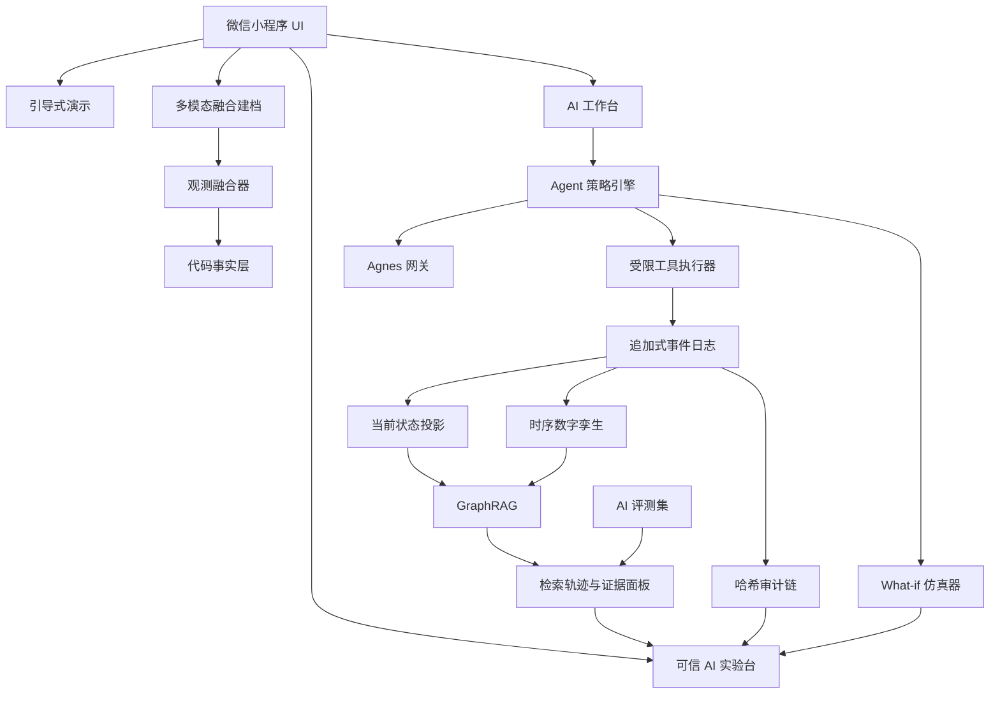

# 启核图策微信小程序端高级加分扩展计划

> **For agentic workers:** REQUIRED SUB-SKILL: Use superpowers:subagent-driven-development (recommended) or superpowers:executing-plans to implement this plan task-by-task. Steps use checkbox (`- [ ]`) syntax for tracking.

**Goal:** 在已规划的视觉、录入、Agent、分享和提交材料之上，增加一组真正可运行、可解释、可验证的高级能力，让评委在 3 至 5 分钟内听懂技术深度，并能通过界面、日志和测试记录复查每项主张。

**Architecture:** 在现有 Taro 小程序、Node/MySQL 后端、GraphRAG 和受限工具协议之上增加“可信 AI 技术旗舰层”：追加式事件日志负责撤销、时间旅行和审计；仿真器在克隆状态上运行 What-if 推演；策略引擎约束 Agent 权限；时序图谱和检索轨迹解释 AI 依据；多源观测融合把照片、小票、条码和语音转换为带置信度的库存事实。所有高级能力共享同一套数据事实和失败降级逻辑，不做独立演示壳。

**Tech Stack:** Taro 4.1.9、React 18、TypeScript、Zustand、Node.js、MySQL、Agnes 多模态模型、现有 GraphRAG、SHA-256 事件链、Canvas 2D、微信小程序码与扫码能力、Vitest。

**Spec:** [微信小程序端提分与交付执行计划](2026-11-10-微信小程序端提分与交付执行计划.md)、用户提供的作品提交要求、75 分预指导截图、[AI 主导与 GraphRAG 补充方案](../../启核图策-AI主导与GraphRAG补充方案.md)。

## Global Constraints

- 本计划是主计划的扩展包。Task 0 至 Task 4 未通过前，不开始高级功能；高级功能失败时必须通过功能开关隐藏，不能拖垮主流程。
- 所有模拟结果必须明确标为“推演结果”，不得写成已发生事实。
- 所有高级算法都使用真实输入、真实状态和可重算结果，不播放伪造的 AI 分析动画。
- 模型不得直接修改库存、采购、方案、家庭任务或权限；所有写操作继续经过预览、确认、执行和撤销。
- 新增依赖必须小于 150KB 构建增量；引入任何依赖前先记录包体积变化。
- 每个高级模块必须有纯函数单元测试；需要微信开发者工具或外部微信后台的步骤分别记录为“已验证”或“未验证”。
- 主包继续不超过 2MB，分包总量不超过 20MB；高级页面优先放入分包。
- 最终答辩只强调能现场演示并且有代码、日志和测试证据的能力；没有证据的技术词汇不进入作品说明。
- 时间不足时，优先保留“事件撤销、What-if 推演、Agent 策略沙箱、引导式演示”，其余功能按开关关闭。

---

## 一、评委能记住的技术叙事

不要把高级能力讲成“用了很多框架”。更有效的叙事是五句话：

> 第一，我们把家庭资源变成了带时间维度的数字孪生。
>
> 第二，任何 AI 建议先在沙箱里推演影响，再由权限策略审核，最后才允许执行。
>
> 第三，每次库存变化都有可撤销事件和可校验审计链。
>
> 第四，AI 的每个结论都能展开检索轨迹和证据路径。
>
> 第五，我们用真实评测集验证工具准确率、证据覆盖率、幻觉率和响应时延。

对应到六维创新：

| 维度 | 高级加分主张 | 评委可现场看到的证据 |
|---|---|---|
| AI 应用创新 | AI 从回答升级为“可推演、可审批、可撤销”的家庭行动代理 | What-if 推演、策略审批、整批撤销 |
| 场景创新 | 家庭储物空间成为可分时查询、可跨空间搜索的数字孪生 | 时序图谱、空间地图、扫码定位 |
| 产品创新 | 多源信息融合建档，冲突自动标记，不让单一视觉模型独断 | 拍照 + 小票 + 条码 + 语音融合面板 |
| 技术创新 | 时序 GraphRAG、事件溯源、策略引擎、检索追踪和评测闭环 | 架构图、代码、评测报告 |
| 商业模式创新 | 周报与家庭协同产生持续订阅价值，可信审计支撑社区共享版 | 周报、家庭任务、审计回执 |
| 用户体验创新 | 用“今天先做什么”和引导式演示降低理解成本 | 新手导览、动作队列、AI 实验台 |

---

## 二、高级功能候选池与取舍

| 编号 | 能力 | 技术含量 | 演示效果 | 8 天可落地性 | 结论 |
|---|---|---:|---:|---:|---|
| C1 | 事件日志、时间旅行、可信审计链 | 高 | 高 | 高 | **必做** |
| C2 | What-if 沙箱推演 | 高 | 极高 | 高 | **必做** |
| C3 | Agent 策略引擎与角色审批 | 高 | 高 | 高 | **必做** |
| C4 | 时序 GraphRAG 与检索轨迹 | 高 | 高 | 中高 | **必做** |
| C5 | 多源观测融合与 AI 盘点 | 高 | 极高 | 中 | **优先做** |
| C6 | 家庭空间地图与二维码标签 | 中高 | 高 | 中 | 条件做 |
| C7 | 自然语言自动化与消耗预测 | 高 | 高 | 中 | 条件做 |
| C8 | AI 评测台与运行时观测 | 高 | 中高 | 中高 | **必做** |
| C9 | 家庭任务接力与审批通知 | 中高 | 高 | 中 | 条件做 |
| C10 | 端侧小模型 | 高 | 中 | 低 | 本期不做 |
| C11 | 向量数据库替换 GraphRAG | 中 | 低 | 低 | 本期不做，避免概念堆叠 |
| C12 | 全量 CRDT 多端同步 | 高 | 低 | 低 | 本期不做，保留幂等事件同步 |

取舍原则：优先做“评委一眼能看懂、开发者可以追问、失败可降级”的能力。事件链和推演是基础，优先级高于任何纯视觉装饰。

---

## 三、增强后的目标架构



核心数据流：

1. 用户操作或 AI 提案先生成领域事件，但不立刻修改事实。
2. 策略引擎检查角色、证据、数量范围、预算风险、隐私级别和审批要求。
3. What-if 仿真器在克隆状态上应用事件，返回影响值。
4. 用户确认后，事件进入工作区，投影出新的库存、采购、方案和图谱。
5. 事件携带前置哈希和幂等键，同步时由后端形成 SHA-256 审计链。
6. 撤销操作生成补偿事件，不删除历史。
7. 检索轨迹记录“路由、实体、路径、证据、模型、耗时、降级原因”，供用户展开和评测台复核。

---

## 四、高级功能实施任务

### Task H0：功能开关与“可信 AI 实验台”容器

**Files:**
- Create: `wxminiapp/NexcoreGraph_wxminiapp/src/config/features.ts`
- Create: `wxminiapp/NexcoreGraph_wxminiapp/src/pages/lab/index.tsx`
- Create: `wxminiapp/NexcoreGraph_wxminiapp/src/pages/lab/index.config.ts`
- Create: `wxminiapp/NexcoreGraph_wxminiapp/src/pages/lab/index.module.scss`
- Modify: `wxminiapp/NexcoreGraph_wxminiapp/src/app.config.ts`
- Create: `wxminiapp/NexcoreGraph_wxminiapp/tests/features.test.ts`

**Interfaces:**

```ts
export interface FeatureFlags {
  eventJournal: boolean
  simulation: boolean
  policySandbox: boolean
  temporalGraph: boolean
  observationFusion: boolean
  spaceMap: boolean
  automationRules: boolean
  familyTasks: boolean
  evaluationConsole: boolean
  guidedTour: boolean
}

export const FEATURES: FeatureFlags
export function enabled(flag: keyof FeatureFlags): boolean
```

- [ ] **Step 1: 写功能开关失败测试**

```ts
import { describe, expect, it } from 'vitest'
import { FEATURES, enabled } from '../src/config/features'

describe('feature flags', () => {
  it('keeps stable core features enabled', () => {
    expect(FEATURES.eventJournal).toBe(true)
    expect(FEATURES.simulation).toBe(true)
    expect(FEATURES.policySandbox).toBe(true)
  })

  it('returns the declared switch', () => {
    expect(enabled('evaluationConsole')).toBe(FEATURES.evaluationConsole)
  })
})
```

- [ ] **Step 2: 运行测试并确认失败**

Run: `npm test -- tests/features.test.ts`

Expected: FAIL，功能配置尚不存在。

- [ ] **Step 3: 实现功能配置和实验台壳页**

实验台首屏只放五张状态卡：

- 审计链：已记录事件数、最后校验结果。
- 仿真沙箱：当前场景和预计影响。
- Agent 策略：允许动作数、需审批动作数、拦截数。
- 检索轨迹：最近一次 GraphRAG 模式和证据条数。
- AI 质量：工具准确率、证据覆盖率、P95 时延。

每张卡都显示“查看依据”，点击进入对应子区。高级功能未完成时由功能开关控制隐藏。

- [ ] **Step 4: 入口放入“我的 → AI 与安全”，同时在工作台提供“为什么这样建议”上下文入口**

实验台定位为“可信 AI 透明中心”，不是开发者调试页。界面使用用户语言，代码 ID 只放在折叠的高级详情中。

- [ ] **Step 5: 运行测试和构建**

Run: `npm test -- tests/features.test.ts && npm run typecheck && npm run build:weapp`

Expected: 全部通过；实验台可从“我的”打开，主包体积增量不超过 20KB。

---

### Task H1：追加式事件日志、时间旅行与可信审计链

**Files:**
- Create: `wxminiapp/NexcoreGraph_wxminiapp/src/domain/events.ts`
- Create: `wxminiapp/NexcoreGraph_wxminiapp/src/services/eventStore.ts`
- Create: `wxminiapp/NexcoreGraph_wxminiapp/src/services/history.ts`
- Create: `wxminiapp/NexcoreGraph_wxminiapp/tests/event-store.test.ts`
- Create: `wxminiapp/NexcoreGraph_wxminiapp/src/components/EventTimeline/index.tsx`
- Create: `wxminiapp/NexcoreGraph_wxminiapp/src/components/EventTimeline/index.module.scss`
- Modify: `wxminiapp/NexcoreGraph_wxminiapp/src/services/api.ts`
- Modify: `wxminiapp/NexcoreGraph_wxminiapp/src/types/index.ts`
- Modify: `harmonyosapp/NexcoreGraph_harmonyos/backend/server.js`

**Interfaces:**

```ts
export type DomainEventType =
  | 'item.created'
  | 'item.qty_changed'
  | 'item.moved'
  | 'item.deleted'
  | 'shopping.added'
  | 'plan.executed'
  | 'plan.reverted'
  | 'rule.changed'
  | 'task.completed'

export interface DomainEvent {
  id: string
  familyId: string
  type: DomainEventType
  targetId: string
  before: Record<string, unknown> | null
  after: Record<string, unknown> | null
  actor: string
  deviceId: string
  createdAt: number
  idempotencyKey: string
  correlationId?: string
  causationId?: string
  prevHash?: string
  hash?: string
  syncStatus: 'pending' | 'sealed' | 'failed'
}

export interface Checkpoint {
  id: string
  eventId: string
  stateDigest: string
  payload: string
  createdAt: number
}

export function appendEvent(input: Omit<DomainEvent, 'id' | 'createdAt' | 'syncStatus'>): DomainEvent
export function createCheckpoint(eventId: string, payload: unknown): Checkpoint
export function compensate(eventId: string, actor: string): DomainEvent
export function timeline(limit: number): DomainEvent[]
export function clearForTest(): void
```

- [ ] **Step 1: 写事件顺序与幂等失败测试**

```ts
import { beforeEach, describe, expect, it } from 'vitest'
import { appendEvent, clearForTest, timeline } from '../src/services/eventStore'

describe('event store', () => {
  beforeEach(() => clearForTest())

  it('deduplicates retries by idempotency key', () => {
    const base = {
      familyId: 'fam-1',
      type: 'item.qty_changed' as const,
      targetId: 'item-1',
      before: { qty: 5 },
      after: { qty: 3 },
      actor: 'member@example.com',
      deviceId: 'wx-device-1',
      idempotencyKey: 'retry-1',
      correlationId: 'agent-run-1',
    }
    expect(appendEvent(base).id).toBe(appendEvent(base).id)
    expect(timeline(10)).toHaveLength(1)
  })

  it('keeps newest events first', () => {
    appendEvent({
      familyId: 'fam-1', type: 'shopping.added', targetId: 'milk',
      before: null, after: { qty: 2 }, actor: 'admin', deviceId: 'wx-1',
      idempotencyKey: 's1',
    })
    expect(timeline(10)[0].type).toBe('shopping.added')
  })
})
```

- [ ] **Step 2: 运行测试并确认失败**

Run: `npm test -- tests/event-store.test.ts`

Expected: FAIL，事件存储尚不存在。

- [ ] **Step 3: 实现客户端事件日志**

- 事件写入 `nexcore_event_journal_v1`，最多保留 500 条。
- 每次事件附带随机 UUID 风格 ID、毫秒时间、幂等键与关联 ID。
- `correlationId` 将一次 Agent 多动作执行归为同一批。
- 事件不能原地修改；撤销通过新增补偿事件完成。
- 保存最近 20 个检查点，每个检查点只保留必要业务数据，不包含图片 base64。

- [ ] **Step 4: 后端增加审计表与哈希链**

```sql
CREATE TABLE IF NOT EXISTS event_journal (
  id BIGINT AUTO_INCREMENT PRIMARY KEY,
  family_id VARCHAR(64) NOT NULL,
  event_id VARCHAR(80) NOT NULL UNIQUE,
  event_type VARCHAR(64) NOT NULL,
  actor VARCHAR(128) NOT NULL,
  device_id VARCHAR(64) NOT NULL,
  correlation_id VARCHAR(80) NULL,
  payload JSON NOT NULL,
  prev_hash CHAR(64) NULL,
  hash CHAR(64) NOT NULL,
  created_at BIGINT NOT NULL,
  UNIQUE KEY uk_family_idempotency (family_id, event_id)
);
```

新增接口：

- `POST /api/events/append`：按家庭串行追加，使用 Node `crypto.createHash('sha256')` 计算 `hash(prevHash + canonicalPayload)`。
- `GET /api/events/timeline/:familyId?limit=50`：返回审计事件。
- `GET /api/events/verify/:familyId`：重算哈希链，返回 `valid`、`checked`、`brokenAt`。

- [ ] **Step 5: 把现有写操作接入事件日志**

现有 `updateItemQty`、`addItem`、`moveItem`、`deleteItem`、`shoppingAdd`、`executePlan` 在成功写库前生成领域事件；写入失败则不追加事件。远端同步成功后把事件标记为 `sealed` 并写回服务端哈希。

- [ ] **Step 6: 实现时间旅行查看**

“操作历史”页提供：

- 最近 20 条事件时间线。
- 按类型筛选：物品、采购、方案、成员。
- 点击事件查看前值、后值、操作者、设备和关联批次。
- 选择检查点查看当时库存摘要；历史状态只读，不自动覆盖当前数据。
- 撤销单个事件或整批 `correlationId` 事件时先展示补偿预览。

- [ ] **Step 7: 运行测试与后端验证**

Run: `npm test -- tests/event-store.test.ts && npm run typecheck && npm run build:weapp`

Expected: 单元测试通过；本地后端 `/api/events/verify/:familyId` 返回 `valid=true`；篡改任意事件后返回 `valid=false`。

---

### Task H2：What-if 推演沙箱

**Files:**
- Create: `wxminiapp/NexcoreGraph_wxminiapp/src/services/simulation.ts`
- Create: `wxminiapp/NexcoreGraph_wxminiapp/tests/simulation.test.ts`
- Create: `wxminiapp/NexcoreGraph_wxminiapp/src/components/ImpactPreview/index.tsx`
- Create: `wxminiapp/NexcoreGraph_wxminiapp/src/components/ImpactPreview/index.module.scss`
- Modify: `wxminiapp/NexcoreGraph_wxminiapp/src/pages/workbench/index.tsx`
- Modify: `wxminiapp/NexcoreGraph_wxminiapp/src/pages/lab/index.tsx`

**Interfaces:**

```ts
export type Scenario =
  | { kind: 'buy'; itemName: string; qty: number; totalPrice: number }
  | { kind: 'consume'; planId: number }
  | { kind: 'remove'; itemId: string }
  | { kind: 'set_budget'; amount: number }

export interface Impact {
  before: {
    items: number
    expiring: number
    lowStock: number
    budgetUsed: number
    health: number
  }
  after: {
    items: number
    expiring: number
    lowStock: number
    budgetUsed: number
    health: number
  }
  delta: Record<string, number>
  warnings: string[]
}

export function simulate(db: DB, scenario: Scenario): Impact
```

- [ ] **Step 1: 写“推演不修改真实状态”失败测试**

```ts
import { describe, expect, it } from 'vitest'
import { simulate } from '../src/services/simulation'

describe('what-if simulation', () => {
  it('does not mutate the source state', () => {
    const state = {
      libraries: [{ id: 'fridge', name: '冰箱', items: [
        { id: 'milk', name: '牛奶', qty: 2, unit: '盒', price: 6, expDays: 3, pos: '冷藏区', lowAt: 1 }
      ] }],
      shopping: [], plans: [], alerts: [], logs: [], aiUsage: [], daily: [],
      budget: 100, history7: [], profile: { people: 3, dislikes: '', goal: '均衡', enabled: true },
      settings: { private: false, chat: true, expiry: true, digest: true, low: true, alertSoon: 7, alertCritical: 3 },
    } as any
    const before = JSON.stringify(state)
    const result = simulate(state, { kind: 'buy', itemName: '牛奶', qty: 2, totalPrice: 12 })
    expect(JSON.stringify(state)).toBe(before)
    expect(result.after.items).toBe(3)
  })

  it('warns when a scenario exceeds the budget', () => {
    const state = {
      libraries: [], shopping: [], plans: [], alerts: [], logs: [], aiUsage: [], daily: [],
      budget: 10, history7: [], profile: { people: 3, dislikes: '', goal: '均衡', enabled: true },
      settings: { private: false, chat: true, expiry: true, digest: true, low: true, alertSoon: 7, alertCritical: 3 },
    } as any
    expect(simulate(state, { kind: 'buy', itemName: '牛奶', qty: 2, totalPrice: 20 }).warnings)
      .toContain('本次购买将超出月度预算 ¥10')
  })
})
```

- [ ] **Step 2: 运行测试并确认失败**

Run: `npm test -- tests/simulation.test.ts`

Expected: FAIL，仿真模块尚不存在。

- [ ] **Step 3: 实现深拷贝推演**

- 只对业务状态做结构化克隆，不复制图片和无关配置。
- 购买场景增加物品、减少购买缺口、更新预算；不自动创建真实物品，除非用户确认“执行推演”。
- 执行方案场景调用同一套方案用料算法，比较前后库存、临期数和低库存数。
- 删除场景只用于评估影响，不自动删除。
- 输入非法或数据不足时返回 `warnings`，不使用模型补数字。

- [ ] **Step 4: 支持自然语言触发**

在工作台增加四类表达：

```text
如果这周再买两盒牛奶会怎样
如果今晚执行这个方案，会缺什么
如果我删掉过期酸奶，健康度会变吗
如果把预算降到 200，这周还够买吗
```

解析出 `Scenario` 后调用 `simulate`；无法确定参数时追问用户，不调用模型猜数字。

- [ ] **Step 5: 实现影响预览组件**

显示四个前后对比：物品总数、临期数、低库存数、预算占用。健康度变化用细条形变化表示，不夸大颜色。底部固定显示：

- `仅推演，尚未修改数据`
- `确认执行`：把推演转成正常写操作预览。
- `换个条件`：回到参数编辑。

- [ ] **Step 6: 在实验台提供可复现案例**

固定三个案例按钮：

- 临期清仓：执行本周方案。
- 补货决策：购买 2 盒牛奶。
- 预算收缩：预算改为 200 元。

按钮只生成推演，不直接写数据。

- [ ] **Step 7: 运行测试**

Run: `npm test -- tests/simulation.test.ts && npm run typecheck`

Expected: PASS；源状态不变、超预算告警和方案推演均有测试。

---

### Task H3：Agent 策略引擎与角色审批

**Files:**
- Create: `wxminiapp/NexcoreGraph_wxminiapp/src/services/policy.ts`
- Create: `wxminiapp/NexcoreGraph_wxminiapp/tests/policy.test.ts`
- Create: `wxminiapp/NexcoreGraph_wxminiapp/src/components/PolicyDecision/index.tsx`
- Create: `wxminiapp/NexcoreGraph_wxminiapp/src/components/PolicyDecision/index.module.scss`
- Modify: `wxminiapp/NexcoreGraph_wxminiapp/src/services/agent.ts`
- Modify: `wxminiapp/NexcoreGraph_wxminiapp/src/pages/lab/index.tsx`
- Modify: `harmonyosapp/NexcoreGraph_harmonyos/backend/server.js`

**Interfaces:**

```ts
export interface PolicyContext {
  actorRole: '管理员' | '成员' | '只读'
  agentProposal: AgentProposal
  currentState: DB
  simulatedImpact: Impact
}

export interface PolicyDecision {
  allow: boolean
  approval: 'none' | 'admin' | 'user'
  reasons: string[]
  blocked: string[]
  riskLevel: 'low' | 'medium' | 'high'
}

export function evaluatePolicy(ctx: PolicyContext): PolicyDecision
```

固定策略：

- 只读成员不能执行任何写动作。
- 成员最多发起 2 个写动作；超过 2 个或涉及删除时必须管理员审批。
- 任意动作无 GraphRAG 证据时不得执行。
- 单次调整库存超过 50% 且数量大于 5 时标记高风险。
- 预算推演超限时要求用户确认。
- 隐私物品不得进入社区摘要、公开分享或跨家庭协作。
- 单次 Agent 最多 3 个动作，执行前必须经过 `simulate`。

- [ ] **Step 1: 写权限矩阵失败测试**

```ts
import { describe, expect, it } from 'vitest'
import { evaluatePolicy } from '../src/services/policy'

const base = {
  currentState: { user: { role: '成员' }, libraries: [], shopping: [], plans: [] },
  simulatedImpact: { warnings: [] },
} as any

describe('agent policy', () => {
  it('blocks read-only users', () => {
    const d = evaluatePolicy({
      ...base,
      actorRole: '只读',
      agentProposal: { title: '调整', summary: '', steps: [], impact: { expiringHandled: 0, shoppingAdded: 0, inventoryChanged: 1 } },
    })
    expect(d.allow).toBe(false)
    expect(d.blocked).toContain('只读成员不能执行写操作')
  })

  it('requires admin approval for delete-like actions', () => {
    const d = evaluatePolicy({
      ...base,
      actorRole: '成员',
      agentProposal: {
        title: '清理', summary: '', impact: { expiringHandled: 1, shoppingAdded: 0, inventoryChanged: 1 },
        steps: [{ id: 's1', kind: 'adjust_qty', targetId: 'milk', label: '牛奶改为 0', qty: 0, evidenceRefs: ['path-1'] }],
      },
    })
    expect(d.approval).toBe('admin')
    expect(d.riskLevel).toBe('high')
  })
})
```

- [ ] **Step 2: 运行测试并确认失败**

Run: `npm test -- tests/policy.test.ts`

Expected: FAIL，策略模块尚不存在。

- [ ] **Step 3: 实现确定性策略判断**

策略判断不得依赖模型。每条拒绝、审批和高风险结论都返回可读原因，并记录到本地事件：

```ts
{
  type: 'agent.policy_evaluated',
  targetId: proposal.id,
  after: { allow, approval, riskLevel, reasons }
}
```

- [ ] **Step 4: 接入 Agent 预览**

预览卡先展示策略结论：

- `可直接执行`
- `需要管理员确认`
- `需要本人再次确认`
- `已拦截：原因`

需要管理员确认时，生成分享给管理员的任务/通知；管理员打开后看到同一份影响预览和证据。管理员拒绝时保留拒绝原因，不执行任何补偿。

- [ ] **Step 5: 在实验台展示策略透明度**

实验台给出当前角色、允许动作、需要审批的动作、被拦截动作和最近一次判断理由。评审可以现场切换“成员/只读”演示策略生效。

- [ ] **Step 6: 运行测试**

Run: `npm test -- tests/policy.test.ts && npm run typecheck`

Expected: PASS；只读、成员、删除、大额调整、无证据和预算超限均有测试。

---

### Task H4：时序 GraphRAG 与检索轨迹

**Files:**
- Create: `wxminiapp/NexcoreGraph_wxminiapp/src/services/retrievalTrace.ts`
- Create: `wxminiapp/NexcoreGraph_wxminiapp/tests/retrieval-trace.test.ts`
- Modify: `wxminiapp/NexcoreGraph_wxminiapp/src/services/graphQuery.ts`
- Modify: `wxminiapp/NexcoreGraph_wxminiapp/src/services/graphRag.ts`
- Modify: `wxminiapp/NexcoreGraph_wxminiapp/src/pages/graph/index.tsx`
- Modify: `wxminiapp/NexcoreGraph_wxminiapp/src/pages/workbench/index.tsx`

**Interfaces:**

```ts
export interface TraceStep {
  id: string
  stage: 'normalize' | 'route' | 'match' | 'traverse' | 'rank' | 'compose'
  label: string
  inputCount: number
  outputCount: number
  ms: number
  detail?: string
}

export interface RetrievalTrace {
  traceId: string
  query: string
  mode: RagMode
  steps: TraceStep[]
  pathIds: string[]
  evidenceCount: number
  staleCount: number
  degraded: boolean
  totalMs: number
}

export function makeTrace(query: string, mode: RagMode): RetrievalTrace
export function finishTrace(trace: RetrievalTrace, ev: RagEvidence): RetrievalTrace
```

- [ ] **Step 1: 写轨迹上限与降级测试**

```ts
import { describe, expect, it } from 'vitest'
import { finishTrace, makeTrace } from '../src/services/retrievalTrace'

describe('retrieval trace', () => {
  it('records bounded trace steps and path ids', () => {
    const trace = makeTrace('牛奶还能放几天', 'fast')
    const done = finishTrace(trace, {
      mode: 'fast', lines: ['冰箱 · 冷藏区 | 牛奶 2 盒 | 3 天到期'],
      paths: [{ nodes: ['item:milk', 'food:milk'], edges: ['instantiates'], facts: ['牛奶'], src: '本地图谱' }],
      stale: false, version: 'gv-1',
    })
    expect(done.steps.length).toBeLessThanOrEqual(8)
    expect(done.pathIds).toEqual(['item:milk>food:milk'])
    expect(done.evidenceCount).toBe(2)
  })
})
```

- [ ] **Step 2: 运行测试并确认失败**

Run: `npm test -- tests/retrieval-trace.test.ts`

Expected: FAIL，轨迹模块尚不存在。

- [ ] **Step 3: 实现可解释检索轨迹**

记录：

- 原问题归一化结果。
- 意图路由和模式选择原因。
- 命中的实体、类别和库。
- 遍历的边类型、跳数、候选路径数。
- 最终证据条数和是否使用社区摘要。
- 模型调用、首字延迟、总时延和是否降级。

轨迹最多 8 步，敏感原文只保留问题前 80 个字符。`evidenceCount` 定义为 `lines.length + paths.length`，`pathIds` 单独记录路径标识。

- [ ] **Step 4: 把时序信息加入图谱**

在 `ItemInstance` 节点增加：

```ts
{
  observedAt: number
  lastChangedAt: number
  expiresAt?: number
  predictedDepletionAt?: number
  confidence: number
}
```

新增边类型：

- `changedTo`：库存事件导致的状态变化。
- `consumes`：方案消耗关系。
- `predictedBy`：预测依据。
- `locatedAt`：空间位置。

图谱页增加三种视图：

- `当前状态`
- `最近变化`
- `未来 7 天预测`

未来视图只显示带置信度的预测节点，并用虚线表示，不得与当前事实混淆。

- [ ] **Step 5: 回答旁增加“检索轨迹”**

点击“为什么这样回答”展开五段：

1. 我理解的问题。
2. 我选择了哪种检索。
3. 我命中了哪些家庭事实。
4. 我引用了哪些路径。
5. 哪些事实过期、缺失或导致降级。

没有证据时明确显示“本次回答未引用图谱，仅使用模型常识”，并在高风险建议中降级为提示。

- [ ] **Step 6: 运行测试和人工验证**

Run: `npm test -- tests/retrieval-trace.test.ts && npm run typecheck && npm run build:weapp`

Expected: 轨迹单元测试通过；工作台可展开轨迹；图谱页三视图切换无错误。

---

### Task H5：多源观测融合与 AI 对比盘点

**Files:**
- Create: `wxminiapp/NexcoreGraph_wxminiapp/src/services/observationFusion.ts`
- Create: `wxminiapp/NexcoreGraph_wxminiapp/tests/observation-fusion.test.ts`
- Create: `wxminiapp/NexcoreGraph_wxminiapp/src/services/audit.ts`
- Create: `wxminiapp/NexcoreGraph_wxminiapp/tests/audit.test.ts`
- Create: `wxminiapp/NexcoreGraph_wxminiapp/src/pages/audit/index.tsx`
- Create: `wxminiapp/NexcoreGraph_wxminiapp/src/pages/audit/index.config.ts`
- Create: `wxminiapp/NexcoreGraph_wxminiapp/src/pages/audit/index.module.scss`
- Modify: `wxminiapp/NexcoreGraph_wxminiapp/src/pages/intake/index.tsx`
- Modify: `wxminiapp/NexcoreGraph_wxminiapp/src/services/agnes.ts`
- Modify: `wxminiapp/NexcoreGraph_wxminiapp/src/app.config.ts`

**Interfaces:**

```ts
export type ObservationSource = 'vision' | 'receipt' | 'barcode' | 'voice' | 'manual'

export interface Observation {
  name: string
  qty?: number
  unit?: string
  pos?: string
  expDays?: number
  price?: number
  confidence: number
  source: ObservationSource
}

export interface FusedObservation {
  name: string
  qty: number
  unit: string
  pos: string
  expDays: number
  price: number
  confidence: number
  sources: ObservationSource[]
  conflicts: string[]
  requiresReview: boolean
}

export function fuseObservations(observations: Observation[]): FusedObservation[]

export type AuditBucket = 'matched' | 'quantityDiff' | 'missingCandidate' | 'extraCandidate' | 'uncertain'

export interface AuditRow {
  bucket: AuditBucket
  name: string
  expectedQty?: number
  observedQty?: number
  confidence: number
  sources: ObservationSource[]
  evidence: string
}

export function compareInventory(expected: Item[], observed: FusedObservation[]): AuditRow[]
```

- [ ] **Step 1: 写多源共识失败测试**

```ts
import { describe, expect, it } from 'vitest'
import { fuseObservations } from '../src/services/observationFusion'

describe('observation fusion', () => {
  it('prefers a high-confidence barcode name and merges quantity evidence', () => {
    const [out] = fuseObservations([
      { name: '鲜牛乳', qty: 2, unit: '盒', confidence: 0.66, source: 'vision' },
      { name: '牛奶', qty: 2, unit: '盒', confidence: 0.98, source: 'barcode' },
      { name: '牛奶', qty: 2, unit: '盒', confidence: 0.94, source: 'receipt' },
    ])
    expect(out.name).toBe('牛奶')
    expect(out.qty).toBe(2)
    expect(out.confidence).toBeGreaterThan(0.9)
    expect(out.sources).toEqual(expect.arrayContaining(['vision', 'barcode', 'receipt']))
  })

  it('marks conflicting quantities for review', () => {
    const [out] = fuseObservations([
      { name: '牛奶', qty: 2, unit: '盒', confidence: 0.9, source: 'vision' },
      { name: '牛奶', qty: 4, unit: '盒', confidence: 0.94, source: 'receipt' },
    ])
    expect(out.requiresReview).toBe(true)
    expect(out.conflicts).toContain('数量：2 盒 / 4 盒')
  })
})
```

- [ ] **Step 2: 写盘点安全失败测试**

```ts
import { describe, expect, it } from 'vitest'
import { compareInventory } from '../src/services/audit'

describe('inventory audit', () => {
  it('never auto-classifies an absent expected item as deleted', () => {
    const rows = compareInventory(
      [{ id: 'milk', name: '牛奶', qty: 2, unit: '盒', pos: '冷藏区', expDays: 3 } as any],
      [{ name: '鸡蛋', qty: 6, unit: '个', pos: '冷藏区', expDays: 10, price: 0, confidence: 0.8, sources: ['vision'], conflicts: [], requiresReview: false }]
    )
    expect(rows.find((r) => r.name === '牛奶')?.bucket).toBe('missingCandidate')
    expect(rows.some((r) => r.bucket === 'matched' && r.name === '鸡蛋')).toBe(true)
  })
})
```

- [ ] **Step 3: 运行测试并确认失败**

Run: `npm test -- tests/observation-fusion.test.ts tests/audit.test.ts`

Expected: FAIL，融合与盘点模块尚不存在。

- [ ] **Step 4: 实现观测融合**

- 来源权重固定：条码 `0.98`、小票 `0.94`、视觉 `0.72`、语音 `0.68`、手动 `1.0`。
- 模型返回自身置信度时与来源权重取较低值，避免自报过高。
- 同名按别名归一；数量冲突时不自动取最大值，标记待确认。
- 价格冲突显示来源和时间；保质期冲突优先小票/手动，仍展示冲突提示。
- 融合结果保留 `sources` 和 `conflicts`，供 UI 与审计链复查。

- [ ] **Step 5: 实现 AI 盘点页**

流程：

1. 选择资源库和盘点范围。
2. 拍摄 1 至 4 张照片。
3. 视觉识别与当前库存对比。
4. 展示“匹配、数量不一致、疑似缺失、疑似新增、不确定”五类。
5. 用户逐项确认，或一键确认低风险项。
6. 生成盘点和事件，可撤销整次盘点。

安全规则：

- 照片看不到不等于已用完，只能标记“疑似缺失”。
- 任何删除必须在用户确认后生成 `item.deleted` 事件。
- 私有物品不进入公开盘点摘要。
- 盘点结果不作为采购或健康度的直接事实，确认后才投影。

- [ ] **Step 6: 输出可展示的盘点报告**

报告显示：

- 本次扫描时间、照片数、观测来源。
- 匹配率、冲突数、待确认数。
- 预计缺少物品与来源证据。
- 一键生成采购清单或家庭任务。

- [ ] **Step 7: 运行测试与人工验证**

Run: `npm test -- tests/observation-fusion.test.ts tests/audit.test.ts && npm run typecheck && npm run build:weapp`

Expected: 单元测试通过；开发者工具中完成“拍照盘点 → 标记疑似缺失 → 确认 → 撤销整次盘点”。

---

### Task H6：空间存储地图与二维码标签

**Files:**
- Create: `wxminiapp/NexcoreGraph_wxminiapp/src/services/location.ts`
- Create: `wxminiapp/NexcoreGraph_wxminiapp/tests/location.test.ts`
- Create: `wxminiapp/NexcoreGraph_wxminiapp/src/pages/space/index.tsx`
- Create: `wxminiapp/NexcoreGraph_wxminiapp/src/pages/space/index.config.ts`
- Create: `wxminiapp/NexcoreGraph_wxminiapp/src/pages/space/index.module.scss`
- Modify: `wxminiapp/NexcoreGraph_wxminiapp/src/pages/library-detail/index.tsx`
- Modify: `wxminiapp/NexcoreGraph_wxminiapp/src/pages/library/index.tsx`
- Modify: `wxminiapp/NexcoreGraph_wxminiapp/src/app.config.ts`
- Modify: `harmonyosapp/NexcoreGraph_harmonyos/backend/server.js`

**Interfaces:**

```ts
export interface StorageLocation {
  id: string
  libraryId: string
  zone: string
  shelf?: string
  box?: string
  displayName: string
}

export interface LocationPath {
  library: string
  zone: string
  shelf?: string
  box?: string
  label: string
}

export function parseLocationText(input: string): StorageLocation | null
export function buildLocationPath(state: DB, itemId: string): LocationPath | null
export function parseSpaceScene(scene: string): { libraryId: string; zone?: string } | null
```

- [ ] **Step 1: 写位置解析失败测试**

```ts
import { describe, expect, it } from 'vitest'
import { parseLocationText, parseSpaceScene } from '../src/services/location'

describe('storage location', () => {
  it('normalizes a readable location', () => {
    expect(parseLocationText('冰箱/冷藏区/中层')).toEqual({
      id: '冰箱>冷藏区>中层',
      libraryId: '冰箱',
      zone: '冷藏区',
      shelf: '中层',
      displayName: '冰箱 · 冷藏区 · 中层',
    })
  })

  it('parses a mini-program scene', () => {
    expect(parseSpaceScene('lib_fridge__zone_chilled')).toEqual({ libraryId: 'fridge', zone: 'chilled' })
  })
})
```

- [ ] **Step 2: 运行测试并确认失败**

Run: `npm test -- tests/location.test.ts`

Expected: FAIL，位置模块尚不存在。

- [ ] **Step 3: 实现 2.5D 空间地图**

不引入 3D 引擎。使用 CSS 透视、层级卡片和确定性布局：

- 家庭为第一层。
- 库为第二层。
- 区域为第三层。
- 货架/盒子为第四层。
- 物品以分类图标和数量徽章显示。

地图支持“找物”“临期热点”“盘点入口”三种模式。

- [ ] **Step 4: 实现二维码标签**

后端新增 `POST /api/wxacode/space`：

- 使用微信 `wxacode.getUnlimited` 生成小程序码，`scene` 为 `lib_<id>__zone_<id>`。
- Access Token 只在后端缓存，不返回客户端。
- 未配置 AppID/Secret 时返回 `501 WXACODE_NOT_CONFIGURED`，界面显示真实原因。

客户端：

- 库详情可生成并保存标签图。
- `Taro.scanCode` 识别小程序码或普通码。
- 扫描后直接打开对应库/区域，并显示“扫码定位”来源标签。

- [ ] **Step 5: 运行测试与真机验证**

Run: `npm test -- tests/location.test.ts && npm run typecheck && npm run build:weapp`

Expected: 位置解析通过；有微信后台配置时生成可打开空间页的小程序码；未配置时显示真实提示。

---

### Task H7：自然语言自动化规则与消耗预测

**Files:**
- Create: `wxminiapp/NexcoreGraph_wxminiapp/src/services/automation.ts`
- Create: `wxminiapp/NexcoreGraph_wxminiapp/src/services/forecast.ts`
- Create: `wxminiapp/NexcoreGraph_wxminiapp/tests/automation.test.ts`
- Create: `wxminiapp/NexcoreGraph_wxminiapp/tests/forecast.test.ts`
- Create: `wxminiapp/NexcoreGraph_wxminiapp/src/pages/rules/index.tsx`
- Create: `wxminiapp/NexcoreGraph_wxminiapp/src/pages/rules/index.config.ts`
- Create: `wxminiapp/NexcoreGraph_wxminiapp/src/pages/rules/index.module.scss`
- Modify: `wxminiapp/NexcoreGraph_wxminiapp/src/app.config.ts`
- Modify: `wxminiapp/NexcoreGraph_wxminiapp/src/pages/workbench/index.tsx`
- Modify: `harmonyosapp/NexcoreGraph_harmonyos/backend/server.js`

**Interfaces:**

```ts
export type RuleMetric = 'qty' | 'days_to_expiry' | 'predicted_days_left'
export type RuleOperator = 'lt' | 'lte' | 'eq'

export interface AutomationRule {
  id: string
  label: string
  metric: RuleMetric
  operator: RuleOperator
  threshold: number
  itemName?: string
  libraryId?: string
  actions: Array<'notify' | 'shopping' | 'agent_brief'>
  enabled: boolean
  source: 'manual' | 'natural_language'
  createdAt: number
}

export interface ConsumptionForecast {
  itemId: string
  dailyRate: number | null
  predictedDaysLeft: number | null
  confidence: 'low' | 'medium' | 'high'
  basis: string
}

export function parseAutomationRule(text: string, state: DB): AutomationRule
export function forecastItem(item: Item, logs: LogEntry[], now: number): ConsumptionForecast
```

- [ ] **Step 1: 写规则与预测失败测试**

```ts
import { describe, expect, it } from 'vitest'
import { parseAutomationRule } from '../src/services/automation'
import { forecastItem } from '../src/services/forecast'

describe('automation and forecast', () => {
  it('parses a deterministic low-stock rule', () => {
    const rule = parseAutomationRule('牛奶少于2盒时提醒我', {
      libraries: [{ id: 'fridge', name: '冰箱', items: [
        { id: 'milk', name: '牛奶', qty: 3, unit: '盒', expDays: 5, pos: '冷藏区' }
      ] }],
    } as any)
    expect(rule.metric).toBe('qty')
    expect(rule.threshold).toBe(2)
    expect(rule.itemName).toBe('牛奶')
  })

  it('uses the median daily consumption from valid history', () => {
    const now = Date.now()
    const logs = [
      { kind: 'consume', name: '牛奶', n: 1, ts: now - 2 * 86400000 },
      { kind: 'consume', name: '牛奶', n: 2, ts: now - 86400000 },
      { kind: 'consume', name: '牛奶', n: 20, ts: now },
    ] as any
    expect(forecastItem({ id: 'milk', name: '牛奶', qty: 6, unit: '盒' } as any, logs, now).dailyRate).toBe(2)
  })
})
```

- [ ] **Step 2: 运行测试并确认失败**

Run: `npm test -- tests/automation.test.ts tests/forecast.test.ts`

Expected: FAIL，规则与预测模块尚不存在。

- [ ] **Step 3: 实现规则解析与预览**

示例必须覆盖：

```text
牛奶少于2盒时提醒我
临期3天前提醒
鸡蛋预计只剩2天时提醒
每周日晚上汇总一次本周资源报告
```

解析结果先显示人话解释、触发条件、动作和当前是否会触发；用户确认后才保存规则。复杂表达可由模型返回 JSON，但必须经过同一确定性校验器。

- [ ] **Step 4: 实现消耗预测**

- 使用最近 14 天有效消耗记录。
- 以按天消耗的中位数作为速率，去除单次异常值。
- 历史不足 3 天时置信度为低，并显示“历史不足，仅作参考”。
- 不输出虚假精确日期；显示“约 X 天”或“暂无足够历史”。
- 预测只用于提醒和建议，不直接修改库存。

- [ ] **Step 5: 接入订阅消息**

规则命中后：

1. 本地生成预警。
2. 若用户已订阅相关模板，后端发送汇总提醒。
3. 点击提醒进入对应物品或 AI 工作台。
4. 提醒内容标注触发规则和计算依据。

- [ ] **Step 6: 运行测试与人工验证**

Run: `npm test -- tests/automation.test.ts tests/forecast.test.ts && npm run typecheck && npm run build:weapp`

Expected: 规则、预测测试通过；用户说“牛奶少于2盒提醒我”后，规则预览可确认，低于阈值时可生成预警。

---

### Task H8：AI 质量评测台与运行时观测

**Files:**
- Create: `wxminiapp/NexcoreGraph_wxminiapp/src/evaluation/dataset.json`
- Create: `wxminiapp/NexcoreGraph_wxminiapp/src/evaluation/metrics.ts`
- Create: `wxminiapp/NexcoreGraph_wxminiapp/tests/evaluation.test.ts`
- Create: `tools/evaluate_weapp_ai.mjs`
- Create: `docs/competition/启核图策-AI评测报告.md`
- Modify: `wxminiapp/NexcoreGraph_wxminiapp/src/pages/lab/index.tsx`
- Modify: `harmonyosapp/NexcoreGraph_harmonyos/backend/server.js`

**Interfaces:**

```ts
export interface EvalCase {
  id: string
  query: string
  expectedMode: 'fast' | 'local' | 'global' | 'multi-hop' | 'tool'
  expectedEntity?: string
  expectedTool?: string
  evidenceRequired: boolean
}

export interface EvalResult {
  caseId: string
  passed: boolean
  mode: string
  tool: string | null
  evidenceCount: number
  latencyMs: number
  numericConsistency: boolean | null
  failureReason?: string
}

export function summarize(results: EvalResult[]): {
  total: number
  passRate: number
  routeAccuracy: number
  toolAccuracy: number
  evidenceCoverage: number
  numericConsistencyRate: number
  p95LatencyMs: number
}
```

- [ ] **Step 1: 建立至少 36 条家庭查询评测集**

比例固定：

- 事实快答 12 条：位置、数量、保质期。
- 全局洞察 6 条：本周临期、健康度、资源构成。
- 规划检索 8 条：临期优先、缺料、预算。
- 写操作 6 条：改数量、采购、执行方案。
- 对抗/降级 4 条：无数据、模糊实体、无证据、模型超时。

- [ ] **Step 2: 写指标失败测试**

```ts
import { describe, expect, it } from 'vitest'
import { summarize } from '../src/evaluation/metrics'

describe('evaluation summary', () => {
  it('computes pass rate and p95 latency', () => {
    const out = summarize([
      { caseId: '1', passed: true, mode: 'fast', tool: null, evidenceCount: 1, latencyMs: 20, numericConsistency: true },
      { caseId: '2', passed: false, mode: 'local', tool: null, evidenceCount: 0, latencyMs: 40, numericConsistency: false },
    ])
    expect(out.total).toBe(2)
    expect(out.passRate).toBe(0.5)
    expect(out.p95LatencyMs).toBe(40)
  })
})
```

- [ ] **Step 3: 运行测试并确认失败**

Run: `npm test -- tests/evaluation.test.ts`

Expected: FAIL，评测模块尚不存在。

- [ ] **Step 4: 实现离线与在线两层评测**

离线层：

- 对确定性路由、参数解析、策略校验和证据装配运行单元评测。
- 记录路由准确率、工具准确率、证据覆盖率。

在线层：

- 启动本地后端，按评测集逐条请求真实接口。
- 记录模型名、时延、降级状态、证据条数和回答中的数字是否能从证据重算。
- 不把所有失败归因于模型；分别统计解析失败、无证据、超时和内容安全拦截。

- [ ] **Step 5: 在实验台展示最后一次评测**

实验台只显示准确率、证据覆盖率、P95 时延和失败样例数量。点击“查看报告”打开静态文档摘要，不在小程序里塞入长报告。

- [ ] **Step 6: 运行评测**

Run: `node tools/evaluate_weapp_ai.mjs`

Expected:

- 输出 JSON 和 Markdown 两种结果。
- 至少记录总用例数、通过率、工具准确率、证据覆盖率、P95 时延。
- 失败用例附原因和请求 ID。

---

### Task H9：角色感知家庭任务与审批接力

**Files:**
- Create: `wxminiapp/NexcoreGraph_wxminiapp/src/services/tasks.ts`
- Create: `wxminiapp/NexcoreGraph_wxminiapp/tests/tasks.test.ts`
- Create: `wxminiapp/NexcoreGraph_wxminiapp/src/pages/tasks/index.tsx`
- Create: `wxminiapp/NexcoreGraph_wxminiapp/src/pages/tasks/index.config.ts`
- Create: `wxminiapp/NexcoreGraph_wxminiapp/src/pages/tasks/index.module.scss`
- Modify: `wxminiapp/NexcoreGraph_wxminiapp/src/pages/workbench/index.tsx`
- Modify: `wxminiapp/NexcoreGraph_wxminiapp/src/pages/mine/index.tsx`
- Modify: `harmonyosapp/NexcoreGraph_harmonyos/backend/server.js`

**Interfaces:**

```ts
export interface FamilyTask {
  id: string
  familyId: string
  title: string
  detail: string
  assignee: string
  creator: string
  dueAt: number
  status: 'pending' | 'accepted' | 'done' | 'blocked'
  actionRef?: {
    kind: 'adjust_qty' | 'shopping_add' | 'execute_plan'
    targetId: string
    proposalId: string
  }
  evidenceRefs: string[]
}

export function createTaskFromProposal(ctx: {
  proposal: AgentProposal
  actor: string
  familyId: string
}): FamilyTask[]
export function transitionTask(task: FamilyTask, next: FamilyTask['status'], actor: string): FamilyTask
```

- [ ] **Step 1: 写任务流转失败测试**

```ts
import { describe, expect, it } from 'vitest'
import { transitionTask } from '../src/services/tasks'

const task = {
  id: 'task-1', familyId: 'fam-1', title: '处理临期牛奶', detail: '',
  assignee: '妈妈', creator: '我', dueAt: Date.now() + 86400000,
  status: 'pending', evidenceRefs: ['path-1'],
} as const

describe('family task state machine', () => {
  it('rejects completion before acceptance', () => {
    expect(() => transitionTask(task as any, 'done', '妈妈')).toThrow('任务尚未接受')
  })

  it('accepts the pending task', () => {
    expect(transitionTask(task as any, 'accepted', '妈妈').status).toBe('accepted')
  })
})
```

还需要覆盖：非负责人不能接受任务、只有审批人可通过删除类动作、任务完成后执行动作必须具备幂等键、拒绝后不修改库存。

- [ ] **Step 2: 实现任务状态机**

状态只允许：

```text
pending -> accepted -> done
pending -> blocked
accepted -> blocked
blocked -> accepted
```

任何状态变化生成事件并记录操作者。

- [ ] **Step 3: 把 AI 建议转成家庭任务**

用户可说“把这件事交给妈妈，周五前完成”。Agent 生成任务预览：

- 任务标题。
- 关联库存/方案。
- 负责人和截止时间。
- 证据。
- 完成后是否执行某个动作。

- [ ] **Step 4: 订阅与微信分享**

任务发送到订阅消息或分享给家庭成员；收到的人先接受，完成任务后由系统执行已获批动作。

- [ ] **Step 5: 在实验台展示家庭协作链路**

选择一条任务，显示“创建 → 接受 → 完成 → 库存变更 → 事件回执”。

- [ ] **Step 6: 运行测试**

Run: `npm test -- tests/tasks.test.ts && npm run typecheck`

Expected: 状态机与权限测试通过。

---

### Task H10：引导式演示与高级答辩证据

**Files:**
- Create: `wxminiapp/NexcoreGraph_wxminiapp/src/services/demoTour.ts`
- Create: `wxminiapp/NexcoreGraph_wxminiapp/src/components/TourTip/index.tsx`
- Create: `wxminiapp/NexcoreGraph_wxminiapp/src/components/TourTip/index.module.scss`
- Create: `wxminiapp/NexcoreGraph_wxminiapp/tests/demoTour.test.ts`
- Modify: `wxminiapp/NexcoreGraph_wxminiapp/src/pages/home/index.tsx`
- Modify: `wxminiapp/NexcoreGraph_wxminiapp/src/pages/workbench/index.tsx`
- Modify: `wxminiapp/NexcoreGraph_wxminiapp/src/pages/lab/index.tsx`
- Modify: `docs/competition/启核图策-作品说明-v2.md`
- Modify: `docs/competition/启核图策-演示视频脚本-v2.md`

**Interfaces:**

```ts
export interface TourStep {
  id: string
  page: string
  title: string
  body: string
  highlightSelector?: string
  nextLabel: string
}

export const TOUR: TourStep[]
export function nextTourStep(currentId: string): TourStep | null
```

- [ ] **Step 1: 写导览顺序测试**

```ts
import { describe, expect, it } from 'vitest'
import { nextTourStep, TOUR } from '../src/services/demoTour'

describe('guided tour', () => {
  it('walks through the five flagship moments in order', () => {
    expect(TOUR.map((s) => s.id)).toEqual([
      'today', 'intake', 'simulate', 'policy', 'audit'
    ])
    expect(nextTourStep('simulate')?.id).toBe('policy')
  })
})
```

- [ ] **Step 2: 运行测试并确认失败**

Run: `npm test -- tests/demoTour.test.ts`

Expected: FAIL，导览模块尚不存在。

- [ ] **Step 3: 实现五步导览**

导览不自动伪造操作，只跳到真实页面并高亮真实区域：

1. “今天先做什么”：AI 主动建议和依据。
2. “30 秒建档”：多源融合与待确认字段。
3. “先推演再执行”：What-if 影响预览。
4. “策略审批”：角色权限和整批撤销。
5. “证据与审计”：GraphRAG 轨迹、事件时间线和哈希校验。

- [ ] **Step 4: 增加实验台“演示脚本”卡**

评委点击“3 分钟看核心”，按导览走过真实页面；每一步都有“为什么重要”和“工程证据”按钮。没有数据的用户可看到各能力说明，但不能看到虚构的库存结果。

- [ ] **Step 5: 更新答辩材料**

作品说明新增一页“技术旗舰层”，只列四件事：

- 时序数字孪生与 What-if。
- 策略引擎与事件回滚。
- GraphRAG 检索轨迹。
- AI 评测与质量指标。

每个主张配对应截图和代码路径。

- [ ] **Step 6: 运行测试**

Run: `npm test -- tests/demoTour.test.ts && npm run typecheck && npm run build:weapp`

Expected: 导览顺序测试通过；视频脚本增加 30 秒高级能力演示。

---

## 五、建议的实施波次

### Wave 1：评委最容易感到“这不是普通聊天机器人”

- H1 事件日志与整批撤销。
- H2 What-if 沙箱推演。
- H3 Agent 策略引擎。
- H4 检索轨迹。
- H10 引导式演示。

预计 2.5 至 3 个工作日，必须优先完成。

### Wave 2：体现“多模态和数据闭环”

- H5 多源观测融合与 AI 盘点。
- H8 AI 评测台。

预计 1.5 至 2 个工作日，若 Wave 1 测试稳定再进入。

### Wave 3：条件功能

- H6 空间地图与二维码。
- H7 自然语言规则与预测。
- H9 家庭任务与审批接力。

每项独立开关，只有当日验证通过才进入演示视频。

### 明确不做

- 端侧小模型：没有足够时间验证体积、功耗和准确率。
- 向量数据库：现有 GraphRAG 已能解释，换成向量库反而增加成本且不易展示。
- 全量 CRDT：高并发家庭场景不是当前主矛盾，先做幂等事件和冲突回执。
- 任何需要伪造数据才能成立的“智能化”演示。

---

## 六、高级能力的展示脚本

### 60 秒技术亮点串讲

1. 打开“今天先做什么”，指出不是模型瞎猜，数字来自图谱和规则。
2. 输入“如果这周再买两盒牛奶会怎样”，展示前后预算、临期和低库存变化。
3. 输入“把临期牛奶排进方案，并把缺的牛奶加采购”，展示三步 Agent 预览。
4. 切换成员角色，展示“超过两个写动作需要管理员审批”。
5. 点击“为什么这样建议”，展开 GraphRAG 检索轨迹。
6. 执行后点击“撤销整批”，展示补偿事件。
7. 打开审计链校验，显示哈希链通过。
8. 打开 AI 评测台，显示真实路由准确率、证据覆盖率和 P95 时延。

### 答辩时的技术边界表述

> 我们没有让大模型直接操作数据库。模型负责理解和表达，代码负责事实、权限、模拟和撤销；GraphRAG 负责证据，事件日志负责可追溯性。高级能力全部围绕这条边界展开。

---

## 七、高级功能验收

### 功能验收

- What-if 推演前后对比至少覆盖购买、执行方案、预算调整三个场景。
- 推演不修改真实数据；确认执行后才生成正式事件。
- 只读成员不能写，成员删除类动作需要管理员审批。
- 一次 Agent 执行可产生多个事件，并可整批撤销。
- 审计链被篡改时能够定位到断链事件。
- 回答可展开检索轨迹，明确显示引用路径与降级原因。
- 多源融合能显示来源和冲突，不把低置信度结果自动写成事实。
- 盘点不会因照片中没看到物品而自动删除库存。

### 技术验收

- 所有纯逻辑模块有 Vitest 测试。
- `npm run verify:weapp` 通过。
- 高级页面全部进入分包或按需加载，主包不超过 2MB。
- 本地后端 `/api/events/verify`、AI 评测脚本、Agent 策略测试均有可复制输出。
- 提供至少一份真实同源评测报告，不使用手工编造的百分比。

### 材料验收

- 作品说明包含一张“可信 AI 技术旗舰层”架构图。
- 视频中至少展示 What-if、策略审批、整批撤销、检索轨迹四项中的三项。
- 创新点表的技术创新和 AI 应用创新都能指到代码与测试证据。
- 提交包包含事件链说明、评测报告和演示截图，不包含真实密钥。
