# 作品介绍文档

**参赛赛事**：2026第九届传智杯全国大学生数智创新与 AI 应用大赛
**参赛赛道**：HarmonyOSCodelabs挑战赛
**团队名称**：天枢序列（团队编号：38376；参赛人：高俊杰；队友：陈庚飞、罗渝川）
**版本号**：V1.1.0
**编制日期**：2026 年 10 月 16 日
**技术栈**：HarmonyOS + ArkTS + ArkUI + Node.js + Express + MySQL + GraphRAG


---

## 目录

- 一、项目说明
- 二、鸿蒙与 AI 能力说明
- 三、创新点说明（六维度）
- 四、技术实现
- 五、成果展示
- 六、历史说明
- 七、迭代优化说明
- 八、落地规划
- 附录 A：评审标准对照（赛道：智慧生活）
- 附录 B：项目信息


## 一、项目说明

### 1.1 项目简介

**启核图策（NexcoreGraph）** 是一个 **AI 主导的家庭资源智能管理系统**，面向“HarmonyOSCodelabs挑战赛”打造。

它要解决的现实问题是：家里的东西**记不住、找不到、用不掉**：重复购买、食物过期、药品与耗材到期、要用时翻箱倒柜。
**库的类型由用户自己定**：冰箱、衣柜、药盒、工具箱、厨具、书架、宠物用品、健身器材、家电都能建，
AI 的识别、图谱、临期提醒与协作机制对每一类库同样生效。
常见的库存记账 App 要用户自己填表。这里换了分工：识别入库、补保质期与存放位置、估价格、
排优先消耗方案都由 AI 做，用户只拍照、只确认；每条结论还能点开看到"证据路径"
（详见 2.3.3 与 4.3.1）。

系统由四部分组成：

表：系统的四个组成部分与各自职责

| 部分 | 技术形态 | 职责 |
|---|---|---|
| 鸿蒙端 App | ArkTS / ArkUI 原生（元服务 atomicService，API 23） | 主客户端；手机 / 平板 / 2in1 三档自适应 |
| 自建后端 | Node.js + Express + MySQL | 账号、家庭、数据快照、AI 网关、图谱存储、用量统计 |
| AI 网关 | 服务端代理调用大模型（文本 + 视觉） | 端侧不持有任何模型密钥 |
| 流转中转 | Node.js 轻量服务（3100） | 多设备数据同步通道 |

**部署形态为局域网自建服务器**：后端运行在用户自己的电脑上，手机/平板同一 WiFi 直连，
数据不出局域网，无需域名与 ICP/App 备案（上架华为应用市场时才需要，见仓库《上线部署清单.md》）。

### 1.2 目标用户

- **主力用户**：25~45 岁的家庭采购与收纳承担者，也就是家里那个"管冰箱、管药箱、管工具箱"的人。痛点是记不住家里有什么、快到期的东西想不起来用、经常重复购买，真要用时又找不到。
- **协同用户**：同住家人（配偶、父母、保姆）。他们不装额外软件，用同一账号在手机或平板上搭把手，或直接在协作牌桌上参与拼菜。
- **延伸用户**：独居青年与合租室友（一人一库、临时拼资源）、需要盯药品与保健品保质期的慢病家庭。
- **门槛要求**：会拍照、会发语音即可，不要求任何收纳或记账习惯。

### 1.3 使用场景

表：典型使用场景与产品的对应动作

| 场景 | 用户此刻在做什么 | 产品怎么接 |
|---|---|---|
| 采购回家 | 手里拎着袋子，没空逐件登记 | 拍一张照片，AI 识别成清单，只补缺字段后确认入库 |
| 临期焦虑 | 打开冰箱/药箱，看到快到期的东西 | 首页"今天要处理"按到期日排序，点一下就处理并核销；保质期对食品、药品、化妆品、滤芯耗材都适用 |
| 想不出吃什么 | 想问"今晚吃什么" | 一句话问 AI，按"缺料最少 + 命中临期最多"给菜谱，并标出缺什么 |
| 换季收纳 | 整理衣柜，想记清有哪些衣物 | 拍衣柜照片按类别入库；衣物这类库不看保质期，只记位置与数量 |
| 工具找不到 | 修东西时找不到工具 | 入库时记库位（如"工具箱·第三格"），搜一下就能定位 |
| 全家协作 | 想和家人分工消耗库存 | 创建协作池拿邀请码，各自把库摆上桌，拼菜后按归属扣减 |
| 换设备继续 | 手机在充电，想用平板接着看 | 同一账号登录即同步；也可用「流转」把当前页面整包送到另一台 |
| 断网/无模型 | 局域网后端临时不可用 | 问候、位置、数量、临期四类问题本地直答，0 次模型调用 |

### 1.4 核心流程

**入库**：拍照 → 端侧压缩（长边 ≤1024px、JPEG q80）→ 自建后端 AI 网关 → 结构化物品（名称/类别/数量/单位/存放位置/保质期/价格）→ 用户只补缺 → 确认入库 → 进入临期监控与方案池。

**消耗**：首页看到临期项或方案 → 点执行 → 按方案扣减库存并留痕（可撤销）→ 采购清单按缺料自动补齐。

**多端**：任一端改动 → 2 秒轮询拉到新版本 → 按 id 原地合并（不打断当前页面）；需要"人跟着页面走"时用「流转」显式接力。

**问答**：意图路由 → 装配证据（库内事实 + 图谱证据）→ 模型只做措辞与工具行 → 写操作先进入待确认队列 → 用户确认后才生效。

演示录屏（3~5 分钟）随材料一并提交，覆盖拍照入库、带证据的 AI 问答、多端流转、协作牌桌与设置页服务器连接。

### 1.5 核心功能

#### 1.5.1 拍照入库模块

- 入口：系统相机拍照（Camera Kit / CameraPicker）或相册多选（photoAccessHelper，一次最多 6 张）
- 端侧处理：以 fd 读取相册授权 URI → 解码 → 长边缩放至 ≤1024px → 压 JPEG(q80) → Base64 上传
- AI 产出：结构化物品数组（名称/类别/数量/单位/存放位置/保质期/价格）
- 用户动作：只补缺字段 + 确认入库；连拍自动按名称合并去重并累加数量
- 空结果与失败都**明确告知**（例如"这张图里没有可入库的家庭物品（用时 1.3s）"），**不回退示例数据**
- **入库目标库可选**：识别结果上方列出你的全部库（冰箱、衣柜、工具箱、厨具…），默认选中你刚才打开的那个库；
  一个库都没有时，按识别出的类别（如"衣物""工具"）自动建库，不把任何物品硬塞进"冰箱"（图 5-16）
- **保质期按物品性质**：有保质期的物品照常推算并进临期队列；衣物、工具、厨具这类没有保质期的记为"不适用"，
  不生成"N 天后到期"，也不会出现在临期提醒里（识别提示词里明确要求这类物品 `expDays` 填 0）（图 5-17）

#### 1.5.2 资源库与物品管理模块

- 多库管理：冰箱、衣柜、药盒、工具箱、厨具、书架、宠物用品、健身器材、家电等任意自建（名称、图标、主色调；
  库名与图标都不设限，图标集含通用/冰箱/厨具/衣物/药品/工具/健身/书籍/宠物/家电十种）
- 柜门开合 3D 交互（开门后门板淡出，避免遮挡柜内物品）
- 物品增删改查、数量步进、编号自动生成、搜索（名称/位置/口语化提问）
- 首启空态引导（"库建好了，但里面还没有物品" → 拍照入库 / 去资源库添加物品）

#### 1.5.3 AI 工作台（首页）模块

- 焦点区"今天要处理"：临期优先队列 + 待确认的 AI 写操作（改数量/加购/执行方案），确认后才生效
- 概览区：临期件数、在库件数、待执行方案、临期消耗率、库存知识图谱规模、避免重复购买次数、盘点中位耗时
- 快捷提问入口（"今晚吃什么""牛奶还能放几天"）

#### 1.5.4 AI 助手（对话与工具协议）模块

- 意图路由：问候/位置/数量/临期 → 本地直答 0 次模型调用；菜谱/营养/采购 → 走网关
- 回答带**来源与证据**小字（如"证据：冰箱·冷藏区｜鸡蛋 6个｜约20天后到期"），可点击复制知识库来源链接
- 工具协议：模型输出 `[调整]名称|数量`、`[购物]名称|数量`、`[菜]菜名|耗时|亮点|用料`，
  一律先进入"待确认"由用户点确认后才写数据
- **自然语言指令层**：建库 / 改名 / 删库、加物 / 删物 / 改数量 / 跨库移动、写进采购清单、
  生成并执行方案、核销提醒、创建或加入协作池、切主题与深浅色、备份与拉取、打开任意页面、搜索，
  都能一句话说；这一层是确定性命中，**不走模型**（对话里标"本地指令 · 0 次模型调用"）
- **破坏性操作先确认**：删库、删物品、跨库移动、改库名不会说完就执行，先出一条确认卡，点了才落库，
  删完还能从提示里撤销
- **指令手册**：对话页右上角问号打开，按五组列出可用说法，点一条直接发出去（图 5-18）；
  手册内容与解析器共用同一份定义，且带启动自检，手册里写的句子必须真能命中
- 交互细节：打开即滚到最新消息、"回到顶部"悬浮按钮（离开顶部才出现）、消息时间由时间戳计算（今天/昨天/日期）

#### 1.5.5 库存知识图谱模块（GraphRAG）

- 三层图谱：实体（库/物品/概念/菜谱/预警/采购/成员）、关系（contains / instantiates / usedBy / belongsTo / inCategory…）、社区（库级/类别级/场景级）
- 可视化：节点-边-社区布局，点节点查看证据路径；支持"仅临期"过滤
- 场景社区按库名自动归类，覆盖非食材库（食材、药品、家电工具、衣物、厨具餐具、书籍文具、玩具模型、个护化妆、母婴、健身、数码电子、清洁日用、家居布艺、宠物、其他）
- 空库时明确说明"当前图里只有内置的食材/菜谱知识层。你入库的物品（食材、衣物、工具、厨具都算）会作为实体进入这张图"

#### 1.5.6 数据分析看板模块

- 库存结构、临期分布、消耗趋势（7/30 天）、AI 用量看板（调用数、平均耗时、快答占比、按路由分布）
- 所有统计算法由代码计算，模型只负责措辞

#### 1.5.7 家庭协作牌桌模块

- **必须先"创建协作池"或"加入协作池"才显示牌桌**（未入池时只给两个入口 + 说明）
- 后端生成 6 位邀请码（去掉易混字符，默认 24 小时有效），池子落库（`coop_sessions` / `coop_members`）
- 各方把手上的资源库摆上桌当"手牌" → 拼菜 → "开饭"按归属扣减库存（文案取自真实扣减结果）→ 结束即清理聚合数据

#### 1.5.8 多端自由流转与实时同步模块

- 登录即开启：任一端改动 → 2 秒轮询拉到新版本 → **按 id 原地合并**（不打断当前页面）
- 同步范围：库与物品、方案、预警、采购清单、每日待办、AI 对话、协作牌桌整棵树、设置与外观、操作日志
- 隐私分级：聊天正文与图片二进制**不随流转同步**；图谱数据默认不进同步 payload
- 显式流转：把"当前页面 + 本机数据"整包送到另一台设备接着做

#### 1.5.9 服务卡片模块

- 4 张卡片（功能卡 / 库存卡 / 资源库卡 / 临期卡），含大尺寸；定时刷新 + 入库即刷新快照
- 卡片进程读不到内存状态，故由端侧把快照写入 Preferences 供卡片读取

#### 1.5.10 账号与数据模块

- 登录：手机号或邮箱 + 随机 6 位验证码（5 分钟有效、60 秒防重发、最多试错 5 次、错 5 次锁 15 分钟）
- 邮箱账号验证码通过自实现 SMTP-over-TLS 真实发信（可配置发信账号）
- 密码登录（可选）：scrypt 加盐慢哈希存储，设/改密码必须先过验证码
- 数据归属：本机落盘（快照）+ 后端权威存储；"我的 → 服务器连接"可改后端地址并连通测试；"数据备份（本机后端）"可手动上传/拉取并提示版本冲突

### 1.6 使用方式

**第一步｜在电脑上起服务（一条命令）**

```powershell
powershell -ExecutionPolicy Bypass -File tools/start-lan.ps1
```

脚本启动后端（3000）与流转中转（3100），并打印手机该填的局域网地址，同时把虚拟网卡标注为"手机连不上，别填这个"。

**第二步｜登录**

输入手机号或邮箱 → 获取验证码 → 登录（可在验证码验证身份后设置登录密码）。
换网络后在 App 内「我的 → 服务器连接」直接改地址并测试，无需重新打包。

**第三步｜日常使用（四个 AI 主导的动作）**

表：四个 AI 主导的动作与用户需要做的事

| 用户动作 | AI 承担的工作 | 用户只需 |
|---|---|---|
| 拍一张照片（冰箱、衣柜、工具箱、购物袋都行） | 识别物品、估数量、判类别、给位置、推保质期与价格 | 补缺 + 确认入库 |
| 问"今晚吃什么" | 结合库存图谱与临期情况，按"缺料少 + 命中临期多"排序给方案 | 点执行 |
| 说"鸡蛋只剩 5 个" | 解析意图、生成待确认写操作 | 点确认 |
| 打开首页 | 汇总临期/待执行/图谱规模/避免重复购买 | 直接看结论 |

**第四步｜多端一起用**

手机与平板登录同一账号后，任一端改动的数据会在数秒内自动出现在另一端；也可用「流转」按钮整包接力。

---

## 二、鸿蒙与 AI 能力说明

### 2.1 调用的 HarmonyOS 原生能力

这一节回答一个具体问题：这个应用到底用了鸿蒙的哪些能力，每一项负责哪一步动作。原则是能用系统能力就不自己造。拍照用 Camera Kit 的 CameraPicker，不需要相机权限；选图走 photoAccessHelper 的多选，一次最多 6 张；读授权 URI 时按 fd 交给 ImageKit 解码，端侧缩到长边 1024px、JPEG q80 再上传，上传体积和识别耗时因此都可控（相册链路实测读图 186ms）。持久化只用 ArkData Preferences：会话、用户数据快照、主题、AI 偏好、服务卡片快照各存一份；服务卡片进程读不到内存状态，就靠这份快照渲染。网络侧用 NetworkKit http，带候选地址链，换 WiFi 或换电脑时不必重新打包，在 App 内改地址即可。

表 2-1 是逐项对照。边界也先说清楚：本项目是元服务（atomicService）形态，环境光传感器、端侧关系型数据库与端侧 OCR 在元服务下有编译期白名单限制，用不了，所以没进这张表；取舍理由与实测报错见 2.2。

表：项目实际调用的 HarmonyOS 原生能力与用途

| 能力域 | 具体 API / 组件 | 在本项目里的用途 |
|---|---|---|
| 语言与 UI 框架 | ArkTS、ArkUI、V2 状态管理 | 全部界面与状态 |
| 应用形态 | 元服务（atomicService） | 免安装、即点即用 |
| 自适应布局 | 断点 + 内容宽度显式计算 | 手机底部标签 / 平板左侧通高导航 / 2in1 |
| 相机 | Camera Kit（CameraPicker） | 拍照入库（免相机权限） |
| 相册 | photoAccessHelper | 相册多选 ≤6 张、连拍合并 |
| 文件与图片 | CoreFileKit（按 fd 读授权 URI）、ImageKit | 解码、缩放、JPEG 压缩后上传 |
| 本地存储 | ArkData Preferences | 会话、数据快照、主题、AI 偏好、卡片快照 |
| 网络 | NetworkKit http | 候选地址链、健康探测、超时透传 |
| 服务卡片 | 4 张卡片（功能/库存/资源库/临期） | 桌面触点，入库即刷新快照 |
| 半模态与动效 | bindSheet、组件转场 | AI 助手浮层、柜门开合 |

### 2.2 元服务形态的能力边界

元服务对部分系统能力有编译期白名单，以下几项经实测确认并如实标注：

表：元服务形态下受限的能力与实测结论

| 能力 | 结论 |
|---|---|
| 环境光传感器（自适应深浅色主题） | 代码可写但构建被拦：`ERROR 11706010 can't support atomicservice application`（AMBIENT_LIGHT / intensity / off），已回退 |
| 端侧关系型数据库 relationalStore | SDK 声明中元服务可用标记为 0，未采用；端侧持久化走 Preferences |
| 端侧 OCR（@hms.ai.ocr.textRecognition） | 同上，元服务可用标记为 0；多模态识别走云端网关 |
| 加速度计等其余传感器 | 有元服务标记，但需 ohos.permission.ACCELEROMETER，属需申请权限项 |
| 推送 Push Kit | 需 AGC 凭据与真机推送环境（数据表 push_subscription 已就绪） |
| 应用接续（系统级） | 需两台 NEXT 真机；本项目用"同一账号多端实时同步 + 显式流转"达到同等效果 |

取舍说明：本项目保留元服务的免安装形态，因此上述受限能力不做；若要全部放开，可切换为 App 形态或申请相应权限。

### 2.3 AI 技术应用


（以下为已落地的 AI 能力与用法）

#### 2.3.1 多模态视觉识别（拍照入库）

端侧压缩后的 JPEG → 网关 → 结构化物品 JSON。实测冰箱图 6~7 件、2.3~2.9s；不相关图 0 项、0.5~4.3s。
上游偶发返回裸字符串数组、字段名不一致（label/item）、代码块包裹等情况均做了归一化处理。
**收录范围覆盖全部库类型**（食材、药品、衣物鞋帽、厨具餐具、工具五金、文具书籍、玩具、宠物、健身、数码、母婴…），
并区分"有无保质期"：有保质期的给天数，衣物/工具/厨具这类必须给 0，避免把衣柜里的毛衣算成临期品。

#### 2.3.2 意图路由 + 证据约束的文本生成

断网/无模型时仍可用（问候、位置、数量、临期 → 本地直答 0 次模型调用）；
在线时由脚本装配证据块 + 图谱证据，要求"数字必须与证据一致、不得编造证据外的物品"。

#### 2.3.3 GraphRAG 证据装配

见 2.3.1。多跳模式在"没有临期物品"时会取不到证据，现已自动退回实体邻域，
并把模式标注为 `multi-hop→local`，避免"AI 手上没有用户数据却硬答"。

#### 2.3.4 工具协议与写操作确认

模型输出 `[调整]/[购物]/[菜]` 工具行 → 解析后进入"待确认"队列 → 用户点确认才写库，
写操作可撤销；采购清单与方案核销同样走确认流程。

#### 2.3.5 其他 AI 能力

TTS 播报（设置项，未配置端点时明确 501 并静默降级，不假装成功）；
AI 用量统计（端侧上报 → 后端按路由聚合，可看调用数/平均耗时/快答占比）；
服务卡片与数据看板中的"AI 产出"均带来源标注（如"拍照识别（AI 生成）"）。

#### 2.3.6 自然语言指令层：把"所有操作"变成一句话

命令表写在 `common/Commands.ets`，22 条示例覆盖建库、改名、删库、物品增删改、跨库移动、
采购清单、方案生成与执行、提醒核销、协作池创建与加入、主题与色板、备份与拉取、页面跳转与搜索。
解析是确定性的（正则 + 库存回查 + 数量单位解析），命中就直接执行，不进模型：
实测每条回复下面都标着"本地指令 · 0 次模型调用"，断网同样能建库、加物品、改数量、换主题。

开放式提问（今晚吃什么、营养、为什么）命中不到指令，照常走模型路，两条路共用一个对话框，
用户不需要知道哪句走哪条。安全边界与前面的写操作一致：删库、删物品、跨库移动、改库名这四条先出确认卡，
确认后才落库，删除后仍可从提示里撤销；没读懂的句子交给模型，不会假装执行。

手册与解析器同源（同一份 `CMD_HELP` 定义，帮助页直接读它渲染），并带启动自检：
手册里每句话都要能被指令层或意图快答接住，否则 hilog 打出未命中清单——实测"手册自检 22/22 可命中"。

### 2.4 测试方案

#### 2.4.1 接口级自动化自测

后端 **40 项** 全部通过（详见《功能测试报告.md》）：认证、家庭、同步（含 409 版本冲突与"下载内容逐字段一致"）、
协作池、图谱（端侧构图 payload 32 节点/41 边/3 社区，66ms）、AI 对话（真模型，回答含真实数字）、
视觉识别（冰箱图 6 项）、用量聚合，以及各类 400/404 边界。
密码存储另有 **15 项** 专项自测（盐唯一性、慢哈希耗时 ≥15ms、库内无明文、连错锁定、防账号探测等）。

#### 2.4.2 端到端实测与取证方法

在鸿蒙模拟器上用 `uitest` 驱动真实点击，用 `dumpLayout` 取界面树作为可复核证据，
关键流程（登录、建库、拍照入库、AI 问答、协作池创建、跨设备同步、数据写穿后端）均有界面文本与数据库记录支撑；
并用**视觉模型读屏**复核界面渲染（曾据此发现"空结果卡片按钮文字被截断"并修正）。

#### 2.4.3 异常路径专项

模型 429/503 降级、超时、空结果、返回格式异常、上游连接失败均覆盖，保证"失败原因可见"；
提交前自检脚本 `tools/check_release.py` 共 11 项（含"无密钥明文入库""端侧构图 0 次模型调用"等红线），当前全通过。

#### 2.4.4 安全与合规红线

端侧不持有模型密钥；AI 生成内容有标识；统计与数字由代码计算，模型只做措辞与工具行输出；
实测发现模型偶发把"思考过程/回复策略"一起输出，已加提示词约束 + 服务端兜底裁剪。

---

## 三、创新点说明（六维度）

### 3.1 AI 应用创新

AI 落在主链路上，没在聊天框里空转。拍一张照片就出结构化库存；临期的自动排进方案；一句"只剩 5 个"就生成待确认的写操作。识别结果标"拍照识别（AI 生成）"，写操作先预览、后确认。

操作面也一并交给了对话：建库、加物、改数量、跨库移动、写采购清单、执行方案、切主题这些事不用点进菜单找按钮，
说一句就行，而且这部分是本地指令、不花模型调用；能说什么写在对话页的「指令手册」里，点一条就能试。

### 3.2 场景创新

家庭库存在这套产品里是**要治理的东西**：食材库对应临期治理与拼菜，衣物/工具/药品库对应清点、定位与到期提醒。记下来的库存得能直接派上用场：回答"今晚吃什么""谁家出什么"，一次协作后按归属自动扣减。
"库的类型不设限"这句是落到代码里的：入库时能选目标库，没有库时按识别出的类别自动建库，非易耗品不会被塞一个假到期日，图谱的场景社区也会按库名归到厨具、衣物、工具这些类别。

### 3.3 产品创新

主线是"只补缺"：AI 先把能填的填满，用户只处理缺的那几项。首启给出下一步，空结果给出出口（"这张图里没有可入库的家庭物品（用时 1.3s）"），不用示例数据凑数。

### 3.4 商业模式创新

以"局域网自建服务器"作为默认部署：后端跑在用户自己的电脑上，数据不出局域网，不需要域名与备案，用户零云成本起步；同一套代码改地址即可迁移到公网，便于从个人自用走向小型家庭订阅。

### 3.5 技术创新

#### 3.5.1 把"用户自己的库存"做成知识图谱并用于生成（GraphRAG）

这条链路是端到端实现的：

1. **端侧确定性构图**（0 次模型调用，作为工程红线）：库、物品、类别概念、场景、菜谱、预警、采购、日志 → 实体与关系
2. **后端五表存储**：节点 / 边 / 社区 / 社区摘要 / 版本，按家庭隔离
3. **三种证据装配模式**：实体邻域（local）、多跳（multi-hop）、社区摘要（global）
4. **可追溯与可回放**：每条证据带推理路径与来源；回答中出现证据数字即记录为"已引用"

实测：仅一件"鸡蛋 6 个、20 天后到期"的物品即可产出
`冰箱·冷藏区｜鸡蛋 6个｜约20天后到期｜¥12.5` 的证据行，模型回答"冰箱里还有 6 个鸡蛋"与证据严格一致。

#### 3.5.2 AI 失败可解释、绝不回退假数据

识图失败或空结果只报真实原因，界面给出口（重新拍照 / 从相册选）。上一版里的示例数据已经删干净：
8 个预置数据函数、固定演示码、兜底回复、写死的对家文案。现在数据只有两个来源：用户输入或拍照，后端返回。

#### 3.5.3 真实 AI 链路的"速度治理"（针对上游限流）

- **模型链降级**：视觉识别按 `2.5-flash → 3.0-flash → 2.0-flash` 顺序自动切换
- **429 立刻换模型**（不空等重试）：实测易限流型号在第 2 次起 88~236ms 收到 429 即切走，整体 0.6~2.9s；
  改造前同场景会空等 2.4s 并重传 3 次图片
- **硬预算**：识图端到端 25s 预算 + 端侧读图 12s 上限，超预算直接提示"识别超时"
- **提示词收敛**：明确"只收家庭可入库物品、场景元素不收录、没有就返回 `[]`"

#### 3.5.4 多端实时同步（快照 DTO + 版本过滤 + 原地合并）

端侧同一份快照 DTO 同时用于"本机持久化 / 云端备份 / 跨设备流转"，云端只当"家庭数据块"存储不自解析；
接收端按 id 原地合并，避免整体替换导致界面观察到旧实例而不刷新。
实测：手机新建"药盒"库 → 平板**未做任何操作**，7 秒内自动出现"2 个库"+ 药盒卡片。

#### 3.5.5 局域网自建部署（数据不出局域网）

后端跑在用户电脑上，App 内明确标注 **"局域网自建服务器 · 非云端"**，并提供地址修改与连通测试；
同一套代码改地址即可迁移到公网，兼顾"真实可用"与"隐私可控"。

#### 3.5.6 密码存储采用迭代式慢哈希加盐

使用 Node 内置 `crypto.scrypt`，参数 `N=16384, r=8, p=1, keylen=64`（单次约 16MB 内存 / 实测 79ms），
每用户 16 字节随机盐，存自描述串 `scrypt$N=…$<salt>$<hash>`（便于日后调参且旧记录仍可验证），
校验用 `timingSafeEqual` 定长比较；设/改密码必须先过验证码，账号不存在时也做等量运算防账号探测。

### 3.6 用户体验创新

#### 3.6.1 只补缺，不让人从头填表

AI 识别结果以"待补全"卡片呈现，缺失字段才需要用户动手，其余直接进下一步。

#### 3.6.2 版式克制，每屏只有一个焦点

首页只有"今天要处理"一张卡，其余信息退成细线行；间距走 8pt 网格，层级只靠字重与色阶，不用装饰与渐变堆叠。

#### 3.6.3 手机 / 平板各一套布局

手机用底部 Tab。平板与 2in1 换成左侧通高导航栏 + 内容显式计算宽度，首页三列、看板一行三卡，
AI 助手在宽屏改为右侧停靠面板（可收起）。平板这版不是把手机版等比放大，断点两侧的组件排布是分开写的。

#### 3.6.4 把"等待"变成可见

起因是实测里反馈"发一张不相干的图要等很久，也不知道在等什么"。现在识别中显示秒表与排队提示
（"已 3s / 常见 1-3 秒，上游排队时网关会自动切换模型"）；长对话打开即定位最新消息，
并提供"回到顶部"悬浮按钮。

#### 3.6.5 键盘不再是障碍

登录页可滚动；"新建库 / 添加物品 / 编辑物品"的输入框支持**回车即提交**：
此前软键盘会完全盖住底部按钮，用户根本无法提交（已在实测中发现并修复）。

### 3.7 性能实测数据

表：关键性能指标的实测数值

| 指标 | 数值 | 说明 |
|---|---|---|
| 不相关图片识别 | **0.5~4.3s**，返回 0 项 | 单模型完成，不再出现"降级+重试"长尾 |
| 冰箱图识别 | **2.3~2.9s / 6~7 件** | 端到端（含上传） |
| 相册照片端到端 | **≈1.2s**（读图 186ms + 网关 995ms） | 修复前该路径完全卡死 |
| AI 对话 | 0.9~3.0s/次 | 主模型 503 时自动降级，用户无感 |
| 多端同步 | **7 秒内**（含 2 秒轮询间隔） | 任一端改动自动呈现 |
| 识图硬上限 | 25s 预算 / 端侧 45s | 超时明确报错，不无限转圈 |

---

## 四、技术实现

### 4.1 核心架构图

#### 4.1.1 总体架构

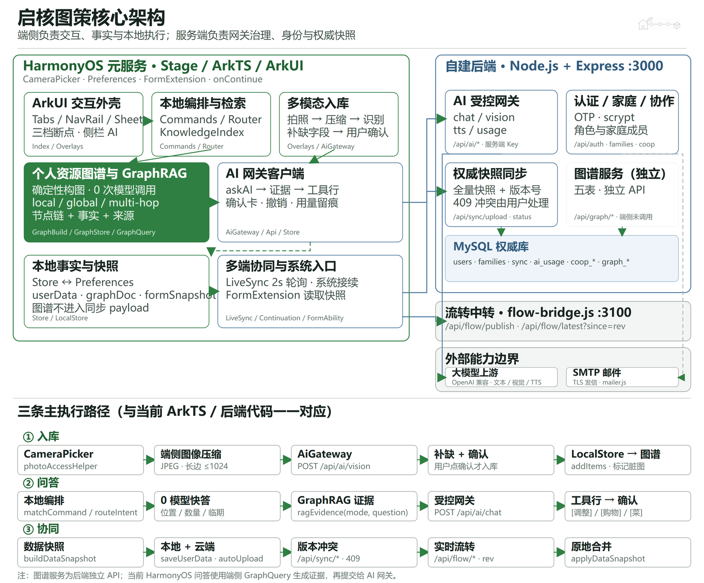

**图 4-1** 核心架构：HarmonyOS 端由 ArkUI 交互外壳、本地编排与检索、多模态入库、
GraphRAG、AI 网关客户端、本地快照，以及多端协同与系统入口组成；自建后端负责 AI 受控网关、
权威快照同步、身份与家庭协作、独立图谱 API，并以 MySQL 存储图谱五表；下方三条执行路径分别
对应拍照入库、可信问答与多端协同。

为避免把关键交互压进一张图，以下按代码职责继续展开七个模块。每张模块图保留真实入口、主要函数、数据边界和关键分支，便于逐项核对实现。

#### 4.1.2 ArkUI 交互与响应式外壳

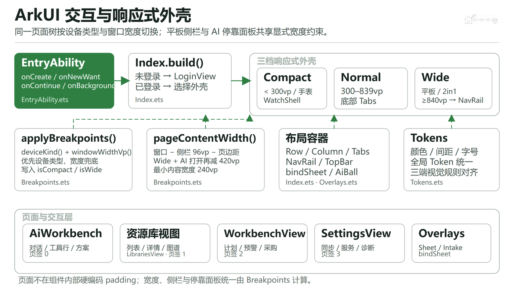

**图 4-2** ArkUI 交互外壳：EntryAbility 启动 Index，`applyBreakpoints` 按设备类型与窗口宽度写入 compact / wide；宽屏启用 NavRail，AI 面板打开时页面内容宽度同步扣除固定面板宽度。

#### 4.1.3 本地编排与零模型快答

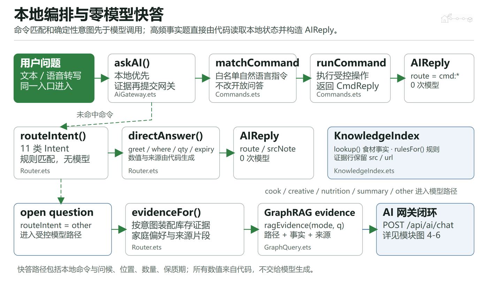

**图 4-3** 本地编排与快答：AiGateway 先匹配受控命令，再按 11 类 Intent 选择确定性快答；问候、位置、数量和保质期由代码读取本地状态，开放问题才进入 GraphRAG 与模型路径。

#### 4.1.4 多模态入库闭环

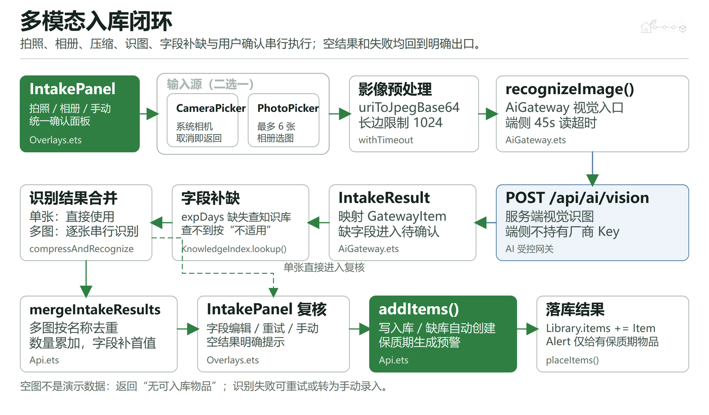

**图 4-4** 多模态入库：CameraPicker 或 PhotoPicker 选图后压缩为 JPEG，经 `/api/ai/vision` 识别并映射为 IntakeResult；多图串行识别后按名称合并，字段补齐、用户确认后才写入资源库。

#### 4.1.5 个人资源图谱与 GraphRAG

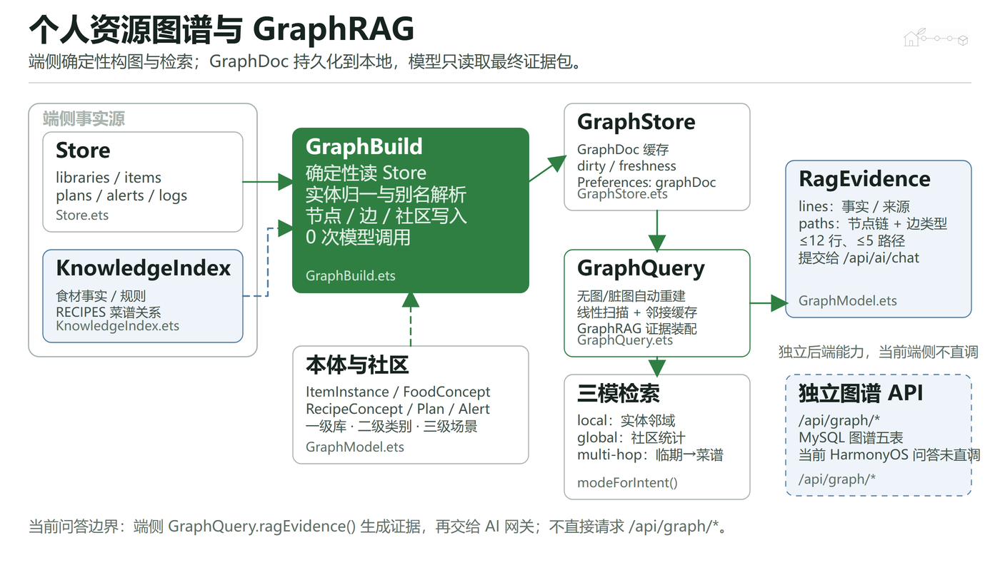

**图 4-5** 个人资源图谱与 GraphRAG：端侧 GraphBuild 从 Store 与知识库确定性构图，GraphStore 持久化 GraphDoc，GraphQuery 提供 local / global / multi-hop 证据包。当前问答不直接调用独立的后端 `/api/graph/*`。

#### 4.1.6 AI 受控网关与写操作确认

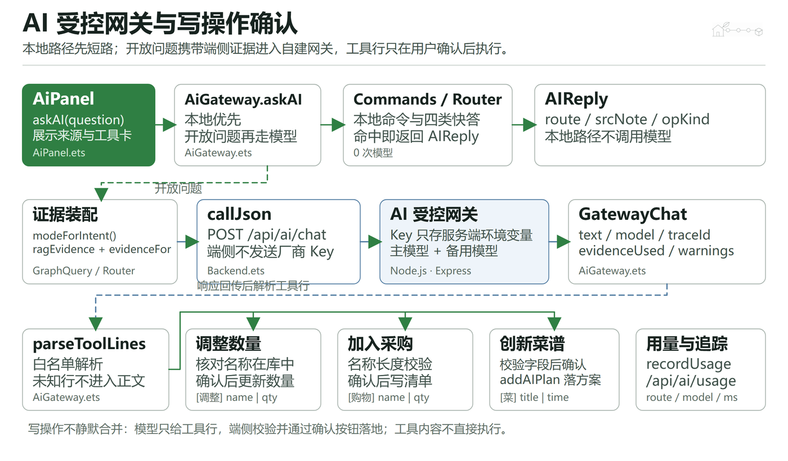

**图 4-6** AI 受控网关：本地命令与快答先短路；开放问题携带端侧证据请求自建 `/api/ai/chat`，厂商 Key 仅存服务端环境变量。返回的工具行先解析和校验，再由用户在端侧确认调整、采购或菜谱操作。

#### 4.1.7 本地快照与三通道同步

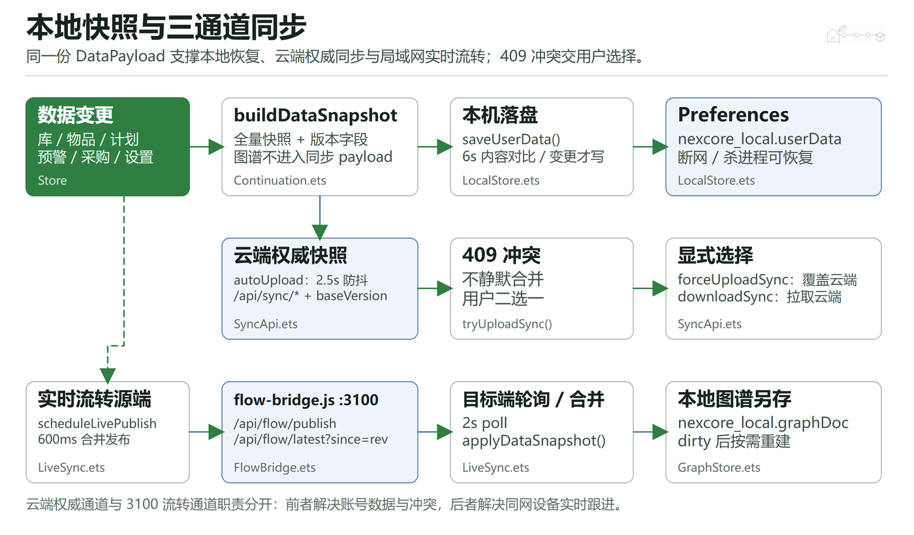

**图 4-7** 本地快照与三通道同步：同一份 DataSnapshot 用于 Preferences 恢复、云端权威快照和 flow-bridge 实时流转；云端 409 冲突交给用户显式选择，本地图谱使用独立 graphDoc 存储。

#### 4.1.8 系统入口与跨设备接续

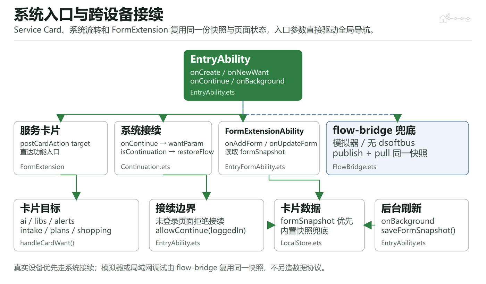

**图 4-8** 系统入口与跨设备接续：EntryAbility 处理服务卡片目标与系统接续，EntryFormAbility 从 formSnapshot 刷新服务卡片；模拟器或同网调试由 flow-bridge 复用同一快照协议。

架构要点：

1. **端侧零密钥**：所有模型调用经自建后端 `/api/ai/*`，端侧不持有任何厂商 Key。
2. **两条通道分工**：`/api/sync/*` 负责账号数据的权威存储与版本冲突，流转中转（3100）负责局域网内多端实时同步。
3. **证据与生成分离**：图谱与统计由代码计算，模型只做措辞与工具行，写操作回到端侧确认。

### 4.2 开发框架与工具

- **鸿蒙端**：ArkTS / ArkUI 声明式 UI，V2 状态管理（`@ObservedV2`/`@Trace`/`@Local`/`@Param`/`@Event`/`@Computed`），
  元服务（atomicService）形态，DevEco Studio 构建（hvigor），API 23
- **断点自适应**：三档布局（手机底部 Tab / 平板与 2in1 左侧通高导航 / 手表精简壳）
- **状态管理踩坑治理**：数据类必须 `@ObservedV2 + @Trace`（否则"数据改了界面不变"）；
  而要整块进同步 DTO 的类不能加观测（否则 `JSON.stringify` 会带内部前缀字段污染协议），改用"换实例触发重绘"
- **后端**：Node.js + Express + MySQL；启动时幂等建表与容错迁移；`pm2`/脚本一键启动

### 4.3 核心算法

#### 4.3.1 GraphRAG 证据装配算法

端侧构图（确定性、0 次模型调用）→ 后端存储 → 三模式装配：
local（实体邻域 + 邻居事实）、multi-hop（临期物品 → 概念 → 菜谱可行性排序）、global（社区统计摘要）；
输出带推理路径与来源的证据行，供模型引用与前端展示来源。

#### 4.3.2 菜谱可行性排序

对候选菜谱计算"缺料数最少 + 命中临期食材最多"的综合分（`score = 命中物品数 − 缺料数 × 0.5`），
把"先吃什么"从主观问题变成可解释排序。

#### 4.3.3 图片压缩与上传策略

按长边等比缩放至 ≤1024px + JPEG(q80) 编码，兼顾识别精度与传输/推理耗时；
缩放与编码均在端侧完成，服务端不承担图片处理。

#### 4.3.4 多端同步合并算法

快照 DTO（含版本号）+ 内容比对（每 6s 比对快照字符串，变了才落盘/上传）+ 版本过滤（`since=rev`）+ 按 id 原地合并；
收发两侧都用同一份 DTO，保证"本机恢复"与"换设备拉取"结果一致。

#### 4.3.5 与库类型无关的入库与保质期语义

入库链路不认库名，只认目标库 id：`addItems(results, libId)` 写进用户选定的库，库里一个都没有时用识别出的
`category` 建库；物品的 `expDays` 统一约定 **0 = 不适用**（衣物、工具、厨具、书籍、数码），
只有 `expDays > 0` 才会生成临期预警、计入"临期消耗率"、出现在服务卡片与首页焦点区。
旧口径错在两处默认值：6 处把 0 当成"没填"补齐成 7 天，7 处 `expDays <= 7` 的判断没带 `> 0`，
任何没有保质期的物品入库后都会立刻变成临期品。
图谱侧同步收敛：端侧 `GraphBuild.sceneOf()` 与后端 `graphBuild.js` 用同一张关键字表把库归到场景社区。

### 4.4 数据存储技术

- **端侧**：ArkData Preferences 持久化四类数据：登录会话、用户数据快照、主题偏好、AI 偏好与用量；
  AI 对话另存一份并做上限裁剪
- **服务端 MySQL**：`users` / `families` / `family_members` / `sync_snapshots` / `ops_logs` / `ai_usage` +
  图谱五表（节点/边/社区/摘要/版本）+ `coop_sessions` / `coop_members`
- **同步协议**：`/api/sync/status|upload|download`，版本号 + 409 冲突（可选 force 覆盖），后端只存"家庭数据块"不自解析
- **服务卡片**：卡片进程读不到内存状态，由端侧把统计快照写入 Preferences 供卡片读取

### 4.5 网络通信技术

- **端侧 NetworkKit http**：候选地址链 + 健康探测缓存（`/api/health` 回带部署形态与局域网 IP 列表）；
  手动指定地址优先并持久化
- **AI 网关**：所有模型调用经自建后端 `/api/ai/*`（文本 / 视觉 / TTS / 用量），端侧零密钥；
  上游适配 OpenAI 兼容协议，含超时、重试与降级策略
- **流转通道**：轻量中转服务（publish / latest(since rev) / clear），局域网内多端数据同步
- **邮件**：自实现最小 SMTP-over-TLS 客户端（EHLO → AUTH LOGIN → MAIL/RCPT → DATA），用于验证码发信

### 4.6 ArkTS / ArkUI 实现逻辑

- **状态管理**：数据类用 `@ObservedV2 + @Trace`，直接改字段即可重绘；**要整块进同步 DTO 的类（如工作台）不能加观测**，否则 `JSON.stringify` 会带内部前缀字段污染协议，这类对象改用"换实例触发重绘"（`cloneForRender()`）。
- **列表与详情**：库详情、识别结果卡片用 `ForEach` + 稳定 key；数量步进回写 store，再由 `store.touch()` 统一触发刷新。
- **浮层体系**：AI 助手与业务面板统一走 `bindSheet` 半模态；宽屏时 AI 助手改为右侧停靠面板。
- **异步与超时**：图片解码、网络请求、识别链路都带显式超时（读图 12s、识别 45s、网关预算 25s），任何一步不回调都会给用户明确失败原因，界面不会无限转圈。

### 4.7 UI/UX 技术

- **设计令牌系统**：颜色/圆角/间距/时长统一走 Token，品牌色取自官方徽标像素；支持亮/暗与色板切换（默认亮色）
- **动效**：柜门开合 3D、识别扫描线、Toast 与浮层过渡；克制使用，不做装饰性渐变铺底
- **交互细节**：键盘回车提交、可滚动登录页、消息区"回到顶部"、识别秒表与排队提示、空态引导、来源引用点击复制；
  新建库的图标行在手机上排不下十个图标（原来最右边那个被切掉半截），改成横向滚动
- **可读性**：数字统一等宽字形（tnum），层级只靠字重与色阶
- **启动体验**：启动窗口背景色与主题同色（`#F5F9FB`），避免"深色闪一下变白"

---

### 4.8 难点与解决方案

表：实测暴露的难点与解决方式

| 难点 | 现象 | 解决 |
|---|---|---|
| 相册授权 URI 解码卡死 | 既不 resolve 也不 reject，界面永远停在"识别中"，网关收不到请求 | 改用 `fileIo.openSync(uri)` 拿 fd 再 `createImageSource(fd)`，并加 12s 硬超时；实测读图 186ms 完成 |
| 上游限流导致"识别特别久" | 主模型 429 后旧逻辑退避 0.8s+1.6s 重试两次，并重传整张图 | 429/403 立即换模型，5xx/超时仅 400ms 重试一次；改后不相关图 0.5~4.3s 返回 |
| 软键盘遮挡提交按钮 | 登录、新建库、添加物品的按钮被键盘完全盖住，弹层还滚不动 | 登录页改可滚动；表单输入框支持回车即提交，与按钮共用同一实现 |
| 空牌桌崩溃 | 进入工作台闪退：`Cannot read property color of undefined` | 座位按"下标存在才绘制，否则画空位"处理，并补"上桌（用我的库）"入口 |
| 跨设备改了不刷新 | 数据看着换了、点击却不变化 | 接收端按 id 原地合并，避免整体替换导致界面持有旧实例 |
| 对话时间恒为"刚刚" | 写死的标签，跨天也显示"刚刚" | 消息带真实时间戳，标签由时间戳计算（今天/昨天/日期） |

## 五、成果展示

### 5.1 品牌与应用图标


**图 5-1** 启核图策品牌 Logo（绿/青/蓝取自官方徽标像素；"启核"= 唤醒家庭资源内核）


**图 5-2** 鸿蒙应用/元服务图标（同时作为启动页图标，配浅色底 `#F5F9FB`）

### 5.2 界面截图


**图 5-3** 拍照入库遇到"图中没有可入库的家庭物品"时的真实界面（实测该图为相册中一张网页截图，
AI 判定 0 项、用时 1.3s；界面给出"重新拍照 / 从相册选"明确出口，**不回退任何示例数据**）

### 5.3 负责人认证

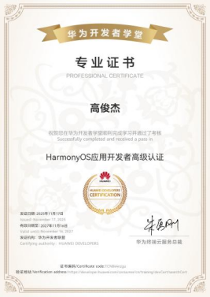

**图 5-4** 项目负责人**高俊杰**的 **HarmonyOS 应用开发者高级认证**（华为开发者学堂颁发）。
证书编号 TCVH60880，2025 年 11 月 14 日颁发，有效期至 2027 年 11 月 13 日；
可在华为开发者官网"证书验证"页按编号核验。证书原件随材料一并提交。

### 5.4 手机端截图


**图 5-7** 手机端工作台：协作池、手牌位与邀请码，用于家人拼菜与按归属扣减

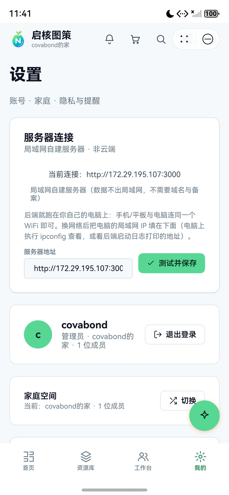

**图 5-8** 手机端"我的"：服务器连接标注为"局域网自建服务器"，当前地址在此可直接修改

### 5.5 平板端截图

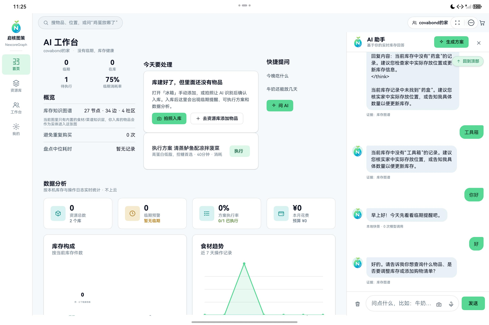

**图 5-9** 平板端首页：左侧通高导航栏 + 顶部搜索 + 多列内容区


**图 5-10** 平板端 AI 助手：宽屏下改为右侧停靠面板


**图 5-11** 平板端资源库：多库卡片，以及柜门、拍照、流转入口

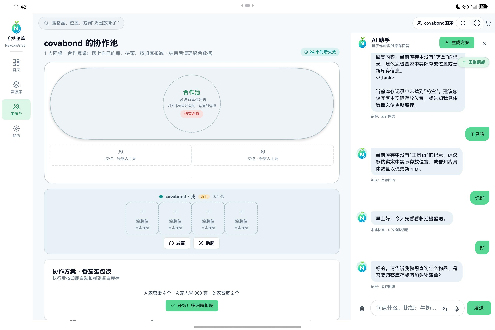

**图 5-12** 平板端工作台

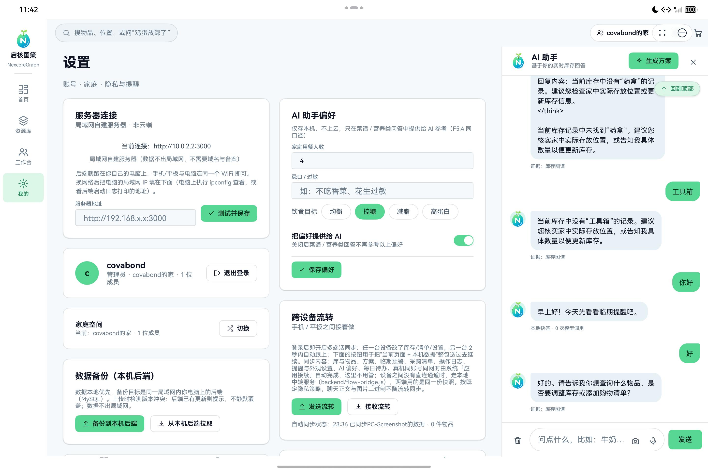

**图 5-13** 平板端"我的"：宽屏下左右分栏的设置页（服务器连接、账号与数据、AI 偏好、外观）

> 平板与手机不是同一套布局：平板用左侧通高导航 + 多列内容，手机用底部标签 + 单列。

### 5.6 跨设备联动效果图


**图 5-14** 同一账号下手机与平板的联动：两端各自独立布局（手机底部标签 + 单列；平板左侧通高导航 + 多列），任一端改动后另一端自动呈现。

### 5.7 运行日志

以下为真实运行日志片段（自建后端控制台输出）：

```
[nexcoregraph-backend] AI 网关: 已配置 Key (sk-Coul****zPU4) | model=agnes-2.0-flash alt=agnes-3.0-flash
  | vision=agnes-2.5-flash>agnes-3.0-flash>agnes-2.0-flash budget=25000ms maxTok=900
[nexcoregraph-backend] 验证码通道: 邮箱 covabond@163.com @ smtp.163.com（已配置授权码） | AUTH_SHOW_CODE=0
[nexcoregraph-backend] 部署形态: 局域网自建服务器（不经过公网，不需要域名与备案）
[ai-gateway] vision agnes-2.5-flash:2840ms:ok
[ai-vision] items=5 ms=2841 model=agnes-2.5-flash trail=agnes-2.5-flash:2840ms:ok
[intake] open fd=70 +63ms / getImageInfo 1440x2560 +110ms / createPixelMap +147ms
  / packToData 170KB +185ms / base64 226KB +186ms
[auth] 验证码邮件已发送: covabond@163.com
```

可读出三点：① 识图由单个模型在 2.8s 内完成（trail 显示未降级）；② 端侧读图流水线 186ms 走完；③ 部署形态与密钥脱敏在启动时即打印，便于复核。

### 5.8 关键交互演示

表：现场可演示的关键交互与预期表现

| 交互 | 演示动作 | 预期表现 |
|---|---|---|
| 拍照入库 | 拍一张冰箱照片 | 2~3s 内出现结构化物品卡片，只补缺即可入库 |
| 证据问答 | 问"今晚吃什么" | 回答下方给出证据来源小字，数字与库存一致 |
| 跨设备流转 | 手机建一个库 | 平板同账号 7 秒内自动出现该库 |
| 协作拼菜 | 创建协作池 → 摆上手牌 → 开饭 | 按归属扣减库存并留痕 |
| 数据归属 | 打开「我的 → 服务器连接」 | 明确标注"局域网自建服务器"，可改地址并连通测试 |

### 5.9 库类型不设限（本轮实测）

这三张图是同一台手机模拟器上的连续操作：建一个"厨具柜"库 → 在厨具柜里点拍照入库 → 选相册里的一张蔬菜照片 →
AI 识别出"胡萝卜 4 根 / 冷藏区 / 14 天" → 结果卡片上方出现「入库到」并默认选中厨具柜 → 确认入库。

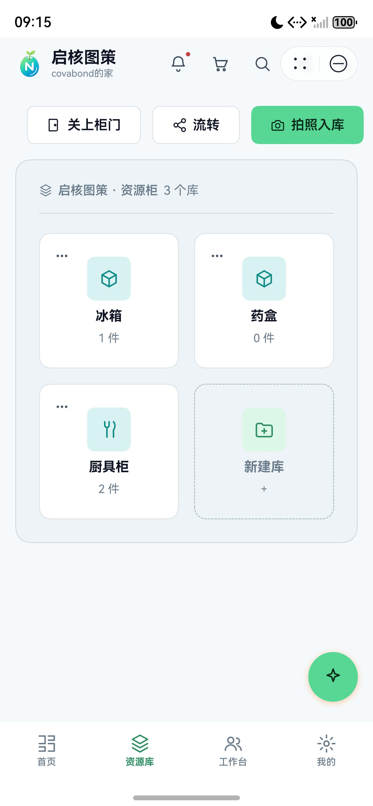

**图 5-15** 资源库：三个库都是自己建的，库名与图标随用户定（厨具柜用的是厨具图标）；后面还有「新建库」入口

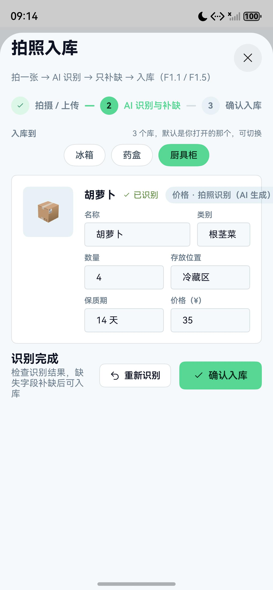

**图 5-16** 识别结果上方的「入库到」：冰箱 / 药盒 / 厨具柜都在列，默认选中你刚打开的那个库（这里是厨具柜），
识别结果本身是 AI 给的"胡萝卜 4 根 / 冷藏区 / 14 天 / ¥35.00"，字段可改

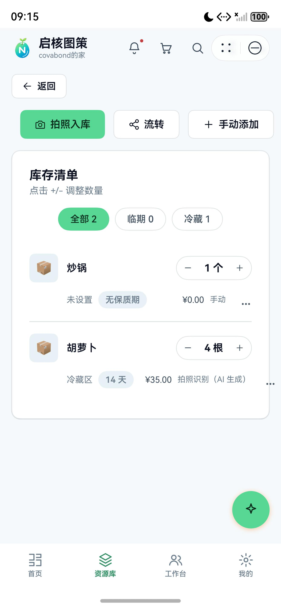

**图 5-17** 厨具柜里同时躺着两类物品：手动加的"炒锅"标的是**无保质期**（不产生临期提醒，不计入临期件数），
AI 拍的"胡萝卜"标的是 14 天；筛选行里也没有出现"冷藏/冷冻"这类只对冷链库有意义的按钮

### 5.10 自然语言指令层

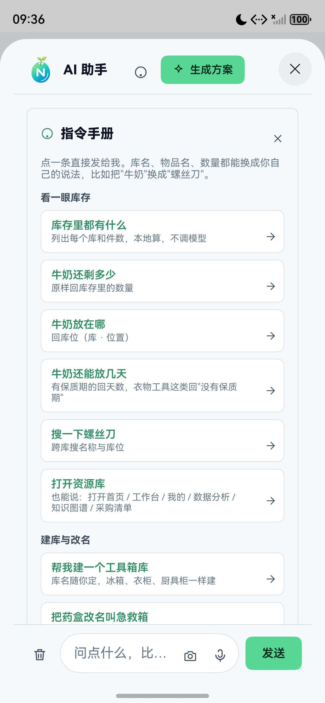

**图 5-18** 对话页右上角问号打开「指令手册」：五组共 22 条示例，每组下面是它管的事；点一条直接发出去


**图 5-19** 同一段对话里，"换回浅色主题"和"库存里都有什么"都由**本地指令**接住
（回复下方标注"本地指令 · 0 次模型调用"），库存清单是分库列出来的真实数字

## 六、历史说明

本作品**有既往版本**：它在团队自研的 Web 原型（web-demo）与同仓库的 Web / 微信小程序端基础上，重写为鸿蒙端原生应用并完成 AI 主导化改造；代码可验证，`common/Db.ets`、`common/Store.ets` 文件头注释写明"移植 web-demo/js/data.js""对应 web-demo app.js 的 S + DB"，同仓库并存 `web/NexcoreGraph_web` 与 `wxminiapp/NexcoreGraph_wxminiapp`。**相对基线的优化部分见第七章。**

### 6.1 项目状态

**当前状态**：可运行、可演示、可复现。鸿蒙端已在本机模拟器（Mate 80 Pro Max / MatePad Pro 11）
完成全流程实测，后端接口自测 40 项、密码安全自测 15 项、提交前自检 11 项均通过；
部署形态为局域网自建（可迁移至公网，见《上线部署清单.md》）。

尚未完成：上架华为应用市场（需 AGC 发布证书、备案与部分类目资质）、阿里云公网部署（可选）。

### 6.2 发表/获奖情况

项目负责人高俊杰持有 **HarmonyOS 应用开发者高级认证**（华为开发者学堂，证书编号 TCVH60880，
有效期至 2027-11-13，证书原件随材料提交，见图 5-4）。

论文、专利与软件著作权目前均未申报；竞赛获奖情况以实际申报及组委会公示为准。


---

## 七、迭代优化说明

### 7.1 双 UI 方案实现

同一套代码按断点自适应三档形态：

- **手机**：底部 Tab（首页 / 资源库 / 工作台 / 我的），单列卡片流
- **平板 / 2in1**：左侧通高导航栏（含品牌 Logo 与名称）+ 顶部搜索；首页三列（事实区 / 今天要处理 / 快捷提问），
  看板一行三卡；AI 助手改为右侧停靠面板（可收起）；登录页左右分栏（左侧放大徽标）
- **关键技术点**：内容区宽度必须显式计算（`pageContentWidth()`）：ArkUI 在 Scroll 子节点只认左内边距，
  所以平板端第一版做出来，左侧导航栏直接把右边的卡片压掉了一截，改成显式算宽才对。

### 7.2 性能优化

表：本轮性能优化前后对比

| 优化项 | 优化前 | 优化后 |
|---|---|---|
| 不相关图片识别 | 1.5~4.3s 且每次降级备用模型；历史均值 4.5s/9.5s，最大 21.3s，另有 6 条失败 | **0.5~4.3s，全部单模型，返回 0 项** |
| 相册照片端到端 | **卡死**（请求根本没发出） | 读图 186ms + 网关 995ms ≈ **1.2s** |
| 冰箱图识别 | 10.1s | **2.3~2.9s / 6~7 件** |
| 429 限流处理 | 同模型退避 0.8s+1.6s 重试 3 次并重传图片 | **88~236ms 内识别并换模型** |
| 多端同步 | 需手动"上传/下载" | 任一端改动 **7 秒内**自动呈现 |
| 首启数据 | 8 个预置库 + 5 件样例物品 | 空库 + 首启引导（数据 100% 来自用户与后端） |

### 7.3 其他优化（含实测暴露的缺陷修复）

表：实测暴露的缺陷与修复清单

| # | 缺陷/优化 | 后果 | 修复 |
|---|---|---|---|
| 1 | 空牌桌点"工作台"崩溃（`Cannot read property color of undefined`） | 直接闪退 | 下标存在才画座位；补"上桌"入口 |
| 2 | 软键盘挡住"登录"按钮 | 无法登录 | 登录页改可滚动 |
| 3 | 软键盘挡住"创建库/添加物品"按钮，弹层还滚不动 | 无法建库、无法录入 | 输入框回车即提交（与按钮共用同一实现） |
| 4 | 工作台内部改动界面不重绘 | 看似卡死 | `cloneForRender()` + 状态刷新 |
| 5 | "undefined 位成员" | 字段命名不一致 | 兼容两种字段名 |
| 6 | 相册授权 URI 解码卡死 | 永远停在"识别中" | fd 读取 + 12s 硬超时 + 分段日志 |
| 7 | 协作池未创建就显示牌桌/邀请码 | 语义错误、误导 | 改为"创建或加入后才显示"，池子落后端并校验有效性 |
| 8 | 对话时间写死"刚刚"、AI 思考过程外泄 | 时间永远不对 / 体验差 | 时间戳计算标签 + 提示词约束与兜底裁剪 |
| 9 | 启动页深色底与亮色主题割裂 | 每次启动"闪一下" | 启动窗口背景色改为与主题同色 |
| 10 | 首页图谱数字像假数据 | 空库也显示"19 节点" | 空库时注明"只有内置知识层"，且不再显示"0 社区" |

### 7.4 与基线项目的关系（说明）

本项目**不是从零起步**：它在团队自研的 **Web 原型（web-demo）** 与同仓库的 Web / 微信小程序端基础上，
重写为**鸿蒙端原生应用**并完成 AI 主导化改造。代码中可验证：

- `common/Db.ets`、`common/Store.ets` 文件头注释明确写着"移植 web-demo/js/data.js""对应 web-demo app.js 的 S + DB"
- 同仓库并存 `web/NexcoreGraph_web`（含本地模拟后端 `mockapi.js`）与 `wxminiapp/NexcoreGraph_wxminiapp`
- 后端接口契约与 Web 端模拟层对齐（同一套 REST 语义）

**本次相对基线的优化**主要在三方面：

1. **鸿蒙原生重写**：从浏览器 Web 原型迁移到 ArkTS/ArkUI 原生，落地相机、相册、Preferences、服务卡片、元服务形态与多端自适应布局
2. **AI 主导化**：新增真实视觉识别入库、GraphRAG 证据装配、AI 用量看板与工具协议确认流；把 AI 从"聊天入口"提到主链路
3. **真实数据与工程化收口**：删除全部预置数据、改为真实验证码/密码登录、后端作为数据权威、多端实时同步，
   并补上自检脚本、测试报告、部署清单与安全加固（见 7.3）

---

## 八、落地规划

### 8.1 上架与推广计划

表：上架与推广的四阶段安排

| 阶段 | 目标 | 关键动作 |
|---|---|---|
| 内测（当前） | 团队与身边家庭跑通闭环 | 局域网自建部署，手机 + 平板双端实测 |
| 公网可用 | 非同网用户也能用 | 迁移云服务器（同一套代码改地址即可），补 HTTPS 与接口鉴权 |
| 应用市场上架 | 用户可搜索安装 | AGC 建元服务、发布证书、元服务备案与类目资质 |
| 校园推广 | 首批种子用户 | 高校社团与宿舍场景：合租拼菜、寝室共用库存 |

### 8.2 用户增长思路

- **家庭内裂变**：协作池邀请码天然带传播，一位用户通常带入 2~3 位协同用户。
- **内容触点**：把"临期菜谱"做成可分享卡片（与服务卡片同款视觉），分享时自带邀请入口。
- **场景化拉新**：开学季、搬家季推"冰箱清点"单一功能，降低首次使用门槛。
- **留存抓手**：库存与临期两张服务卡片常驻桌面，形成每日被动曝光。

### 8.3 商业闭环

- **免费层**：局域网自建 + 单家庭单账号，核心功能全部免费（数据在用户自己电脑上，平台侧近乎零成本）。
- **订阅层**：面向不愿自建电脑的家庭提供云托管，按家庭/年订阅。
- **增值层**：菜谱与营养知识库扩展、家庭预算与浪费报告；与本地生鲜、社区团购做缺料清单的转化合作。
- **成本控制**：模型调用是主要变动成本，已通过模型链降级、提示词收敛与本地快答压到最低；用量看板可实时查看每路由调用数与平均耗时。

### 8.4 运营机制

- **家庭管理员**负责邀请与管理成员，操作日志（ops_logs）留痕，冲突改动可回溯。
- **AI 用量看板**对内作为成本闸门，对外展示 AI 省下的事（临期消耗率、避免重复购买次数、盘点中位耗时）。
- **反馈闭环**：识别错误可直接在补缺表单里改，改动即数据，作为下一轮提示词与知识库的迭代输入。

### 8.5 后续迭代方向

1. 补齐受限能力：申请推送与位置地图凭据，或评估切换 App 形态以放开传感器与端侧模型；
2. 端侧能力增强：待元服务支持后接入端侧人脸/文字检测做入库预处理，进一步降延迟与成本；
3. 图谱深化：把社区摘要用于"家庭消费画像"，支撑预算与浪费报告；
4. 跨端扩展：接入更多 HarmonyOS 设备形态（穿戴提醒、智慧屏看板）。

## 附录 A：评审标准对照（赛道：智慧生活）


### A.1 评审六维度：我们的对应证据

表：评审六维度与对应证据位置

| 维度（权重） | 我们的对应证据 | 证据位置 |
|---|---|---|
| **技术实现（25%）** | 鸿蒙原生 ArkTS/ArkUI（元服务，API 23）；相机/相册/文件/图片/Preferences/网络/服务卡片等原生能力；多端同步（快照 DTO + rev 过滤 + 按 id 原地合并）；工程化：幂等迁移、发布前 11 项自检、接口自测 40 项、崩溃定位到 .ets 行号；安全：模型密钥零下发、scrypt 加盐慢哈希、防爆破、防账号探测 | 四章、三章 3.2、七章 7.2 |
| **AI 能力融合（20%）** | 视觉识别入库（真实网关）、GraphRAG 证据装配（local/多跳/社区摘要三模式 + 可追溯路径）、Agent 式工具协议（写操作先预览再确认）、意图路由本地直答（0 次模型调用）、多端 AI 对话同步；AI 在主链路上（拍照即入库、方案即排序） | 二章 2.1、三章 3.5 |
| **创新设计（20%）** | AI 应用：把"自己的库存"做成图谱再生成；场景：家庭临期治理 + 协作拼菜；产品：AI 主导，用户不填表；技术：429 立刻换模型 + 25s 硬预算、四端同账号流转、局域网自建免备案；体验：只补缺、识别秒表、回车即提交、回到顶部；商业模式：数据留在用户局域网（隐私即卖点） | 二章 2.1 / 2.2 |
| **场景落地与价值（15%）** | 真实问题：重复购买与临期浪费；使用对象：家庭（多成员/多设备）；场景闭环：拍摄→识别→入库→临期提醒→方案→核销；可推广：局域网自建零成本起步、同一套代码可迁公网；价值量化：临期消耗率、避免重复购买次数、盘点中位耗时 | 一章、七章 7.2 |
| **产品体验与运营思维（10%）** | 完整用户路径（登录→入库→看板→问答→流转→备份）；新增用户首启引导（空库明确下一步）；服务卡片做桌面触点；AI 用量看板支撑成本可控；可迭代：模型链与提示词可调、算法参数写在存储串里便于升级 | 一章 1.3、三章 3.5.3 |
| **完整性与材料质量（10%）** | 可稳定演示（本机双端实测通过）；材料齐备：作品介绍文档 + 功能测试报告 + 部署清单 + 鸿蒙端验收文档 + AI 主导与 GraphRAG 方案 + 品牌规范；关键能力均有实测数字或截图/日志证据 | 五章、附录 |

### A.2 技术能力清单核对

表：赛道技术能力清单逐项核对

| 清单项 | 状态 | 说明 |
|---|---|---|
| HarmonyOS 6 / API 20+、ArkTS、ArkUI、元服务、原子化服务 | ✅ 已做 | 元服务（atomicService）形态，API 23；声明式 UI + V2 状态管理 |
| 自适应布局 | ✅ 已做 | 手机 / 平板 / 2in1 三档断点，平板为左侧通高导航 + 内容显式计算宽度 |
| 账号 | ✅ 已做 | 自建账号体系（手机号或邮箱 + 验证码，可设密码），每个账号自动建家庭 |
| 推送 | ○ 未做 | 需 AGC 凭据与真机推送环境（`push_subscription` 表已就绪） |
| 支付 | ○ 未做 | 需商户资质，本项目无付费环节，故不引入 |
| 位置 / 地图 | ○ 未做 | Map Kit 需 AGC 地图 Key；当前以"库位/存放位置"文本字段替代 |
| 相机 | ✅ 已做 | CameraPicker 真实拍照 → 压缩 → 识图入库 |
| 录音 | ✅ 已做 | AI 助手语音输入（ASR 模块） |
| 相册 | ✅ 已做 | 相册多选（≤6 张）+ 连拍合并去重 |
| 传感器 | ○ 未做 | 已实测尝试：环境光传感器在**元服务形态下编译期即被拦截**（见 A.3 的报错证据），故不在本形态内实现 |
| 生物识别 | ○ 未做 | 需真机指纹/人脸，模拟器不可验证；且需 `ohos.permission.ACCESS_BIOMETRIC` 授权 |
| 通讯录 | ○ 未做 | 需 `ohos.permission.READ_CONTACTS` 授权（属需申请权限项，按本次范围未做） |
| 数据库 | △ 部分实现 | 服务端 MySQL 完整使用（含图谱五表）；端侧 `relationalStore` 经查**无元服务可用标记**，本形态未采用，端侧持久化用 Preferences |
| 跨设备协同 / 应用接续 / 服务流转 | △ 部分实现 | 同账号多端实时同步 + 显式流转已实现并实测；系统级「应用接续」需两台 NEXT 真机（`Continuation` 已接入） |
| 硬件互助（跨设备相机等） | ○ 未做 | 需真机 |
| 跨端数据同步 | ✅ 已做 | 手机→平板 7 秒内自动呈现（实测） |
| 端侧模型 | ○ 未做 | 已核查 `@hms.ai.ocr.textRecognition` 的元服务可用标记为 0，本形态未采用；云端多模态识别已完整落地 |
| 云端大模型 | ✅ 已做 | 文本 + 视觉经自建网关调用，模型链自动降级 |
| RAG / GraphRAG | ✅ 已做 | 图谱三层 + 三模式证据装配 + 来源标注 |
| AI 工作流 | ✅ 已做 | 拍摄→识别→补缺→入库→提醒→方案→核销的闭环 |
| Agent | △ 部分实现 | 工具协议 + 待确认队列 + 可撤销（未接开放 Agent 框架） |
| 多模态识别 | ✅ 已做 | 图像识别入库（含空结果与失败路径） |
| 智能推荐与问答 | ✅ 已做 | 菜谱可行性排序、临期优先方案、证据约束问答 |
| MCP | △ 部分实现 | 已实现"资源 + 工具"语义的工具行协议（`[调整]/[购物]/[菜]`）；标准 MCP Server 作为下一批 |
| 接口联调 | ✅ 已做 | 40 项接口自测（含 409 冲突、400/404 边界） |
| 日志监控 | ✅ 已做 | 网关分段耗时 trail、识别分段埋点、崩溃日志定位、AI 用量看板 |
| 性能优化 | ✅ 已做 | 见 7.2 量化对比表 |
| 安全合规 | ✅ 已做 | 密钥零下发、scrypt 加盐慢哈希、防爆破、防账号探测、隐私分级、私有仓库 |
| AI 辅助开发工具 | ✅ 已做 | 提交前自检脚本、Markdown→Word 生成器、去 AI 味处理脚本、多模态识图核对证书与界面 |

### A.3 元服务形态的能力边界

本项目形态是**元服务（atomicService）**。元服务对部分系统与 AI 能力有编译期白名单限制，本项目已实测确认：

表：元服务形态的能力边界与取舍

| 能力 | 尝试与结果 |
|---|---|
| 环境光传感器（自动深浅色主题） | 代码已写（读照度自动切主题，零权限），**构建被拦**：`ERROR 11706010 can't support atomicservice application`，涉及 `AMBIENT_LIGHT`、`intensity`、`off` 三处调用；已完整回退，不留编译不过的工程 |
| 端侧关系型数据库 `relationalStore` | 查 SDK 声明文件，元服务可用标记数为 **0**，据此判断本形态不可用，未采用 |
| 端侧 OCR `@hms.ai.ocr.textRecognition` | 同上，元服务可用标记数为 **0**，未采用 |
| 加速度计等其余传感器 | Sensor Kit 确有 41 处元服务可用标记，但与"零权限"约束冲突（加速度计需 `ohos.permission.ACCELEROMETER`），按本次范围未做 |

由此形成的三条可选路径，供团队决策：

1. **保持元服务**：只做不依赖受限设备 API 的加分项（后端与工程类，如 MCP 兼容工具接口、日志监控、性能与安全加固）；已落地的能力展示。
2. **改为 App（非元服务）形态**：上述设备与端侧 AI 能力大多可用，但失去元服务"免安装、即点即用"的特点。
3. **接受申请权限**：如通讯录（`READ_CONTACTS`）、生物识别（`ACCESS_BIOMETRIC`）、加速度计（`ACCELEROMETER`），需在 `module.json5` 声明并在运行时向用户请求。

### A.4 每项加分点的证据位置

下表把每个加分点与**文档位置、实测数据、图号**一一对应，便于逐项核对：

表：每个加分点的文档位置与可核对证据

| 加分点 | 文档位置 | 现场可核对的证据 | 图 |
|---|---|---|---|
| HarmonyOS 原生能力（元服务 + 相机 + 相册 + 文件 + 图片 + Preferences + 网络 + 服务卡片） | 4.1 / 4.2 | 元服务形态构建通过；拍照入库端到端读图 186ms | 图 5-3、5-11 |
| 自适应布局（手机 / 平板 / 2in1 三档） | 4.1 / 7.1 | 平板为左侧通高导航 + `pageContentWidth()` 显式计算宽度 | 待补（平板） |
| 分布式协同：跨端数据同步 | 1.5.8 · 4.3.4 | 手机新建"药盒"库 → 平板 7 秒内自动出现"2 个库" | 待补（同框） |
| AI 能力融合：多模态识别入库 | 2.3.1 | 冰箱图 6~7 件 / 2.3~2.9s；不相关图 0 项 / 0.5~4.3s | 图 5-3 |
| AI 能力融合：GraphRAG 证据装配 + RAG | 2.3.3 · 4.3.1 | 证据行 `冰箱·冷藏区｜鸡蛋 6个｜约20天后到期｜¥12.5` 与回答数字一致 | 图 5-10 |
| 库类型不设限：入库目标库可选 + 无保质期物品不进临期 | 5.9 / 1.5.1 · 1.5.2 · 1.5.5 / 4.3.5 | 代码：`addItems(results, libId)` / `parseExpDays()` / 端侧与后端同口径的 `sceneOf()`；实测：厨具柜里 2 件物品、临期 0，AI 识别"胡萝卜 4 根 / 14 天" | 图 5-15~5-17 |
| 自然语言指令层：全量操作一句话完成，0 次模型调用 | 2.3.6 · 1.5.4 · 5.10 | 命令表 22 条 + 启动自检"手册自检 22/22 可命中"；实测建库、加物、改数量、跨库移动（带确认卡与撤销）、换主题 | 图 5-18、5-19 |
| AI 工作流（拍→识别→入库→提醒→方案→核销） | 1.5.1 · 1.5.3 | 首页"今天要处理"队列 + 待确认写操作 | 图 5-7 |
| Agent 式工具协议（写操作先预览后确认、可撤销） | 2.3.4 | `[调整]/[购物]/[菜]` 三类工具行 + 待确认队列 | 图 5-8 |
| 智能推荐与问答（菜谱可行性排序、临期优先） | 4.3.2 | `score = 命中物品数 − 缺料数 × 0.5` 排序规则 | — |
| 性能优化（429 立即换模型 + 25s 硬预算 + 压缩策略） | 7.2 | 改造前 21.3s/含失败 → 改造后 0.5~4.3s 单模型 | — |
| 安全合规（密钥零下发 + scrypt 加盐慢哈希 + 防爆破 + 防账号探测） | 4.5 · 3.5.6 | 密码自测 15 项全过；连错 5 次锁 15 分钟 | — |
| 工程与工具（接口联调 + 日志监控 + AI 辅助开发） | 2.4.1 · 4.2 | 接口自测 40 项、提交前自检 11 项、网关 trail 分段耗时 | — |
| 资质与材料完整性 | 五章 / 6.2 | 负责人鸿蒙应用开发者认证；作品文档 + 功能测试报告 + 部署清单 | 图 5-4 |

**尚缺截图的加分点及原因**（列出并说明）：

- **平板端布局 / 双端同步同框**：平板端左侧导航栏的标签点击在本机模拟器上反复被吞（同一坐标连续 3 次未命中），未取到有效帧；机制已实测通过（7 秒同步），只是缺一张"同框"画面。
- **工作台协作牌桌 / 我的（服务器连接）**：手机端右下角两个标签位与 AI 悬浮球区域重叠，自动点击难以命中，已改用带页面签名校验的抓图脚本（`tools/capture_shots.ps1`，命中特征文字才落图）仍两次未命中，故未计入。
- **服务卡片**：需在桌面手动添加卡片，命令行无法完成。


### A.5 现场演示顺序

1. **AI 主链路**：现场拍一张冰箱照 → 6 项物品 2~3 秒识别入库（展示速度和结构化产出）
2. **GraphRAG**：对同一批库存提"今晚吃什么" → 展示回答下方的证据路径与来源
3. **多端流转**：手机建库 → 平板同账号自动出现（现场计时）
4. **语音 + 相册**：语音问一句、相册连拍合并入库
5. **隐私卖点**：展示"我的 → 服务器连接"的"局域网自建服务器 · 非云端"标注
6. **工程化**：现场跑一次提交前自检（11 项）与接口自测（40 项）
7. **资质**：出示负责人的鸿蒙应用开发者认证

---

## 附录 B：项目信息

表：项目基本信息

| 项 | 内容 |
|---|---|
| 项目名称 | 启核图策（NexcoreGraph） |
| 参赛赛事 | 2026第九届传智杯全国大学生数智创新与 AI 应用大赛 |
| 解决方案/赛道 | HarmonyOSCodelabs挑战赛 |
| 团队名称 | 天枢序列 |
| 团队编号 | 38376 |
| 所属院校 / 组别 | 广西师范大学 / B组 |
| 项目负责人 | 高俊杰（鸿蒙端负责人，持 HarmonyOS 应用开发者高级认证，见图 5-4） |
| 队员 | 陈庚飞、罗渝川（Codelabs 教程与截图、知识库检索测试、价值指标算法与测试用例、演示视频剪辑） |
| 开发环境 | DevEco Studio（hvigor）、Node.js 18+、MySQL 8 |
| 目标平台 | HarmonyOS NEXT（元服务 atomicService，API 23） |
| 源码形态 | 私有仓库 `NexcoreGraph`（monorepo：鸿蒙端 + 后端 + Web/小程序端 + 文档） |
| 主要交付物 | 源码工程、Release HAP、Codelabs 教程、演示视频（3~5 分钟）、作品介绍文档 |
| 文档索引 | `docs/功能测试报告.md`、`docs/上线部署清单.md`、`docs/启核图策-鸿蒙端专项整改与验收文档.md`、`docs/启核图策-AI主导与GraphRAG补充方案.md`、`docs/启核图策-NexcoreGraph-品牌规范.md` |
