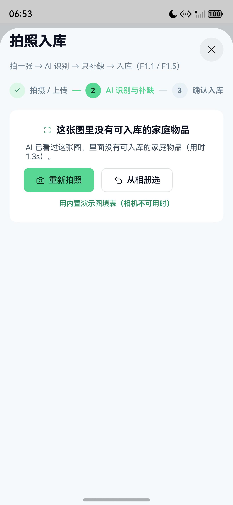
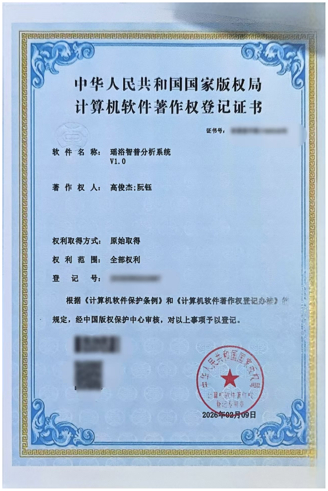
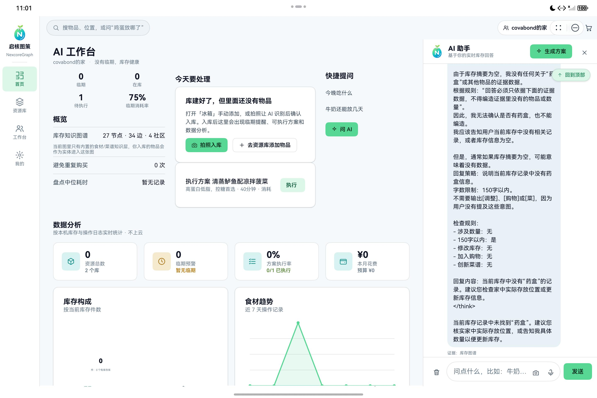

# 作品介绍文档

**团队名称**：天枢序列（负责人：高俊杰；队员：罗渝川）
**解决方案**：HarmonyOS CodeLabs 挑战赛
**版本号**：V1.0.0
**编制日期**：2026 年 10 月 15 日
**技术栈**：HarmonyOS + ArkTS + ArkUI + Node.js + Express + MySQL + GraphRAG

> 说明：本文性能数字与功能结论均来自本机实测（鸿蒙模拟器 Mate 80 Pro Max / MatePad Pro 11 + 自建后端），
> 可逐条追溯至仓库内《功能测试报告.md》；第 6 章"发表/获奖情况"因仓库内无相关记录，留待团队如实填写。

---

## 一、项目详情及使用方式

### 1.1 项目简介

**启核图策（NexcoreGraph）** 是一个 **AI 主导的家庭资源智能管理系统**，面向"HarmonyOS CodeLabs 挑战赛"。

它要解决的现实问题是：家里的东西**记不住、找不到、用不掉**：重复购买、食物过期、临期浪费。
与常见的"库存记账 App"不同，本项目的核心不是让用户填表，而是**让 AI 承担识别与决策**：
用户只需拍一张照片、问一句话，AI 负责识别入库、补全保质期/存放位置/价格、排出优先消耗方案，
并让每条结论都能追溯到"证据路径"（详见 2.1 亮点二与 4.2）。

系统由四部分组成：

| 部分 | 技术形态 | 职责 |
|---|---|---|
| 鸿蒙端 App | ArkTS / ArkUI 原生（元服务 atomicService，API 23） | 主客户端；手机 / 平板 / 2in1 三档自适应 |
| 自建后端 | Node.js + Express + MySQL | 账号、家庭、数据快照、AI 网关、图谱存储、用量统计 |
| AI 网关 | 服务端代理调用大模型（文本 + 视觉） | 端侧不持有任何模型密钥 |
| 流转中转 | Node.js 轻量服务（3100） | 多设备数据同步通道 |

**部署形态为局域网自建服务器**：后端运行在用户自己的电脑上，手机/平板同一 WiFi 直连，
数据不出局域网，无需域名与 ICP/App 备案（上架华为应用市场时才需要，见仓库《上线部署清单.md》）。

### 1.2 核心功能模块

#### (1) 拍照入库模块

- 入口：系统相机拍照（Camera Kit / CameraPicker）或相册多选（photoAccessHelper，一次最多 6 张）
- 端侧处理：以 fd 读取相册授权 URI → 解码 → 长边缩放至 ≤1024px → 压 JPEG(q80) → Base64 上传
- AI 产出：结构化物品数组（名称/类别/数量/单位/存放位置/保质期/价格）
- 用户动作：只补缺字段 + 确认入库；连拍自动按名称合并去重并累加数量
- 空结果与失败都**明确告知**（例如"这张图里没有可入库的家庭物品（用时 1.3s）"），**不回退示例数据**

#### (2) 资源库与物品管理模块

- 多库管理：冰箱 / 药盒 / 衣柜 / 工具箱…任意自建（名称、图标、主色调）
- 柜门开合 3D 交互（开门后门板淡出，避免遮挡柜内物品）
- 物品增删改查、数量步进、编号自动生成、搜索（名称/位置/口语化提问）
- 首启空态引导（"库建好了，但里面还没有物品" → 拍照入库 / 去资源库添加物品）

#### (3) AI 工作台（首页）模块

- 焦点区"今天要处理"：临期优先队列 + 待确认的 AI 写操作（改数量/加购/执行方案），确认后才生效
- 概览区：临期件数、在库件数、待执行方案、临期消耗率、库存知识图谱规模、避免重复购买次数、盘点中位耗时
- 快捷提问入口（"今晚吃什么""牛奶还能放几天"）

#### (4) AI 助手（对话与工具协议）模块

- 意图路由：问候/位置/数量/临期 → 本地直答 0 次模型调用；菜谱/营养/采购 → 走网关
- 回答带**来源与证据**小字（如"证据：冰箱·冷藏区｜鸡蛋 6个｜约20天后到期"），可点击复制知识库来源链接
- 工具协议：模型输出 `[调整]名称|数量`、`[购物]名称|数量`、`[菜]菜名|耗时|亮点|用料`，
  一律先进入"待确认"由用户点确认后才写数据
- 交互细节：打开即滚到最新消息、"回到顶部"悬浮按钮（离开顶部才出现）、消息时间由时间戳计算（今天/昨天/日期）

#### (5) 库存知识图谱模块（GraphRAG）

- 三层图谱：实体（库/物品/概念/菜谱/预警/采购/成员）、关系（contains / instantiates / usedBy / belongsTo / inCategory…）、社区（库级/类别级/场景级）
- 可视化：节点-边-社区布局，点节点查看证据路径；支持"仅临期"过滤
- 空库时明确说明"当前图里只有内置的食材/菜谱知识层，你入库的物品会作为实体进入这张图"

#### (6) 数据分析看板模块

- 库存结构、临期分布、消耗趋势（7/30 天）、AI 用量看板（调用数、平均耗时、快答占比、按路由分布）
- 所有统计口径由代码计算，模型只负责措辞

#### (7) 家庭协作牌桌模块

- **必须先"创建协作池"或"加入协作池"才显示牌桌**（未入池时只给两个入口 + 说明）
- 后端生成 6 位邀请码（去掉易混字符，默认 24 小时有效），池子落库（`coop_sessions` / `coop_members`）
- 各方把手上的资源库摆上桌当"手牌" → 拼菜 → "开饭"按归属扣减库存（文案取自真实扣减结果）→ 结束即清理聚合数据

#### (8) 多端自由流转与实时同步模块

- 登录即开启：任一端改动 → 2 秒轮询拉到新版本 → **按 id 原地合并**（不打断当前页面）
- 同步范围：库与物品、方案、预警、采购清单、每日待办、AI 对话、协作牌桌整棵树、设置与外观、操作日志
- 隐私分级：聊天正文与图片二进制**不随流转同步**；图谱数据默认不进同步 payload
- 显式流转：把"当前页面 + 本机数据"整包送到另一台设备接着做

#### (9) 服务卡片模块

- 4 张卡片（功能卡 / 库存卡 / 资源库卡 / 临期卡），含大尺寸；定时刷新 + 入库即刷新快照
- 卡片进程读不到内存状态，故由端侧把快照写入 Preferences 供卡片读取

#### (10) 账号与数据模块

- 登录：手机号或邮箱 + 随机 6 位验证码（5 分钟有效、60 秒防重发、最多试错 5 次、错 5 次锁 15 分钟）
- 邮箱账号验证码通过自实现 SMTP-over-TLS 真实发信（可配置发信账号）
- 密码登录（可选）：scrypt 加盐慢哈希存储，设/改密码必须先过验证码
- 数据归属：本机落盘（快照）+ 后端权威存储；"我的 → 服务器连接"可改后端地址并连通测试；"数据备份（本机后端）"可手动上传/拉取并提示版本冲突

### 1.3 使用方式

**第一步｜在电脑上起服务（一条命令）**

```powershell
powershell -ExecutionPolicy Bypass -File tools/start-lan.ps1
```

脚本启动后端（3000）与流转中转（3100），并打印手机该填的局域网地址，同时把虚拟网卡标注为"手机连不上，别填这个"。

**第二步｜登录**

输入手机号或邮箱 → 获取验证码 → 登录（可在验证码验证身份后设置登录密码）。
换网络后在 App 内「我的 → 服务器连接」直接改地址并测试，无需重新打包。

**第三步｜日常使用（四个 AI 主导的动作）**

| 用户动作 | AI 承担的工作 | 用户只需 |
|---|---|---|
| 拍一张冰箱/货架照片 | 识别物品、估数量、判类别、给位置、推保质期与价格 | 补缺 + 确认入库 |
| 问"今晚吃什么" | 结合库存图谱与临期情况，按"缺料少 + 命中临期多"排序给方案 | 点执行 |
| 说"鸡蛋只剩 5 个" | 解析意图、生成待确认写操作 | 点确认 |
| 打开首页 | 汇总临期/待执行/图谱规模/避免重复购买 | 直接看结论 |

**第四步｜多端一起用**

手机与平板登录同一账号后，任一端改动的数据会在数秒内自动出现在另一端；也可用「流转」按钮整包接力。

---

## 二、项目亮点

### 2.1 技术创新点

#### (1) 把"用户自己的库存"做成知识图谱并用于生成（GraphRAG）

不是把资料塞进 prompt，而是完整实现了一条图谱链路：

1. **端侧确定性构图**（0 次模型调用，作为工程红线）：库、物品、类别概念、场景、菜谱、预警、采购、日志 → 实体与关系
2. **后端五表存储**：节点 / 边 / 社区 / 社区摘要 / 版本，按家庭隔离
3. **三种证据装配模式**：实体邻域（local）、多跳（multi-hop）、社区摘要（global）
4. **可追溯与可回放**：每条证据带推理路径与来源；回答中出现证据数字即记录为"已引用"

实测：仅一件"鸡蛋 6 个、20 天后到期"的物品即可产出
`冰箱·冷藏区｜鸡蛋 6个｜约20天后到期｜¥12.5` 的证据行，模型回答"冰箱里还有 6 个鸡蛋"与证据严格一致。

#### (2) AI 失败可解释、绝不回退假数据

识图失败/空结果只报真实原因，界面给出明确出口（重新拍照 / 从相册选），
并彻底移除了历史版本中的示例数据（8 个预置数据函数、固定演示码、演示兜底回复、写死的对家文案等）。
数据只来自两处：① 用户输入/拍照 ② 后端返回。

#### (3) 真实 AI 链路的"速度治理"（针对上游限流）

- **模型链降级**：视觉识别按 `2.5-flash → 3.0-flash → 2.0-flash` 顺序自动切换
- **429 立刻换模型**（不空等重试）：实测易限流型号在第 2 次起 88–236ms 收到 429 即切走，整体 0.6–2.9s；
  改造前同场景会空等 2.4s 并重传 3 次图片
- **硬预算**：识图端到端 25s 预算 + 端侧读图 12s 上限，超预算直接提示"识别超时"
- **提示词收敛**：明确"只收家庭可入库物品、场景元素不收录、没有就返回 `[]`"

#### (4) 多端实时同步（快照 DTO + 版本过滤 + 原地合并）

端侧同一份快照 DTO 同时用于"本机持久化 / 云端备份 / 跨设备流转"，云端只当"家庭数据块"存储不自解析；
接收端按 id 原地合并，避免整体替换导致界面观察到旧实例而不刷新。
实测：手机新建"药盒"库 → 平板**未做任何操作**，7 秒内自动出现"2 个库"+ 药盒卡片。

#### (5) 局域网自建部署（数据不出局域网）

后端跑在用户电脑上，App 内明确标注 **"局域网自建服务器 · 非云端"**，并提供地址修改与连通测试；
同一套代码改地址即可迁移到公网，兼顾"真实可用"与"隐私可控"。

#### (6) 密码存储采用迭代式慢哈希加盐

使用 Node 内置 `crypto.scrypt`，参数 `N=16384, r=8, p=1, keylen=64`（单次约 16MB 内存 / 实测 79ms），
每用户 16 字节随机盐，存自描述串 `scrypt$N=…$<salt>$<hash>`（便于日后调参且旧记录仍可验证），
校验用 `timingSafeEqual` 定长比较；设/改密码必须先过验证码，账号不存在时也做等量运算防账号探测。

### 2.2 用户体验亮点

#### (1) 只补缺，不让人从头填表

AI 识别结果以"待补全"卡片呈现，缺失字段才需要用户动手，其余直接进下一步。

#### (2) 版式克制，每屏只有一个焦点

首页只有"今天要处理"一张卡，其余信息退成细线行；间距走 8pt 网格，层级只靠字重与色阶，不用装饰与渐变堆叠。

#### (3) 手机 / 平板真两套布局（不是把手机版放大）

手机用底部 Tab；平板与 2in1 用左侧通高导航栏 + 内容显式计算宽度，首页三列、看板一行三卡，
AI 助手在宽屏改为右侧停靠面板（可收起）。

#### (4) 把"等待"变成可见

识别中显示秒表与排队提示（"已 3s / 常见 1-3 秒，上游排队时网关会自动切换模型"）；
长对话打开即定位最新消息，并提供"回到顶部"悬浮按钮。

#### (5) 键盘不再是障碍

登录页可滚动；"新建库 / 添加物品 / 编辑物品"的输入框支持**回车即提交**：
此前软键盘会完全盖住底部按钮，用户根本无法提交（已在实测中发现并修复）。

### 2.3 性能亮点

| 指标 | 数值 | 说明 |
|---|---|---|
| 不相关图片识别 | **0.5–4.3s**，返回 0 项 | 单模型完成，不再出现"降级+重试"长尾 |
| 冰箱图识别 | **2.3–2.9s / 6–7 件** | 端到端（含上传） |
| 相册照片端到端 | **≈1.2s**（读图 186ms + 网关 995ms） | 修复前该路径完全卡死 |
| AI 对话 | 0.9–3.0s/次 | 主模型 503 时自动降级，用户无感 |
| 多端同步 | **7 秒内**（含 2 秒轮询间隔） | 任一端改动自动呈现 |
| 识图硬上限 | 25s 预算 / 端侧 45s | 超时明确报错，不无限转圈 |

---

## 三、AI测试技术落地使用情况概述

> 本章按"用了哪些 AI 能力 / 效果如何被验证 / 可靠性怎么保证 / 红线如何守"说明。

### 3.1 AI 技术应用

#### (1) 多模态视觉识别（拍照入库）

端侧压缩后的 JPEG → 网关 → 结构化物品 JSON。实测冰箱图 6–7 件、2.3–2.9s；不相关图 0 项、0.5–4.3s。
上游偶发返回裸字符串数组、字段名不一致（label/item）、代码块包裹等情况均做了归一化处理。

#### (2) 意图路由 + 证据约束的文本生成

断网/无模型时仍可用（问候、位置、数量、临期 → 本地直答 0 次模型调用）；
在线时由脚本装配证据块 + 图谱证据，要求"数字必须与证据一致、不得编造证据外的物品"。

#### (3) GraphRAG 证据装配

见 2.1(1)。多跳模式在"没有临期物品"时会取不到证据，现已自动退回实体邻域，
并把模式如实标注为 `multi-hop→local`，避免"AI 手上没有用户数据却硬答"。

#### (4) 工具协议与写操作确认

模型输出 `[调整]/[购物]/[菜]` 工具行 → 解析后进入"待确认"队列 → 用户点确认才写库，
写操作可撤销；采购清单与方案核销同样走确认流程。

#### (5) 其他 AI 能力

TTS 播报（设置项，未配置端点时明确 501 并静默降级，不假装成功）；
AI 用量统计（端侧上报 → 后端按路由聚合，可看调用数/平均耗时/快答占比）；
服务卡片与数据看板中的"AI 产出"均带来源标注（如"拍照识别（AI 生成）"）。

### 3.2 测试方案

#### (1) 接口级自动化自测

后端 **40 项** 全部通过（详见《功能测试报告.md》）：认证、家庭、同步（含 409 版本冲突与"下载内容逐字段一致"）、
协作池、图谱（端侧构图 payload 32 节点/41 边/3 社区，66ms）、AI 对话（真模型，回答含真实数字）、
视觉识别（冰箱图 6 项）、用量聚合，以及各类 400/404 边界。
密码存储另有 **15 项** 专项自测（盐唯一性、慢哈希耗时 ≥15ms、库内无明文、连错锁定、防账号探测等）。

#### (2) 端到端实测与取证方法

在鸿蒙模拟器上用 `uitest` 驱动真实点击，用 `dumpLayout` 取界面树作为可复核证据，
关键流程（登录、建库、拍照入库、AI 问答、协作池创建、跨设备同步、数据写穿后端）均有界面文本与数据库记录支撑；
并用**视觉模型读屏**复核界面渲染（曾据此发现"空结果卡片按钮文字被截断"并修正）。

#### (3) 异常路径专项

模型 429/503 降级、超时、空结果、返回格式异常、上游连接失败均覆盖，保证"失败原因可见"；
提交前自检脚本 `tools/check_release.py` 共 11 项（含"无密钥明文入库""端侧构图 0 次模型调用"等红线），当前全通过。

#### (4) 安全与合规红线

端侧不持有模型密钥；AI 生成内容有标识；统计与数字由代码计算，模型只做措辞与工具行输出；
实测发现模型偶发把"思考过程/回复策略"一起输出，已加提示词约束 + 服务端兜底裁剪。

---

## 四、项目所涉及的关键技术

### 4.1 开发框架与工具

- **鸿蒙端**：ArkTS / ArkUI 声明式 UI，V2 状态管理（`@ObservedV2`/`@Trace`/`@Local`/`@Param`/`@Event`/`@Computed`），
  元服务（atomicService）形态，DevEco Studio 构建（hvigor），API 23
- **断点自适应**：三档布局（手机底部 Tab / 平板与 2in1 左侧通高导航 / 手表精简壳）
- **状态管理踩坑治理**：数据类必须 `@ObservedV2 + @Trace`（否则"数据改了界面不变"）；
  而要整块进同步 DTO 的类不能加观测（否则 `JSON.stringify` 会带内部前缀字段污染协议），改用"换实例触发重绘"
- **后端**：Node.js + Express + MySQL；启动时幂等建表与容错迁移；`pm2`/脚本一键启动

### 4.2 核心算法

#### (1) GraphRAG 证据装配算法

端侧构图（确定性、0 次模型调用）→ 后端存储 → 三模式装配：
local（实体邻域 + 邻居事实）、multi-hop（临期物品 → 概念 → 菜谱可行性排序）、global（社区统计摘要）；
输出带推理路径与来源的证据行，供模型引用与前端展示来源。

#### (2) 菜谱可行性排序

对候选菜谱计算"缺料数最少 + 命中临期食材最多"的综合分（`score = 命中物品数 − 缺料数 × 0.5`），
把"先吃什么"从主观问题变成可解释排序。

#### (3) 图片压缩与上传策略

按长边等比缩放至 ≤1024px + JPEG(q80) 编码，兼顾识别精度与传输/推理耗时；
缩放与编码均在端侧完成，服务端不承担图片处理。

#### (4) 多端同步合并算法

快照 DTO（含版本号）+ 内容比对（每 6s 比对快照字符串，变了才落盘/上传）+ 版本过滤（`since=rev`）+ 按 id 原地合并；
收发两侧都用同一份 DTO，保证"本机恢复"与"换设备拉取"结果一致。

### 4.3 数据存储技术

- **端侧**：ArkData Preferences 持久化四类数据：登录会话、用户数据快照、主题偏好、AI 偏好与用量；
  AI 对话另存一份并做上限裁剪
- **服务端 MySQL**：`users` / `families` / `family_members` / `sync_snapshots` / `ops_logs` / `ai_usage` +
  图谱五表（节点/边/社区/摘要/版本）+ `coop_sessions` / `coop_members`
- **同步协议**：`/api/sync/status|upload|download`，版本号 + 409 冲突（可选 force 覆盖），后端只存"家庭数据块"不自解析
- **服务卡片**：卡片进程读不到内存状态，由端侧把统计快照写入 Preferences 供卡片读取

### 4.4 网络通信技术

- **端侧 NetworkKit http**：候选地址链 + 健康探测缓存（`/api/health` 回带部署形态与局域网 IP 列表）；
  手动指定地址优先并持久化
- **AI 网关**：所有模型调用经自建后端 `/api/ai/*`（文本 / 视觉 / TTS / 用量），端侧零密钥；
  上游适配 OpenAI 兼容协议，含超时、重试与降级策略
- **流转通道**：轻量中转服务（publish / latest(since rev) / clear），局域网内多端数据同步
- **邮件**：自实现最小 SMTP-over-TLS 客户端（EHLO → AUTH LOGIN → MAIL/RCPT → DATA），用于验证码发信

### 4.5 UI/UX技术

- **设计令牌系统**：颜色/圆角/间距/时长统一走 Token，品牌色取自官方徽标像素；支持亮/暗与色板切换（默认亮色）
- **动效**：柜门开合 3D、识别扫描线、Toast 与浮层过渡；克制使用，不做装饰性渐变铺底
- **交互细节**：键盘回车提交、可滚动登录页、消息区"回到顶部"、识别秒表与排队提示、空态引导、来源引用点击复制
- **可读性**：数字统一等宽字形（tnum），层级只靠字重与色阶
- **启动体验**：启动窗口背景色与主题同色（`#F5F9FB`），避免"深色闪一下变白"

---

## 五、项目相关的图片 / 照片

### 5.1 品牌与应用图标


**图 5-1** 启核图策品牌 Logo（绿/青/蓝取自官方徽标像素；"启核"= 唤醒家庭资源内核）


**图 5-2** 鸿蒙应用/元服务图标（同时作为启动页图标，配浅色底 `#F5F9FB`）

### 5.2 界面截图



**图 5-3** 拍照入库遇到"图中没有可入库的家庭物品"时的真实界面（实测该图为相册中一张网页截图，
AI 判定 0 项、用时 1.3s；界面给出"重新拍照 / 从相册选"明确出口，**不回退任何示例数据**）

### 5.3 项目资质与认证证书

项目负责人高俊杰的证书原件（PDF，12 页）经识图核对，共含三份，均随材料提交：



**图 5-4** 计算机软件著作权登记证书（国家版权局；著作权人：高俊杰、罗渝川；2026 年 02 月 09 日）

**图 5-5** 计算机软件著作权登记证书（国家版权局；著作权人：高俊杰；2026 年 03 月 17 日）

**图 5-6** 人工智能常识微认证（华为技术有限公司；持有人：高俊杰；有效期至 2027 年 10 月 24 日）

> 说明：三份证书的名称、颁发机构、持有人与日期均由多模态识图逐页核出（原件为扫描件、无文本层），
> 与原始 PDF 一并提交；软著登记号请以证书原件为准填写。

### 5.4 本轮已补拍：手机端真实截图

以下两张为本轮在鸿蒙模拟器（Mate 80 Pro Max）上运行最新构建后实拍，并逐张经识图核对内容无误：


**图 5-7** 手机端首页（AI 工作台）：空库首启引导"库建好了，但里面还没有物品"，配"拍照入库 / 去资源库添加物品"两个动作，
底部为单一 AI 提问入口；整屏只有"今天要处理"一处焦点，其余信息退成细线行



**图 5-8** 手机端 AI 助手：对话带上下午时间标签与"回到顶部"悬浮按钮，回答受证据约束
（图中为库里没有该物品时如实回答"当前库存中没有…的记录"，不编造）

> 说明：本轮自动点击在资源库 / 工作台 / 我的三个页面以及平板端未被系统接住，抓到的截图与首页重复，
> 已剔除不重复计入；这些页面与平板端、双端同步的截图列入下方清单，待人工点一次即可补齐。

### 5.5 补充说明：建议补拍清单

本轮文档整理时模拟器未启动，以下截图建议演示前补齐（每张均对应本文已实测功能）：

| 编号 | 画面 | 拍摄要点 | 对应功能 |
|---|---|---|---|
| 图 5-5 | 登录页（含"已连接 http://…（局域网自建服务器）"） | 体现局域网自建与真实链路标注 | 1.3 |
| 图 5-6 | 首页 AI 工作台（空库首启引导 + 概览指标） | 体现"每屏一个焦点"的版式 | 1.2(3) / 2.2(2) |
| 图 5-7 | 识别结果补缺（名称/数量/位置/保质期/价格已补全） | 体现 AI 真实产出 | 1.2(1) |
| 图 5-8 | AI 问答（带"证据：冰箱·冷藏区｜…"来源小字） | 体现 GraphRAG 可追溯 | 2.1(1) |
| 图 5-9 | 库存知识图谱（节点/边/社区 + 点节点看证据路径） | 体现图谱可视化 | 1.2(5) |
| 图 5-10 | 双端同框：手机建库 → 平板自动出现（建议录屏 3–5 秒） | 体现多端自由流转 | 2.1(4) |
| 图 5-11 | 家庭协作牌桌（邀请码 + 手牌 + 合作池） | 体现协作玩法 | 1.2(7) |
| 图 5-12 | 服务卡片（桌面 4 张） | 体现 HarmonyOS 卡片能力 | 1.2(9) |
| 图 5-13 | 我的 → 服务器连接 / 数据备份 | 体现部署形态与数据归属 | 1.2(10) / 2.1(5) |

---

## 六、项目发表/获奖情况

### 6.1 项目状态

**当前状态**：可运行、可演示、可复现。鸿蒙端已在本机模拟器（Mate 80 Pro Max / MatePad Pro 11）
完成全流程实测，后端接口自测 40 项、密码安全自测 15 项、提交前自检 11 项均通过；
部署形态为局域网自建（可迁移至公网，见《上线部署清单.md》）。

尚未完成：上架华为应用市场（需 AGC 发布证书、备案与部分类目资质）、阿里云公网部署（可选）。

### 6.2 发表/获奖情况

**截至本版本（2026-10-15）：项目已完成两件计算机软件著作权登记（著作权人分别为高俊杰、罗渝川，
2026-02-09；以及高俊杰，2026-03-17，均为国家版权局登记，见图 5-4、图 5-5），
项目负责人另持有华为技术有限公司颁发的"人工智能常识微认证"（有效期至 2027-10-24，见图 5-6）。
论文、专利与竞赛获奖情况以团队实际申报及组委会公示为准，按下表如实填写：**

| 项 | 是否已有 | 备注 / 证明材料 |
|---|---|---|
| 论文 / 技术文章发表 | <待填写> | 若有，注明期刊/会议与时间 |
| 专利（申请或授权） | <待填写> | 若有，注明申请号/公开号 |
| 软件著作权 | <待填写> | 上架华为应用市场部分类目需要 |
| 竞赛获奖 | <待填写> | 注明赛事全称、赛道、名次、时间 |
| 其他（媒体报道、开源发布） | <待填写> | ， |

> 提示：项目技术材料（功能测试报告、部署清单、鸿蒙端验收文档、AI 主导与 GraphRAG 方案）均在 `docs/` 下，可作为佐证附件一并提交。

---

## 七、项目优化说明

### 7.1 双 UI 方案实现

同一套代码按断点自适应三档形态，而非两套工程：

- **手机**：底部 Tab（首页 / 资源库 / 工作台 / 我的），单列卡片流
- **平板 / 2in1**：左侧通高导航栏（含品牌 Logo 与名称）+ 顶部搜索；首页三列（事实区 / 今天要处理 / 快捷提问），
  看板一行三卡；AI 助手改为右侧停靠面板（可收起）；登录页左右分栏（左侧放大徽标）
- **关键技术点**：内容区宽度必须显式计算（`pageContentWidth()`）：ArkUI 在 Scroll 子节点只认左内边距，
  否则侧边栏会压住右侧组件；这是本项目实测踩到的真实坑

### 7.2 性能优化

| 优化项 | 优化前 | 优化后 |
|---|---|---|
| 不相关图片识别 | 1.5–4.3s 且每次降级备用模型；历史均值 4.5s/9.5s，最大 21.3s，另有 6 条失败 | **0.5–4.3s，全部单模型，返回 0 项** |
| 相册照片端到端 | **卡死**（请求根本没发出） | 读图 186ms + 网关 995ms ≈ **1.2s** |
| 冰箱图识别 | 10.1s | **2.3–2.9s / 6–7 件** |
| 429 限流处理 | 同模型退避 0.8s+1.6s 重试 3 次并重传图片 | **88–236ms 内识别并换模型** |
| 多端同步 | 需手动"上传/下载" | 任一端改动 **7 秒内**自动呈现 |
| 首启数据 | 8 个预置库 + 5 件样例物品 | 空库 + 首启引导（数据 100% 来自用户与后端） |

### 7.3 其他优化（含实测暴露的缺陷修复）

| # | 缺陷/优化 | 后果 | 修复 |
|---|---|---|---|
| 1 | 空牌桌点"工作台"崩溃（`Cannot read property color of undefined`） | 直接闪退 | 下标存在才画座位；补"上桌"入口 |
| 2 | 软键盘挡住"登录"按钮 | 无法登录 | 登录页改可滚动 |
| 3 | 软键盘挡住"创建库/添加物品"按钮，弹层还滚不动 | 无法建库、无法录入 | 输入框回车即提交（与按钮共用同一实现） |
| 4 | 工作台内部改动界面不重绘 | 看似卡死 | `cloneForRender()` + 状态刷新 |
| 5 | "undefined 位成员" | 字段命名不一致 | 兼容两种字段名 |
| 6 | 相册授权 URI 解码卡死 | 永远停在"识别中" | fd 读取 + 12s 硬超时 + 分段日志 |
| 7 | 协作池未创建就显示牌桌/邀请码 | 语义错误、误导 | 改为"创建或加入后才显示"，池子落后端并校验有效性 |
| 8 | 对话时间写死"刚刚"、AI 思考过程外泄 | 时间永远不对 / 体验差 | 时间戳计算标签 + 提示词约束与兜底裁剪 |
| 9 | 启动页深色底与亮色主题割裂 | 每次启动"闪一下" | 启动窗口背景色改为与主题同色 |
| 10 | 首页图谱数字像假数据 | 空库也显示"19 节点" | 空库时注明"只有内置知识层"，且不再显示"0 社区" |

### 7.4 与基线项目的关系（如实说明）

本项目**不是从零起步**：它在团队自研的 **Web 原型（web-demo）** 与同仓库的 Web / 微信小程序端基础上，
重写为**鸿蒙端原生应用**并完成 AI 主导化改造。代码中可验证：

- `common/Db.ets`、`common/Store.ets` 文件头注释明确写着"移植 web-demo/js/data.js""对应 web-demo app.js 的 S + DB"
- 同仓库并存 `web/NexcoreGraph_web`（含本地模拟后端 `mockapi.js`）与 `wxminiapp/NexcoreGraph_wxminiapp`
- 后端接口契约与 Web 端模拟层对齐（同一套 REST 语义）

**本次相对基线的优化**主要在三方面：

1. **鸿蒙原生重写**：从浏览器 Web 原型迁移到 ArkTS/ArkUI 原生，落地相机、相册、Preferences、服务卡片、元服务形态与多端自适应布局
2. **AI 主导化**：新增真实视觉识别入库、GraphRAG 证据装配、AI 用量看板与工具协议确认流；把 AI 从"聊天入口"提到主链路
3. **真实数据与工程化收口**：删除全部预置数据、改为真实验证码/密码登录、后端作为数据权威、多端实时同步，
   并补上自检脚本、测试报告、部署清单与安全加固（见 7.3）

---

## 附录：项目信息

| 项 | 内容 |
|---|---|
| 项目名称 | 启核图策（NexcoreGraph） |
| 解决方案/赛道 | HarmonyOS CodeLabs 挑战赛 |
| 团队名称 | 天枢序列 |
| 项目负责人 | 高俊杰（鸿蒙端负责人，持鸿蒙开发者认证证书，见图 5-4） |
| 队员 | 罗渝川（Codelabs 教程与截图、知识库检索测试、价值指标口径与测试用例、演示视频剪辑） |
| 开发环境 | DevEco Studio（hvigor）、Node.js 18+、MySQL 8 |
| 目标平台 | HarmonyOS NEXT（元服务 atomicService，API 23） |
| 源码形态 | 私有仓库 `NexcoreGraph`（monorepo：鸿蒙端 + 后端 + Web/小程序端 + 文档） |
| 主要交付物 | 源码工程、Release HAP、Codelabs 教程、演示视频（3–5 分钟）、作品介绍文档 |
| 文档索引 | `docs/功能测试报告.md`、`docs/上线部署清单.md`、`docs/启核图策-鸿蒙端专项整改与验收文档.md`、`docs/启核图策-AI主导与GraphRAG补充方案.md`、`docs/启核图策-NexcoreGraph-品牌规范.md` |
