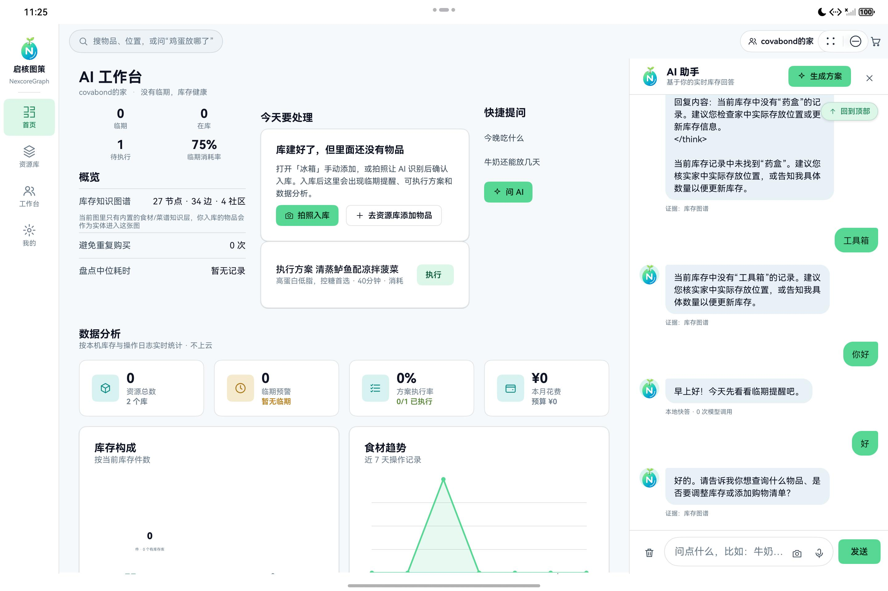

# 00 · 环境与工程骨架

## 目标

导入工程，确认它是 HarmonyOS 原生元服务工程，并生成可安装的 `entry-default-*.hap`。

## 前置条件

- Windows 10/11，安装 DevEco Studio 6.1 或兼容版本。
- 已安装 HarmonyOS SDK `6.1.0(23)`；本工程兼容基线为 `6.0.0(20)`。
- Node.js 18+ 与 MySQL 8，仅后端联调时需要。
- 准备一个 HarmonyOS 模拟器或真机。

## 步骤

1. 打开 DevEco Studio，选择 `Open`。
2. 打开目录 `harmonyosapp/NexcoreGraph_harmonyos`，不是仓库根目录。
3. 等待 `Sync` 完成。若提示 SDK 版本不匹配，安装 API 23 后重新 Sync。
4. 检查 `AppScope/app.json5`：工程采用 `atomicService`，应用名为“启核图策”。
5. 检查 `entry/src/main/resources/base/profile/main_pages.json`，主页面应为 `pages/Index`。
6. 命令行构建：

```powershell
powershell -ExecutionPolicy Bypass -File tools/build.ps1 -Task assembleHap
```

构建脚本会自动定位 DevEco Studio，注入 `DEVECO_SDK_HOME` 与 `NODE_HOME`。

核心入口配置如下：

```json5
{
  "module": {
    "name": "entry",
    "type": "entry",
    "deviceTypes": ["phone", "tablet", "2in1", "wearable"],
    "installationFree": true,
    "pages": "$profile:main_pages"
  }
}
```

## 验证

终端最终出现：

```text
BUILD SUCCESSFUL
artifact: .../entry-default-unsigned.hap
```

随后打开模拟器安装：

```powershell
hdc install -r entry/build/default/outputs/default/entry-default-unsigned.hap
```

模拟器通常允许安装未签名包；真机与正式提交需要团队签名。进入应用后应看到登录页和“局域网自建服务器”连接状态。



## 常见问题

**找不到 hvigorw**：本工程使用 `tools/build.*` 调起 DevEco 自带 Hvigor 的方式，不要求仓库根目录存在 `hvigorw.bat`。

**Sync 后报 SDK 不存在**：在 DevEco 的 SDK Manager 安装 `6.1.0(23)`，或把整个工程统一升级到已安装的 Release SDK。

**真机装不上**：检查签名配置、设备调试授权和目标设备系统版本；不要用模拟器的 unsigned HAP 当作正式 Release 包。

