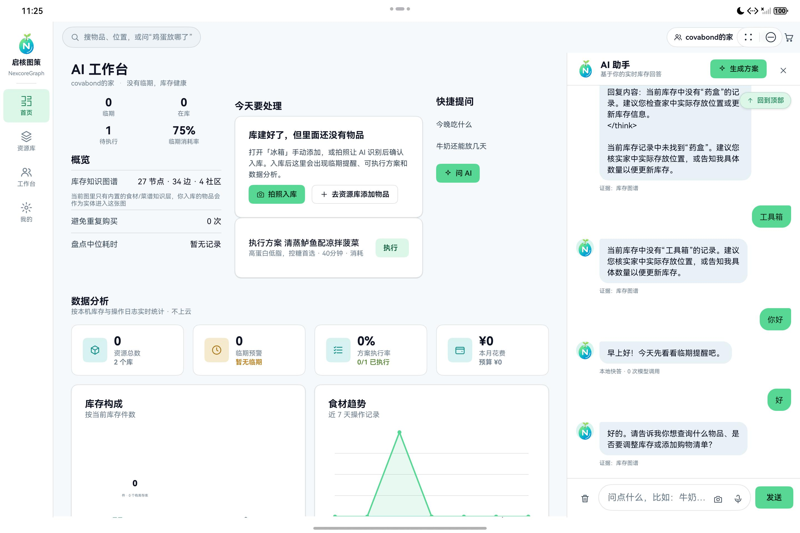
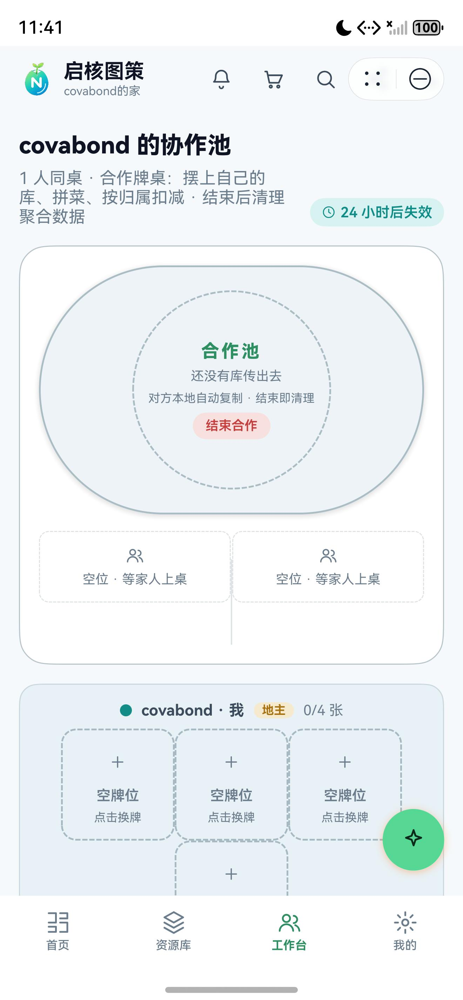

# 01 · 原生 ArkUI 与多端布局

## 目标

用 ArkTS/ArkUI 完成“AI 工作台、资源库、协作工作台、我的”四入口，并让同一套界面适配手机、平板与 2in1。

## 前置条件

- 完成第 00 步且 HAP 可安装。
- 至少准备手机和平板两个模拟器，或一台可旋转设备。

## 步骤

1. 打开 `entry/src/main/ets/pages/Index.ets`，确认页面根容器是 `Tabs`，主界面不依赖 WebView。
2. 保留四个主入口：首页 AI 工作台、资源库、工作台、我的。
3. 页面状态由 `common/Store.ets` 中的 `@ObservedV2` 与 `@Trace` 驱动。
4. 使用 `Breakpoints.ets` 判断窗口宽度，而不是写死设备型号。
5. 手机采用单列；平板与 2in1 增大内容区、使用双栏/栅格布局。
6. 仅在需要覆盖层的场景使用 `Overlays.ets`，列表页保持纯 ArkUI 容器。

页面入口示意：

```ts
Tabs({ barPosition: BarPosition.End }) {
  TabContent() { AiWorkbench() }
  TabContent() { LibrariesView() }
  TabContent() { WorkbenchView() }
  TabContent() { SettingsView() }
}
.onChange((index: number) => {
  store.tabIndex = index;
})
```

自适应判断示意：

```ts
if (isWide) {
  Row() {
    NavigationSide()
    ContentArea()
  }
} else {
  ContentArea()
}
```

## 验证

- 手机：四个底部入口均可达，内容不横向溢出。
- 平板横屏：内容区宽度增大，按钮和卡片不拉伸成过大尺寸。
- 系统切换深/浅色：文字与背景仍有足够对比度。
- 退出再进入：当前主题与应用状态按设计恢复。





## 常见问题

**平板和手机布局打架**：优先按宽度切换容器，不要用 `visibility` 隐藏后仍参与布局。

**列表滚动卡顿**：长列表使用 `List`/`LazyForEach`，避免在 `build()` 里做网络请求或同步计算。

