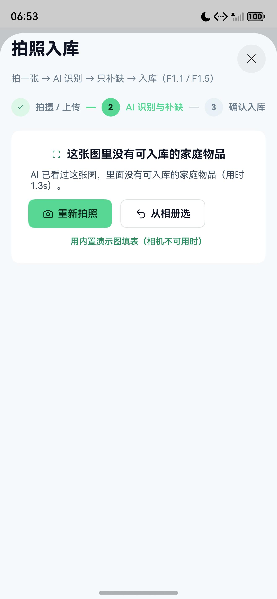

# 02 · 本地优先数据与离线恢复

## 目标

让用户的库、物品、方案、预警、采购与对话在断网或杀进程后仍可恢复，同时避免把模型密钥写入本地数据。

## 前置条件

- 已登录一次应用。
- 可在「我的 → 服务器连接」查看后端地址。

## 步骤

1. 查看 `common/LocalStore.ets`：偏好、会话、用户快照、聊天、AI 用量、价值账本分别持久化。
2. 查看 `common/Continuation.ets` 的 `buildDataSnapshot()` 与 `applyDataSnapshot()`：这是本地恢复、后端同步和跨设备接续共用的 DTO。
3. 登录后调用 `LiveSync.startLiveSync()`；每 6 秒比较内容快照，变化才落盘，避免高频写盘。
4. 修改物品数量，等待一次自动保存，然后杀掉应用进程并重开。
5. 关闭后端或断网，再检查本地快照与快答是否仍可用。

持久化调用示意：

```ts
const snapshot = buildDataSnapshot();
saveUserData();
```

恢复示意：

```ts
const ctx = this.getUIContext().getHostContext() as common.UIAbilityContext;
initLocal(ctx);                  // 读取 userData、会话、偏好与账本
const restored = restoreSession();
```

## 验证

- 新建一个资源库并加入物品。
- 等待至少 7 秒，杀掉应用进程。
- 重新打开应用：库和物品恢复，最近数据不应退回空白或示例数据。
- 断网时，问候、位置、数量和临期等可由本地事实回答的问句仍能响应。



## 常见问题

**重开后数据丢了**：确认已登录并等待一次自动保存；检查 `LocalStore` 初始化是否在 Ability 启动路径中执行。

**同步频繁覆盖**：不要在 `build()` 中写存储；只在业务写操作完成后标记为脏并统一保存。

