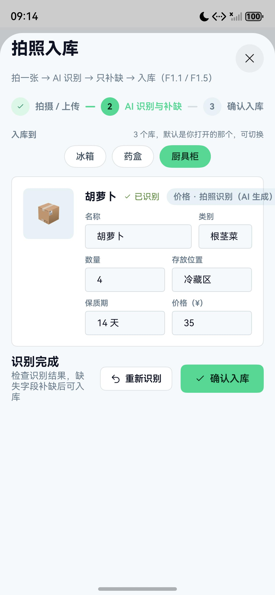

# 03 · 拍照入库与视觉识别

## 目标

把一张家庭场景照片转为结构化物品清单，经用户补缺并确认后写入指定资源库。

## 前置条件

- 后端 `/api/health` 可访问。
- 后端环境变量 `AGNES_API_KEY` 已配置；端侧不配置厂商密钥。
- 准备一张冰箱、衣柜或药箱照片。

## 步骤

1. 在首页点击“拍照入库”。
2. 使用 `CameraPicker` 调用系统相机；用户取消或权限被拒绝时显示真实原因。
3. 端侧把图片压缩为适合上传的 JPEG，并转换为 Base64。
4. 调用自有后端 `/api/ai/vision`，由后端转发视觉模型。
5. 展示识别结果：名称、类别、数量、单位、位置、保质期、价格。
6. 用户选择目标库，补齐缺失字段并确认。
7. 确认后才调用业务层入库；失败时不写入示例物品。

网关调用示意：

```ts
const batch = await recognizeImage(base64Jpeg);
const items = mergeIntakeResults([batch]);
```

确认入库示意：

```ts
await addItems(store.pendingIntake, targetLibraryId);
recordIntakeMs(Date.now() - startedAt);
```

## 验证

- 拍/选一张照片，识别结果能显示真实耗时。
- 没有可识别物品时明确提示，不自动生成虚构清单。
- 选择“衣柜”库后，衣物不会因默认设置被塞进“冰箱”。
- 衣物、工具等无保质期物品不进入临期队列。
- 提交包内搜索不到 `sk-` 厂商密钥。



## 常见问题

**总是提示找不到后端**：让手机和电脑处于同一 WiFi，在设置页填入电脑当前局域网 IP。

**拍照无反应**：检查系统相机是否可用；元服务形态不要假设完整相机 Session 一定可用，优先走 `CameraPicker`。

