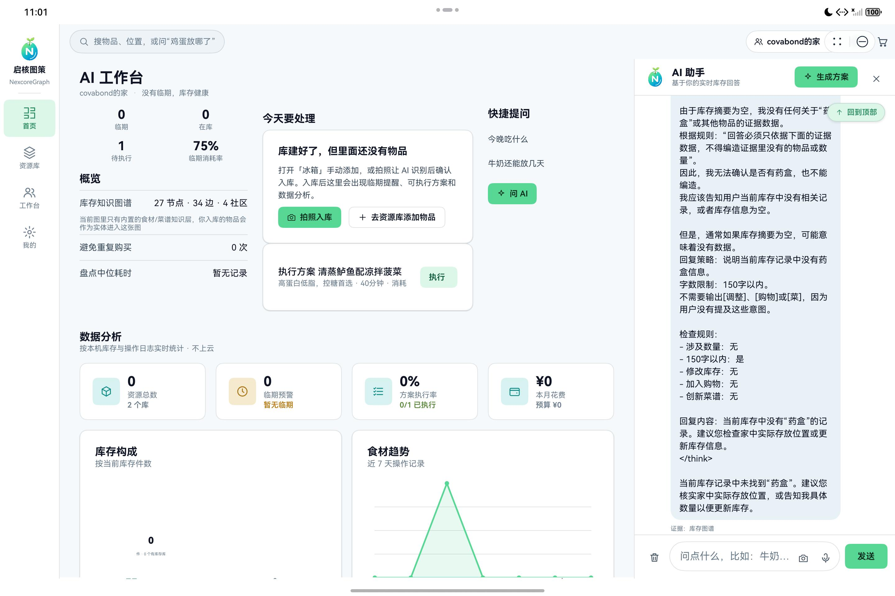

# 04 · AI 路由、证据与受控写操作

## 目标

让 AI 能回答、能规划、能发起写操作，但数值、权限与写操作生效权始终由代码和用户掌握。

## 前置条件

- 至少有 2 个资源库和若干真实物品。
- 后端 AI 网关可用；即使模型不可用，本地快答也应可用。

## 步骤

1. 查看 `common/Router.ets` 的 `routeIntent()`、`evidenceFor()` 与 `directAnswer()`。
2. 对问候、位置、数量、临期四类问题优先本地直答，0 次模型调用。
3. 对菜谱、采购、营养类问题装配库存与知识库证据，再调用 `/api/ai/chat`。
4. 模型只能生成受约束的工具行，例如 `[调整]牛奶|2`、`[购物]鸡蛋|6`、`[菜]...`。
5. 解析出的写操作必须进入待确认卡，用户确认后才执行，并留下可撤销日志。
6. 回答下方展示证据路径与知识库来源；模型失败时回退本地事实回答，不伪造成功结果。

本地直答示意：

```ts
const intent = routeIntent(question);
const reply = directAnswer(intent, question);
if (reply !== null) {
  return reply;
}
```

受控行动示意：

```ts
[调整]name|qty
[购物]name|qty
```

> 工具行只是“建议”，不是执行结果。没有确认按钮的事件，不得改变库存。

## 验证

- 问“牛奶还剩多少”：应 0 次模型调用，答案数字与库存一致。
- 问“把鸡蛋调整为 2 个”：出现确认卡，确认前库存不变。
- 确认后数量更新，日志出现记录；撤销后恢复原值。
- 关闭模型网关：普通对话明确失败，但本地事实问答仍可用。




## 常见问题

**模型回答数字不对**：把数值计算移回 `Router`/业务代码，模型输入中只提供已核验证据。

**写操作直接生效**：检查工具行解析后是否绕过确认卡；所有写操作都应进入待确认队列。

