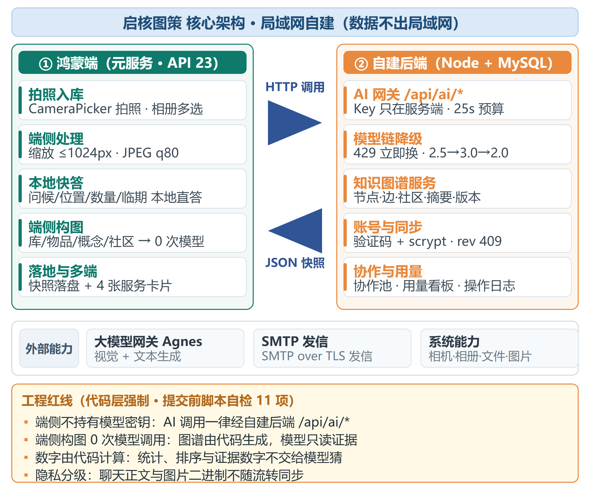

# 05 · 个人资源图谱与 GraphRAG

## 目标

从用户自己的库与物品构建个人资源图谱，在回答时给出可追溯路径，并保证构图本身不调用大模型。

## 前置条件

- 已完成第 02、04 步。
- 至少有“冰箱—物品—知识条目—菜谱/方案”关系数据。

## 步骤

1. 打开 `common/GraphModel.ets`，了解节点、边、社区与查询结果的数据结构。
2. 打开 `common/GraphBuild.ets`，由库、物品、知识条目和方案生成图谱。
3. 构图只使用本地确定规则，不调用网络或模型；`rebuildGraph()` 返回节点数、边数与耗时。
4. 图 JSON 通过 `LocalStore.saveGraphJson()` 落盘，不默认进入普通同步 payload。
5. 查询时由 `GraphQuery.ragEvidence()` 按 local、global、multi-hop 等模式装配路径。
6. `AiGateway` 把图谱证据交给模型润色；最终气泡显示路径、来源与证据条数。

构图调用示意：

```ts
const stat = rebuildGraph();
console.info(`${stat.nodes} 节点 / ${stat.edges} 边 / ${stat.communities} 社区`);
```

检索调用示意：

```ts
const evidence = ragEvidence(modeForIntent(intent), question);
return evidence.paths;
```

## 验证

- 设置页显示图谱规模与最近重建耗时。
- 修改库存后，图谱标记为脏并在需要时重建。
- 打开某个物品的 AI 回答，可看到它命中的库存事实与知识来源。
- 断网时，构图与图谱查询仍可执行。
- 对 `GraphBuild.ets` 做静态检查，不应出现 `createHttp`、`fetch(` 或 `callJson`。



## 常见问题

**图谱每次问答都重建**：只在数据变化后标脏，查询前按版本检查是否需要更新。

**图谱为空的回答仍像有证据**：证据为空时降低结论置信度或明确说明“当前库中无匹配记录”。

