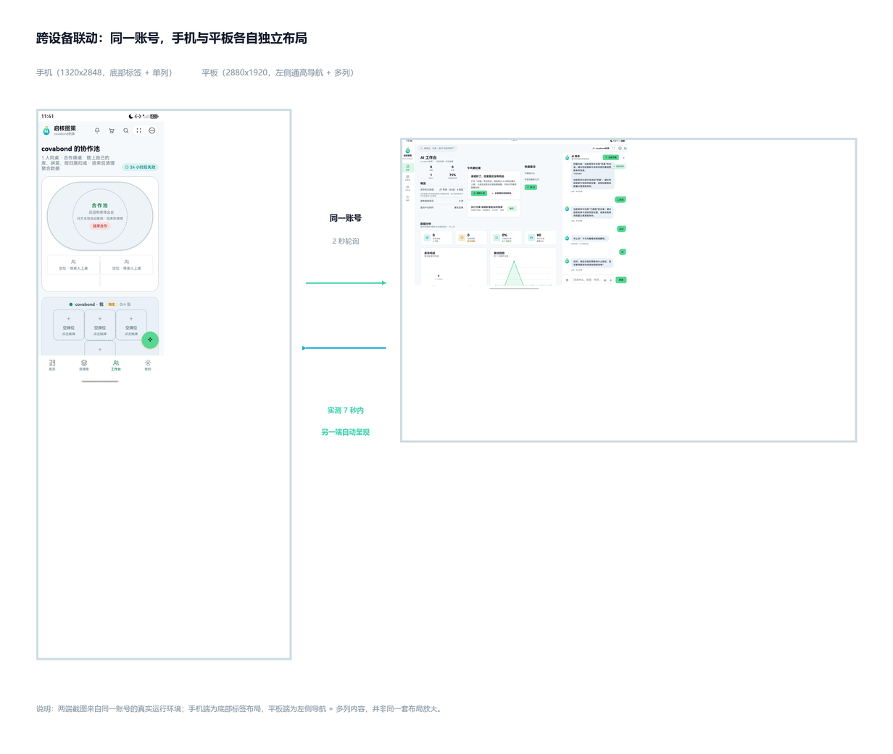

# 06 · 跨设备同步与应用接续

## 目标

让用户在手机和平板之间无缝接着做：数据自动同步，页面、打开的库、AI 对话与未确认动作可通过系统接续恢复。

## 前置条件

- 两台 HarmonyOS NEXT 设备，登录同一华为账号并处于同一网络。
- 两台设备安装同一 HAP 版本。
- 若使用演示中转，另启动 `backend/flow-bridge.js`（3100）。
- 两端应用版本中的快照结构版本必须一致。

## 步骤

1. 确认 `entry/src/main/module.json5` 中 `EntryAbility.continuable` 为 `true`。
2. 在 `EntryAbility.onContinue()` 中调用 `onContinueSave()`，把流程状态写入 `wantParam`。
3. 在 `onCreate()` 与 `onNewWant()` 中判断 `LaunchReason.CONTINUATION`，调用 `restoreFlow()`。
4. 登录后启动 `LiveSync`：每 2 秒轮询中转，数据变化后按 id 原地合并。
5. 手动演示时，在「跨设备流转」页面点“发送流转”，另一台点“接收流转”。
6. 修改物品数量，观察另一台在数秒内更新；再发送当前页面并检查目标端页面状态。

接续写入示意：

```ts
onContinue(wantParam: Record<string, Object>): AbilityConstant.OnContinueResult {
  if (!store.continueEnabled) {
    return AbilityConstant.OnContinueResult.REJECT;
  }
  return onContinueSave(wantParam);
}
```

目标端恢复示意：

```ts
if (isContinuation(launchParam)) {
  restoreFlow(want);
}
```

同步入口示意：

```ts
startLiveSync();
```

## 验证

- 手机新建“药盒”库，平板数秒内出现。
- 手机修改鸡蛋数量，平板库存与日志一致。
- 平板打开“冰箱”详情，手机发送流转，目标端直接恢复同一库。
- 目标端不能从登录页接续敏感状态；未登录时 `continueEnabled` 应为 `false`。
- `X1–X6` 双机用例需实际录屏留证；没有双机环境时，教程与文档不得写成“已实测通过”。



## 常见问题

**系统流转不可用**：先排查账号、同网、NFC/Wi-Fi/蓝牙、应用版本和接续系统开关。

**模拟器只能走中转**：启动 `backend/flow-bridge.js`，在设置页确认服务器地址可访问。

**两端来回覆盖**：给快照加版本号，发送端忽略自己的版本，接收端按 id 合并并串行应用。

