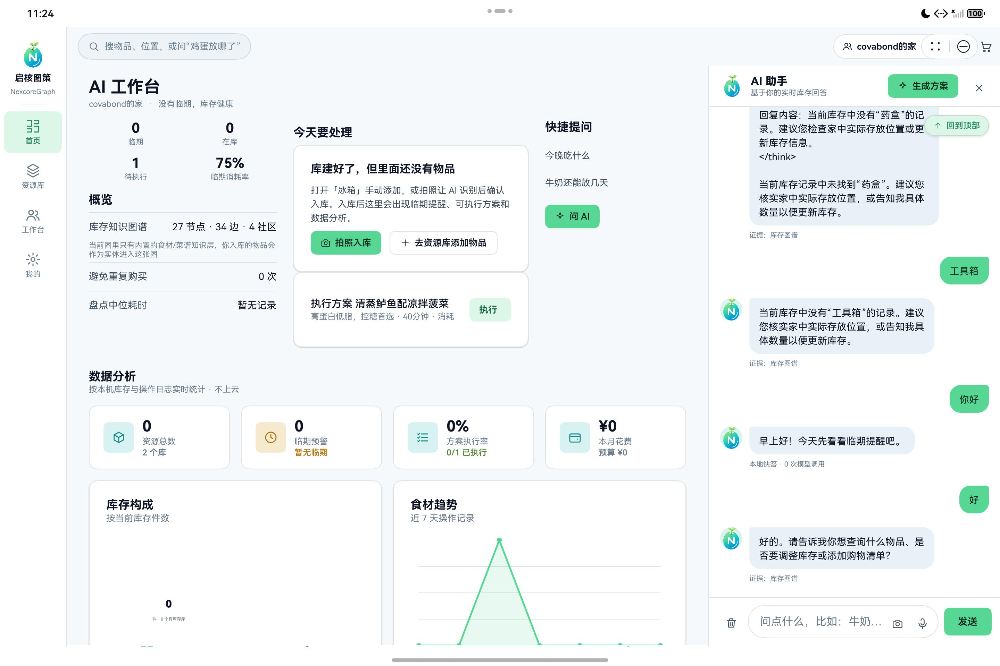

# 07 · 服务卡片与多设备入口

## 目标

不打开主应用也能查看库存与临期信息；卡片支持手机、平板和 2in1 常用尺寸，并能直达对应页面。

## 前置条件

- 完成第 00、02 步并至少入库一件物品。
- 设备桌面允许添加服务卡片。

## 步骤

1. 查看 `entry/src/main/resources/base/profile/form_config.json`。
2. 确认四张卡片：功能入口、库存、资源库、临期。
3. 配置 `2*2`、`2*4`、`4*4` 的适用尺寸。
4. 库存与临期卡片配置 `scheduledUpdateTime: "08:00"`。
5. `EntryFormAbility` 从本地快照读取真实数据，断网也能显示上次结果。
6. 卡片点击通过 `postCardAction` 携带 `target`，由 `EntryAbility.handleCardWant()` 路由到功能页。
7. 将卡片添加到主屏幕，切换尺寸并检查内容是否按尺寸重排。

卡片配置示意：

```json
{
  "name": "ExpiryCard",
  "updateEnabled": true,
  "scheduledUpdateTime": "08:00",
  "defaultDimension": "2*2",
  "supportDimensions": ["2*2", "2*4", "4*4"]
}
```

卡片直达路由示意：

```ts
if (target === 'intake') {
  store.overlay = 'intake';
}
```

## 验证

- 添加 2×2 与 2×4 库存/临期卡片，显示真实数量。
- 杀掉应用后卡片仍显示最近快照。
- 点击卡片进入对应功能，不先落到无意义首页。
- 到 08:00 或手动刷新后数据更新。



## 常见问题

**卡片一直空白**：确认提权到后台前已调用 `saveFormSnapshot()`，且卡片读取路径与主应用一致。

**大尺寸内容被裁切**：分别检查 2×4 与 4×4 栅格，不要只做默认 2×2。

