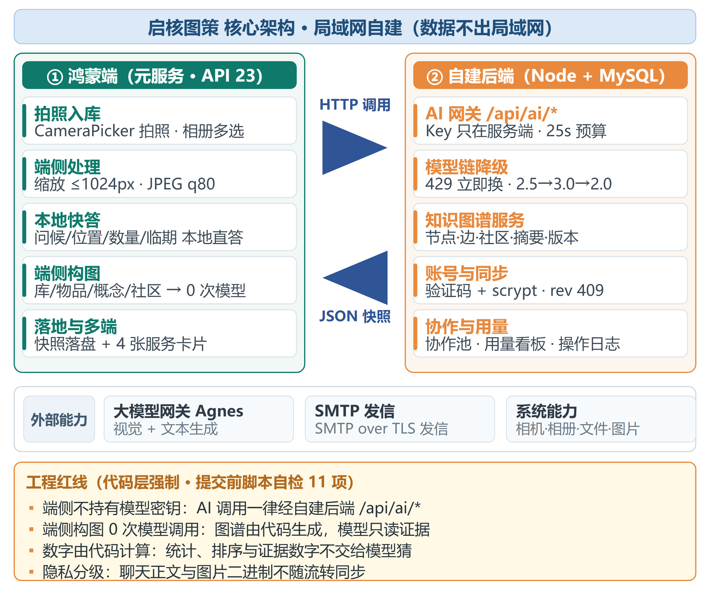

# 启核图策 · HarmonyOSCodelabs 实战教程

> 赛事：2026第九届传智杯全国大学生数智创新与 AI 应用大赛  
> 赛道：HarmonyOSCodelabs挑战赛  
> 作品：启核图策 NexcoreGraph  
> 团队：天枢序列（38376）  
> 工程：`harmonyosapp/NexcoreGraph_harmonyos`

这套教程不是产品说明书，而是一条可以从零跑通的实现路径。每篇都按“目标 → 前置条件 → 操作步骤 → 验证 → 常见问题”组织；代码引用工程中真实存在的模块，界面截取自 HarmonyOS 手机/平板运行结果。

## 教程目录

| 步骤 | 主题 | 完成后能验证什么 |
|---|---|---|
| [00](./00-environment.md) | 环境与工程骨架 | DevEco 能导入并成功构建 HAP |
| [01](./01-native-ui.md) | 原生 ArkUI 与多端布局 | 手机、平板、2in1 页面自适应 |
| [02](./02-local-data.md) | 本地优先数据与离线恢复 | 杀进程后数据仍在，断网仍可查 |
| [03](./03-intake.md) | 拍照入库与视觉识别 | 照片转结构化物品，用户确认后入库 |
| [04](./04-controlled-ai.md) | AI 路由、证据与受控写操作 | 数值可追溯，写操作先确认后生效 |
| [05](./05-graphrag.md) | 个人资源图谱与 GraphRAG | 构图 0 次模型调用，回答带路径证据 |
| [06](./06-distributed.md) | 跨设备同步与应用接续 | 两设备接着做，页面与数据可恢复 |
| [07](./07-service-cards.md) | 服务卡片与多设备入口 | 卡片读真实快照、定时刷新、点击直达 |
| [08](./08-build-submit.md) | 构建、签名、合规与验收 | 构建通过，密钥检查与提交材料齐全 |

## 推荐阅读顺序

第一次接触本项目：从 00 顺序做到 08。  
只评审分布式能力：直接看 06，再回看 02 的快照层。  
只评审 AI 能力：看 03、04、05，重点核对“代码算事实、模型做措辞、写操作须确认”。

## 运行基线

- DevEco Studio 6.1 系列。
- 已验证 HarmonyOS SDK `6.1.0(23)`，兼容基线 `6.0.0(20)`。
- Stage 模型、ArkTS 与声明式 ArkUI。
- 元服务形态，支持 `phone`、`tablet`、`2in1`，并声明 `wearable`。
- 服务端 Node.js + Express + MySQL，AI Key 仅放服务端环境变量。

> API 23 是当前工程已实机验证的基线。若团队改用 API 24 Release，请整体升级 SDK、Hvigor 与依赖后重新跑第 08 步，不要只改单个版本号。

## 教程约定

- 终端命令默认在工程根目录执行。
- 不把真实 API Key、数据库密码或签名私钥写进端侧源码、截图、日志与教程。
- “已验证”只表示当前仓库中有构建或运行证据；“待双机复测”会在对应步骤明确标出。

